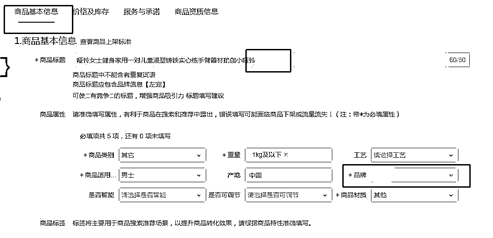
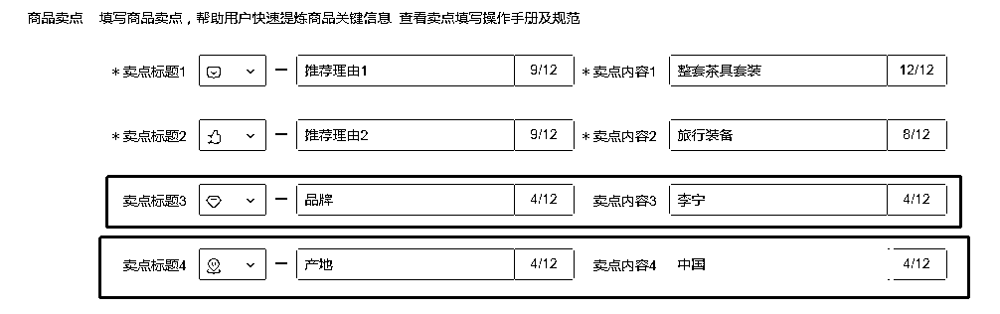

# 5.2.2 完善产品信息

在上架商品之前，首先建议前往美团商家后台，通过“店铺信息-经营资质”入口，确认当前店铺对应的商标品牌，并把店铺的基础信息同步完善好。

接下来，商品标题的写法很关键——标题中必须清楚带上第一步确认好的品牌名。同时需要注意的是，标题有字数限制：最多30个字（即60个字符，字母按1个字符计算）。因此，如果字数超出，可以把标题里一些不影响理解的字词替换成品牌名，比如下面示例中的XXX。

这里要特别提醒：删字时尽量挑那种可有可无的字眼，千万不要误删产品关键词。举个例子，如果商品标题里的“哑铃”被删掉了，顾客在平台搜索时很可能会搜不到这款商品，那就得不偿失了。

另外，凡是带红色「*」的字段都属于必填项目，全部都要如实填好。品牌这一栏系统通常默认是空的，我们只需要手动补填即可：

最后还要检查一下商品卖点部分：如果卖点中出现了别的店铺品牌（比如淘宝原链接里带的品牌），那就把卖点3直接删除掉：

