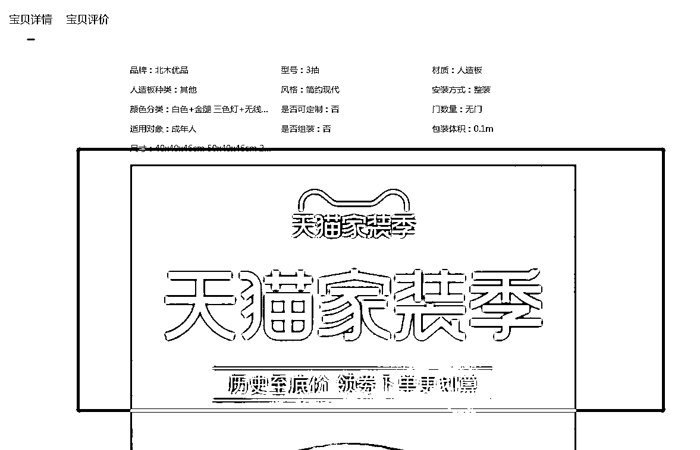
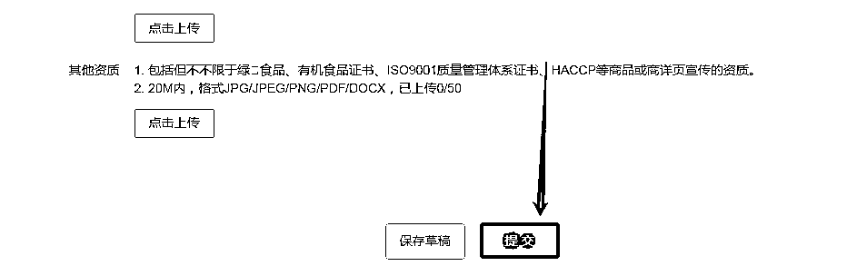

# 5.2.4 轮播图、详情页别漏查

轮播主图一共五张，检查完它们之后，还要看详情页。详情页通常重点看开头两张就行——这两张若没发现问题，后面一般也不太会出状况。主要排查图片里是否出现淘宝或其他品牌的字样、活动信息，例如“淘宝双11满100-20”“天猫狂欢节”等内容。一旦发现，立刻把那张图移除，因为美团对这类其他平台信息是零容忍的。

（错误示例图）

等前面四步全部处理完，点击下方“提交审核”即可。

