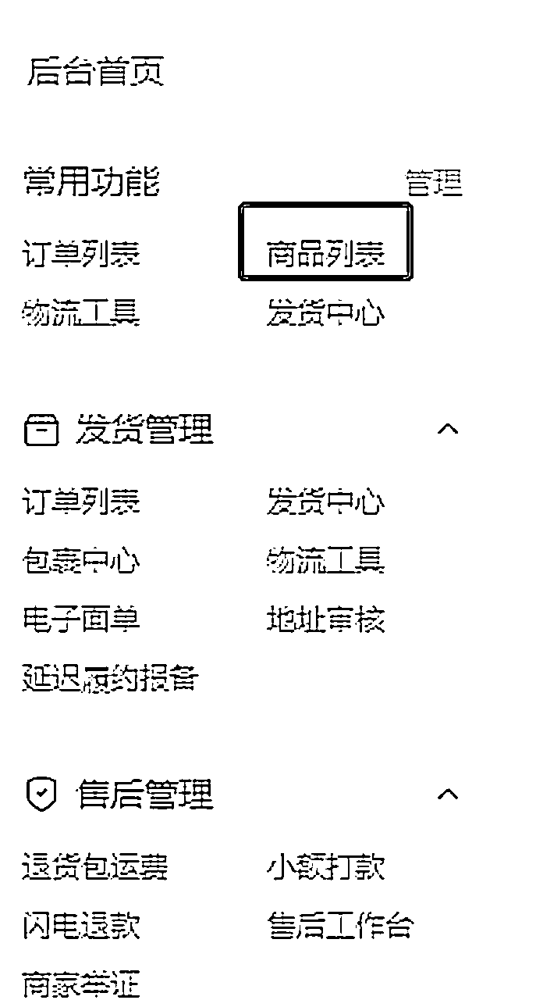
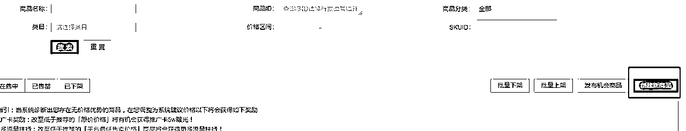
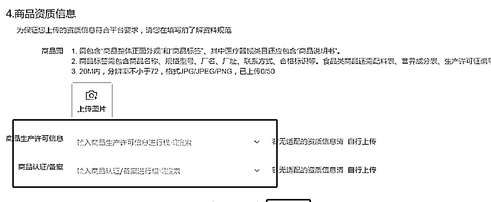

# 5.5 商品高频疑问速答

问：改草稿的时候，怎么提前识别产品要不要资质？

答：最直接的办法是，从商品列表新建一个商品，选好类目并进入创建流程后，把页面拉到最底部，就能看到该类目是否有特殊资质要求。建议顺手把结果记录下来，之后遇到同类型链接直接删除或跳过，能省不少时间：

目前常见的资质要求大致有这些：儿童玩具、头盔、雨伞、通电设备、电子设备等类目，一般都需要提供 3C 认证证书或能源证书；塑料制品类则需要有工业生产许可证。

问：商品可以错放类目吗？

答：要分情况。比如把花瓶放在创意家居里，这属于“小错放”，平台是默许的，不会处罚。善用小错放，既可以提高操作效率，也可能因为不同类目流量差异而获得额外收益。

但如果把情趣用品放到创意家居，性质就变成“大错放”了。平台会直接下架商品，后续店铺还会被限制 7 天不能上新。

内容来源：《运营效率问题以及常见打假问题》@不语

