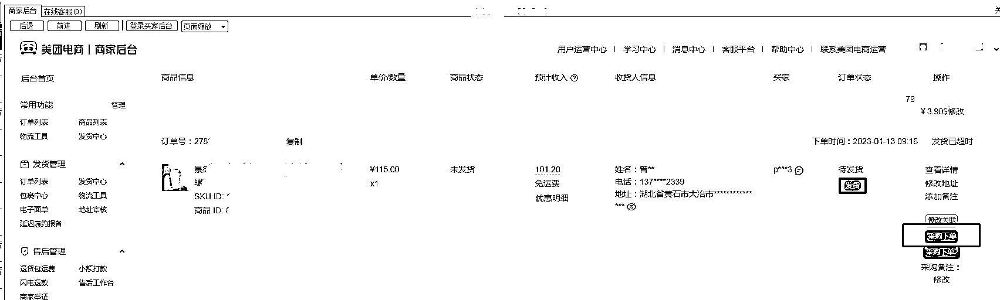
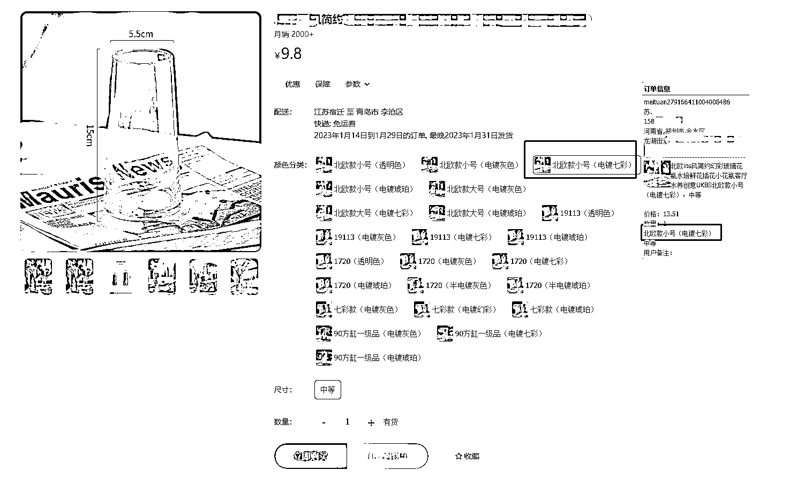
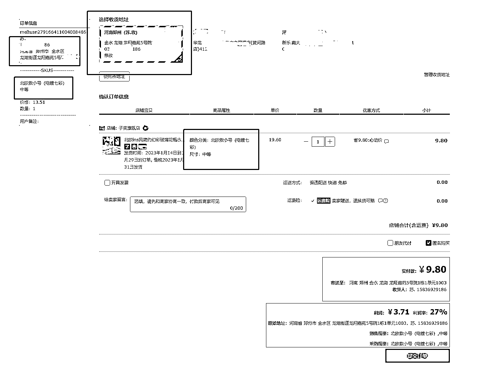

# 6.1.1 拍单采购怎么做？跟着流程走

先把工具准备到位：获取《美团电商工具包-极速下单下载》。之后按下面的流程操作即可。

第一步，从采购下单入口进入，系统会先跳转到淘宝登录界面。

第二步，登录后打开对应商品的详情界面，选中买家所拍的那个 SKU。这里要仔细确认颜色和尺码，避免选错规格。

第三步，客户的收货地址会由系统自动带出；订单下方还能看到这一单的净利润和利润率。核对无误后确认下单并完成付款，一笔订单采购就完成了。

第四步，其他店铺照着同样的方式逐一处理即可。

