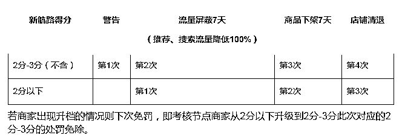

# 7.1 新航路，商家必看

新航路是美团电商考核里的关键环节，地位等同于淘宝的新灯塔、抖音店铺的CCR评分。它的评估并不只看一个点，而是从商品品质、服务分（涵盖售后、物流、客户咨询、纠纷处理）以及附加分等多个角度综合打分。平台设置这些维度的目的很明确：留下符合要求、商品质量靠谱、发货物流等服务有保障的商家。新航路的考核力度很大，不达标的商家会被平台清退。

官方规则地址：https://rules-center.meituan.com/rules-detail/624?commonType=2

想在新航路上提分，重点做好三件事：

1）提高拍单与发货频次：尽量多频次拍单采购，采购号要轮换使用，消费者下单后争取尽快发出。
2）售后问题主动处理：客户反馈的售后要及时跟进解决，尽量不让差评出现。
3）客服消息快速响应：消费者消息要及时回复，客服排班尽量多班次轮换。

