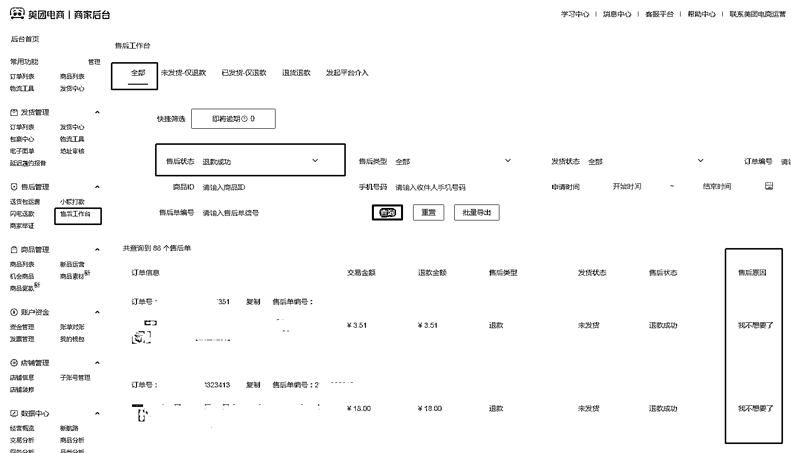
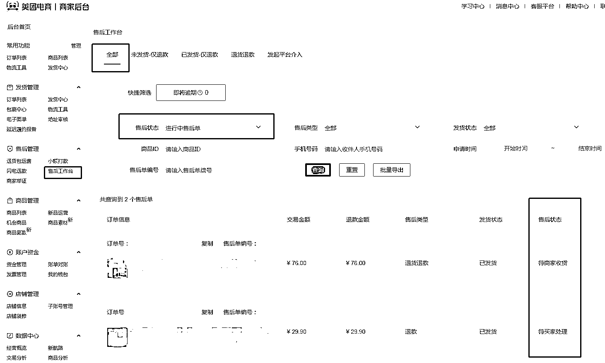

# 8.1 退款处理：本金优先，分场景应对

处理退款时，先守住底线：我们的货物和本金不能丢。只要存在损失风险，就对客户的申请驳回，或者先搁置不处理。

日常只需盯住售后工作台的两个板块：“现在进行中”和“退款成功”。不同情况按下面方式操作：

1）未发货-仅退款
- 还在退款中：如果已经拍单，就去淘宝提交仅退款；等上家退款到账后，再给客户退。
- 已退款成功：如果已经拍单，把订单编号登记到【异常单记录客服 1.0 版】，同时在淘宝申请仅退款，并且每天跟进处理进度。
- 退款中或退款成功：如果还没拍单，直接审批通过客户的退款即可。

2）已发货-仅退款
先驳回客户的退款申请，并写清楚驳回原因；接着去淘宝申请仅退款，同时通知上家拦截快递。若快递没拦住，就引导客户把申请改成“退货退款”。

3）退款退货
告诉客户先别寄回商品；先到淘宝申请退货退款，拿到正确的退货地址后，再发给客户。

