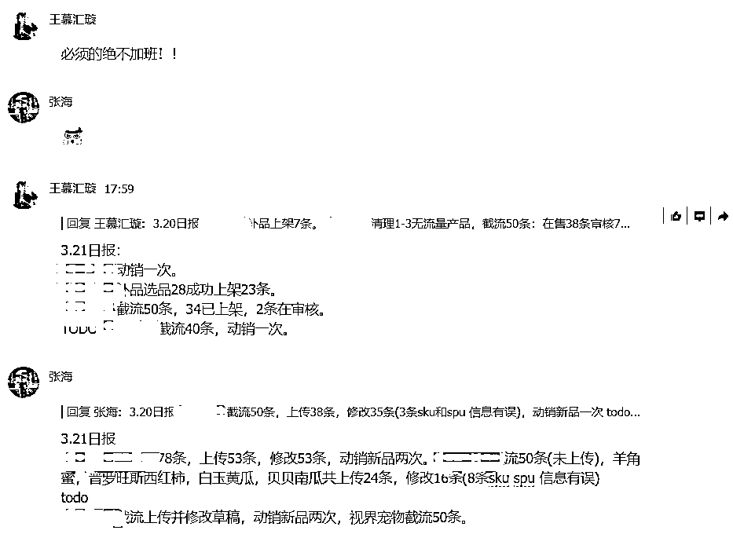
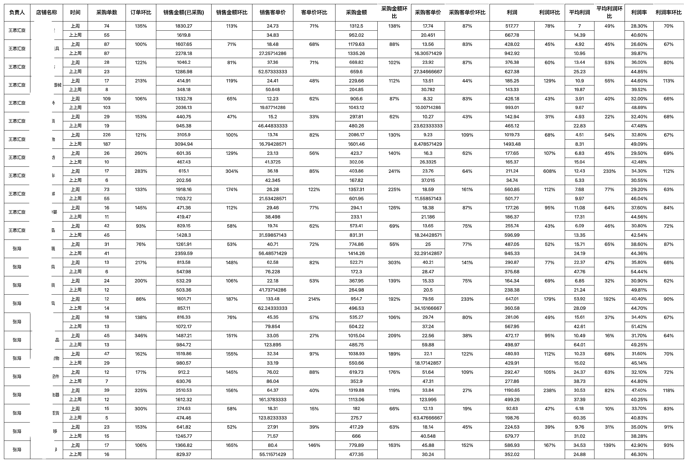
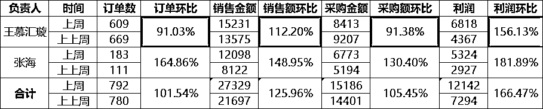

### 8.3.3 技巧三：日报复盘+周报分析

**日报**

日报承担两个功能：一是对当天运营情况做收尾总结，二是把第二天的安排提前理清。如果你们是多人协作的团队，用日报来推动复盘会非常顺手。

站在管理者的角度，需要做到按天跟进：表现好的当场肯定，遇到困难的及时伸手帮忙：

**周报**

周报则是以“周”为单位做跟进用的表格。

它主要看这些内容：本周日均流水、订单量、利润等指标，与上周相比的环比变化。

表格里的数据可以用颜色来区分：红色代表下降，绿色代表上升。

按天做对比其实参考价值有限，拉到周维度看会靠谱不少，放到月维度则更加准确。数据反映的才是最终结果，过程要盯，结果更要盯。

下面这张图是周报的部分内容展示：

借助上面的图表，我们可以锁定那些相对数据增长偏弱的运营人员；同时也能请上周表现更亮眼的同事，把自己的工作方法拿出来给大家分享。

再结合店铺层面的数据做分析，进而有针对性地把店铺里的宝贝优化做得更细。

内容来源：《美团电商运营管理分析》@吕远超

