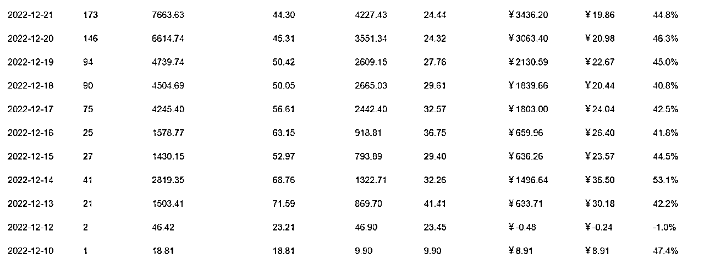

# 8.4.1 准备期：入驻和铺货怎么排

店群模式想跑顺，准备阶段的用工分工很关键。把商家入驻和商品上架拆成两条线，后面起店会快很多。

**先搭入驻班底**

美团入驻流程不算简单，所以当时直接培养了两名兼职，专门负责入驻操作。她们重点要吃透资料填写逻辑，比如商品类目、质检报告、入驻类目，以及商品信息能不能对得上。

具体操作细节，前面章节已经讲过，这里不再展开。培训完成后，每次入驻时，我只需要把入驻类目、商标、对应账号密码安排清楚，营业执照一下来就能马上提交，不耽误时间。

还有个小细节：管理员手机号一定填自己的，所有店共用同一个号码也没问题。这样做有两个好处：一是兼职以后不做了，手机号不用折腾着改；二是入驻结果能第一时间知道，后续有客诉，美团也能马上联系到负责人。

**再拆分上架岗位**

商品上架这块，兼职分成两类：一类做“选品+采集”，一类做“草稿箱审核”。

做“选品+采集”的人，要先给她们定好选品方向，再教基础筛选方法。每人每天的任务是选 200 个品，并把 200 个品采集进草稿箱，当天必须完成，薪资一般在 50—80 元/天。

这项工作还能继续拆：专人每天选 300 个品，费用 50—80 元；另安排人只做采集，按 0.1 元/条计费。

**入驻和上架兼职常出的问题**

1. 一个四级类目下塞进五六十款商品，数量是够了，但明显过载。
2. 选的品和店铺主题不搭，比如手表店挑出一堆衣服。
3. 四级类目本身商品不多时，容易挑到销量低、店铺服务分也低的品。
4. 为了凑数，选出来的图带价格、品牌标识甚至运费字样。

**草稿箱审核这样安排**

审核岗位按 5 个兼职一组，建一个小群。拿到店铺账号后，直接把群名改成对应店铺名。组里找一个人开通美团秀秀会员，用来扣白底图；5 个人同时登录一般不会被封，再多就有封号风险。每个人的任务要按页码分好，避免重复操作。这个岗位的薪资在 0.4—0.8 元/个商品。

审核兼职也容易踩两个坑：一是采集软件会自动扣白底图，有人为了求快，不看效果就直接上传，驳回率会偏高；二是有人图省事，图片上还带着价格、品牌或平台标识，也照样提交审核。

做蓝海市场，效率就是第一位。当时靠人海战术快速起店，只用了两天，订单量就上去了：

