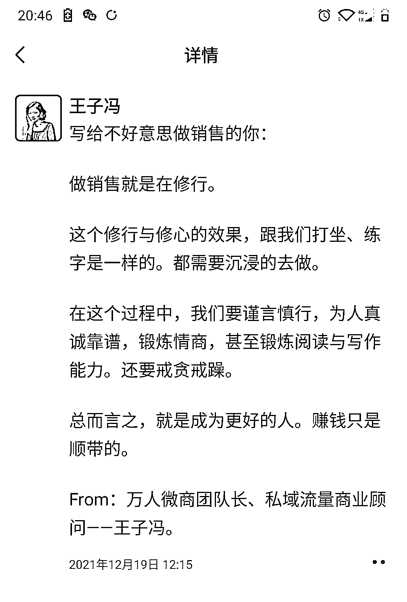
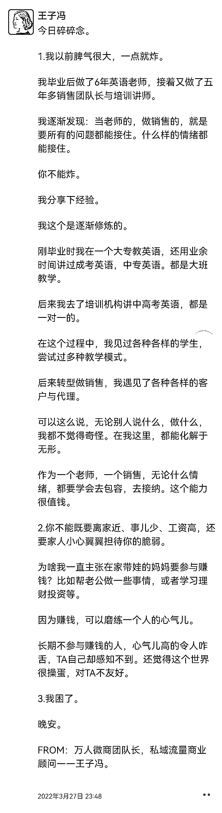

# 第一种：借一个身份，在朋友圈打卡

1）以“某某说”的形式出场

比如“王子冯说”：拥有万人微商团队的王子冯，写下肺腑之言；身为二胎妈妈，她以王子冯之名敬上。

这三个称呼看似对应三种身份，其实背后都是同一个人。写某条文案时，只选取其中一个特定身份来发声，就能让不同圈层的人迅速对号入座。

具体示例可以看下图（点击可放大）：

2）用金句打卡

金句可以延伸正文内容，也可以借一个小故事帮读者听懂，还可以说明这几句话的由来。下面是我以前写过的一些金句：

金句的写法是：先提出问题，再给出答案。平时多写金句，慢慢形成自己的风格；发出去之后，就能积累传播势能。

这一招，对打造个人品牌很加分。