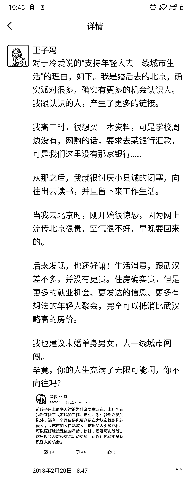

# 案例二：🧣热议背后的冷思考

🧣像一座随时开讲的广场，人人都能发声，观点自然五花八门。热闹之外，更值得追问的是：一条发言为何能迅速引发共鸣，又为何常演变成站队与争吵？面对碎片化信息和情绪化表达，不妨先别急着下结论。看清信息来源，分清事实与感受，听听不同立场的声音，再形成自己的判断。🧣的意义不只在于“说出观点”，更在于让讨论靠近真相、让分歧获得理解。保持独立思考，才是围观热搜时最该带上的能力。