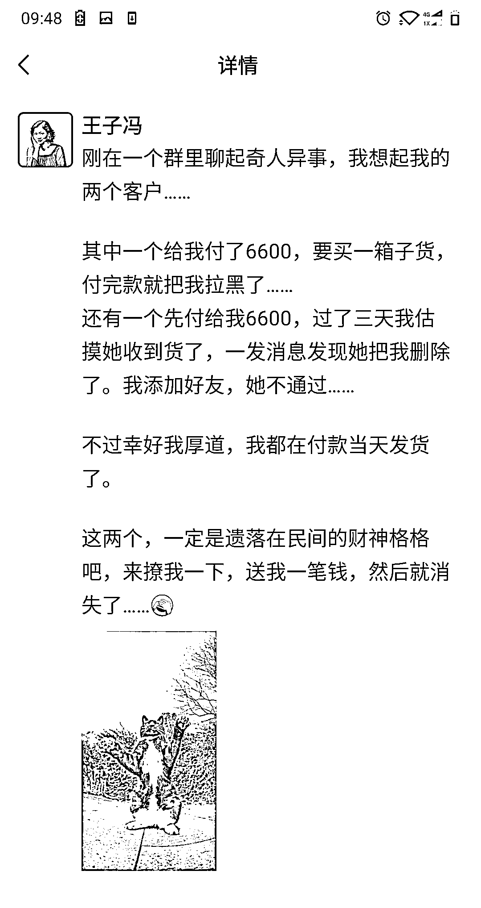
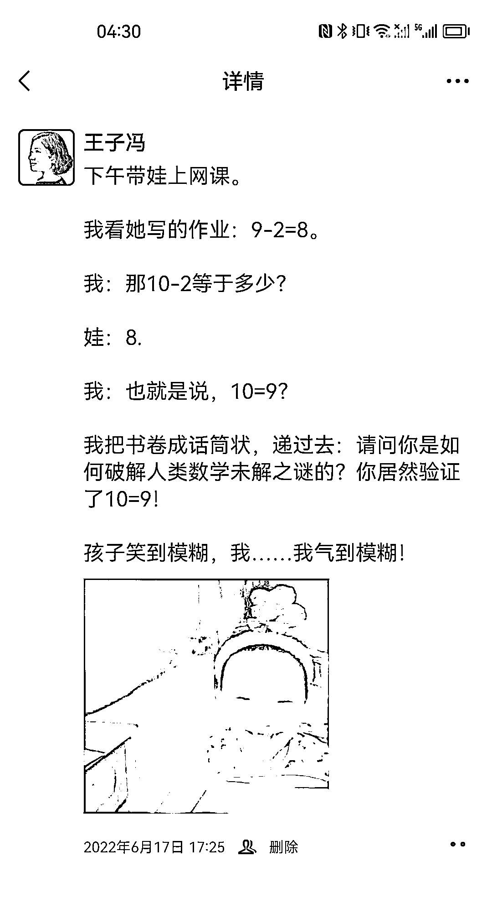
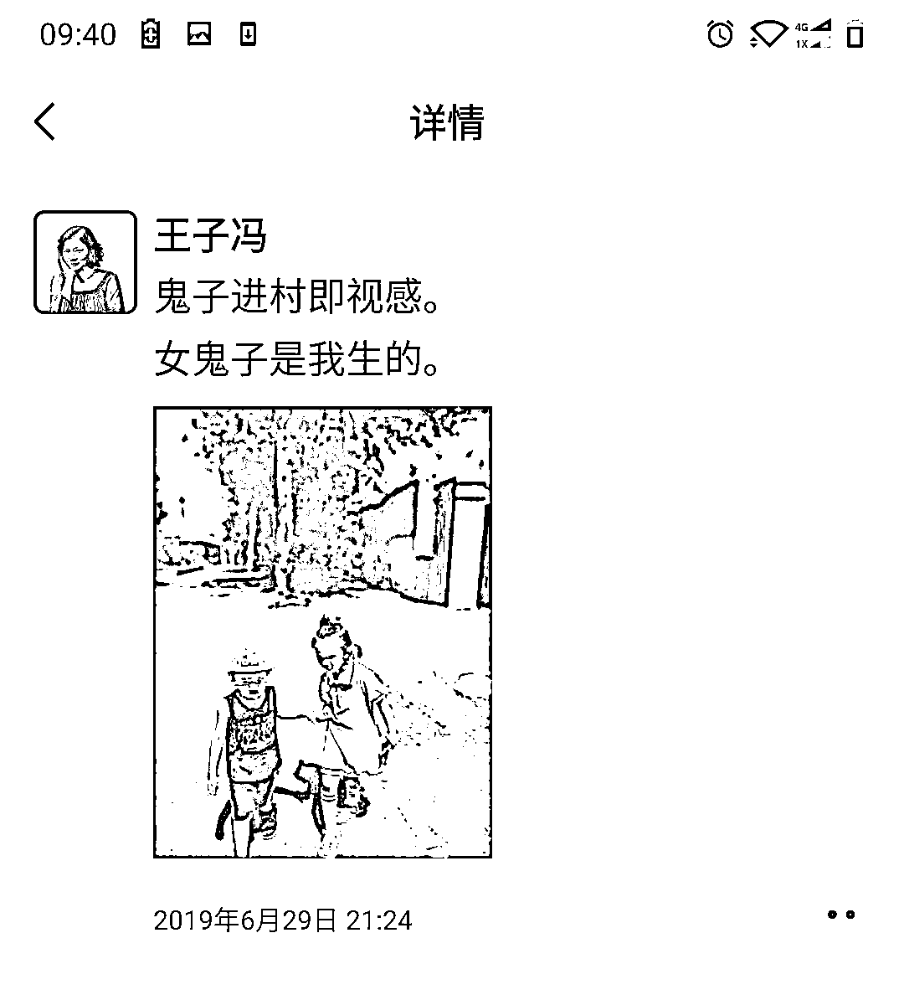
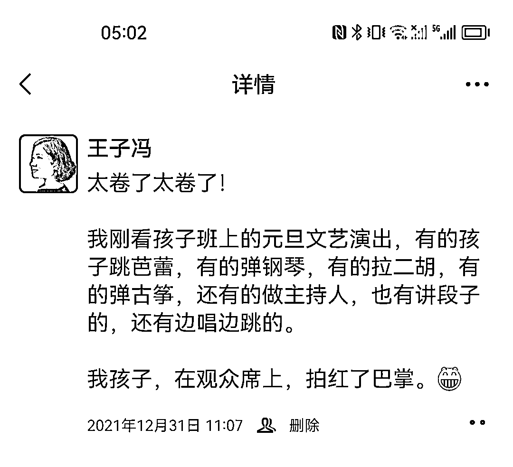
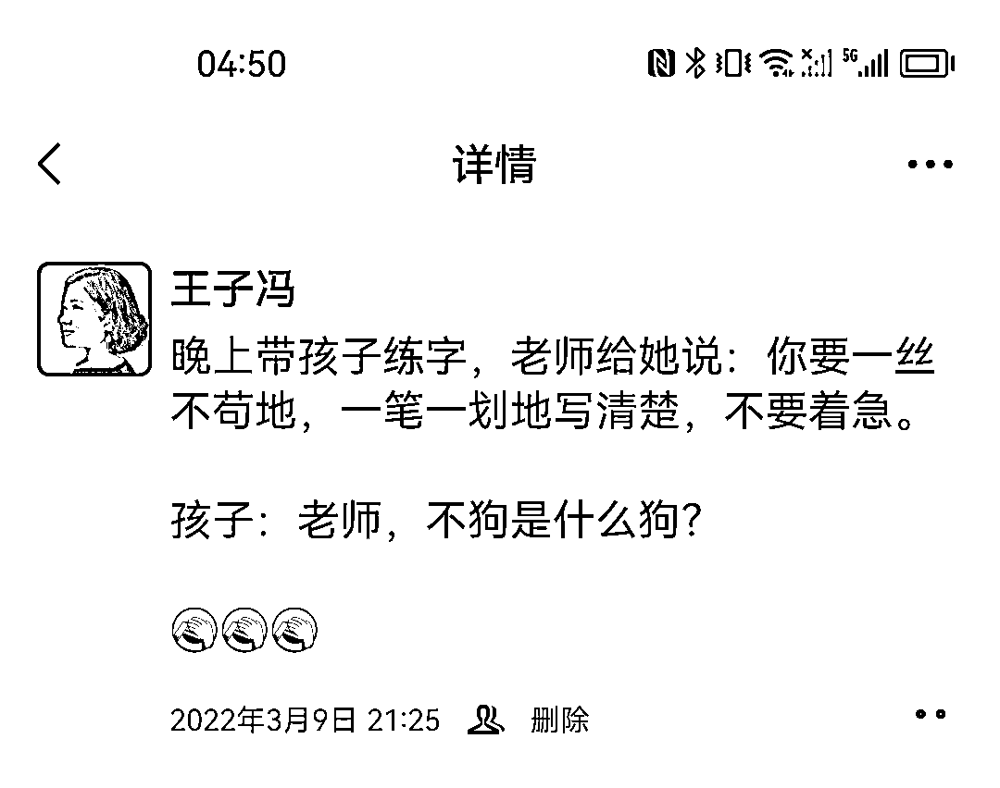
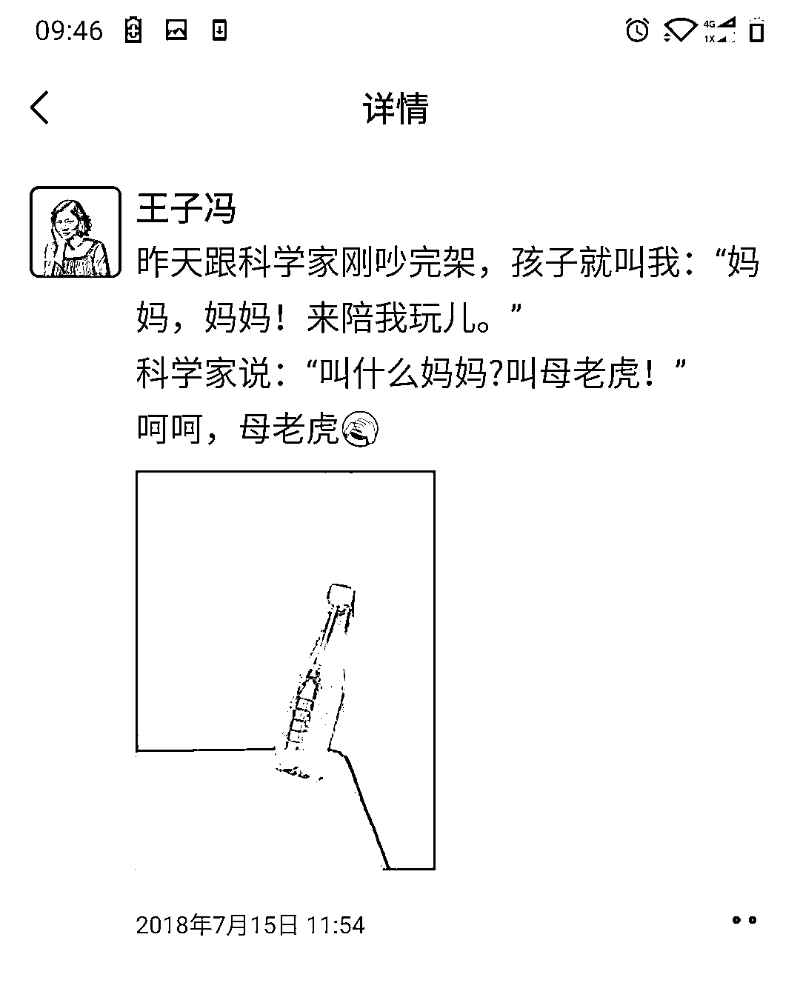
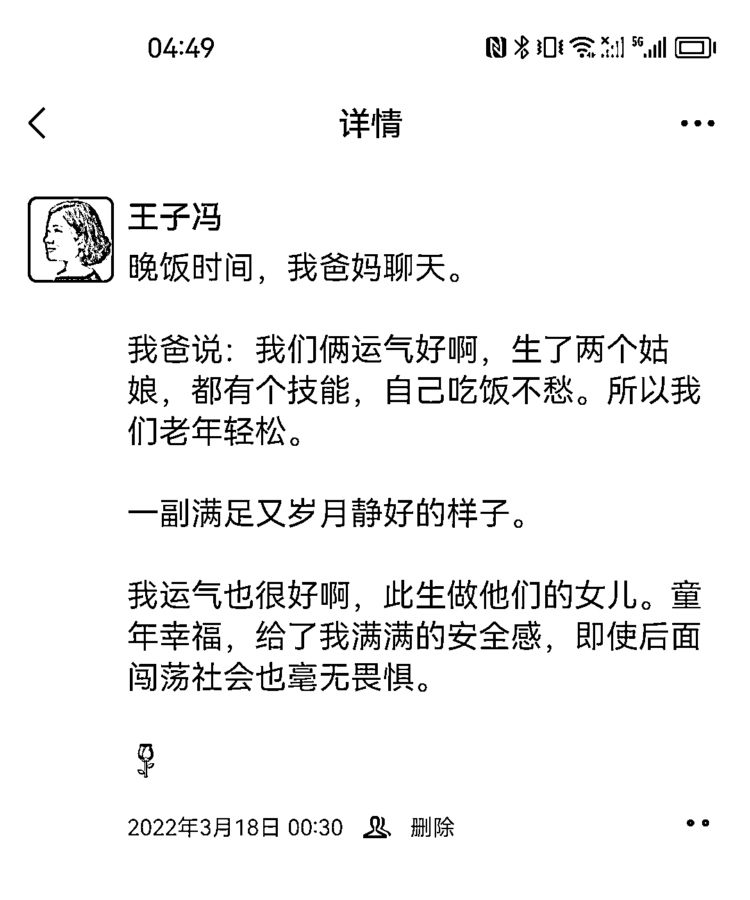
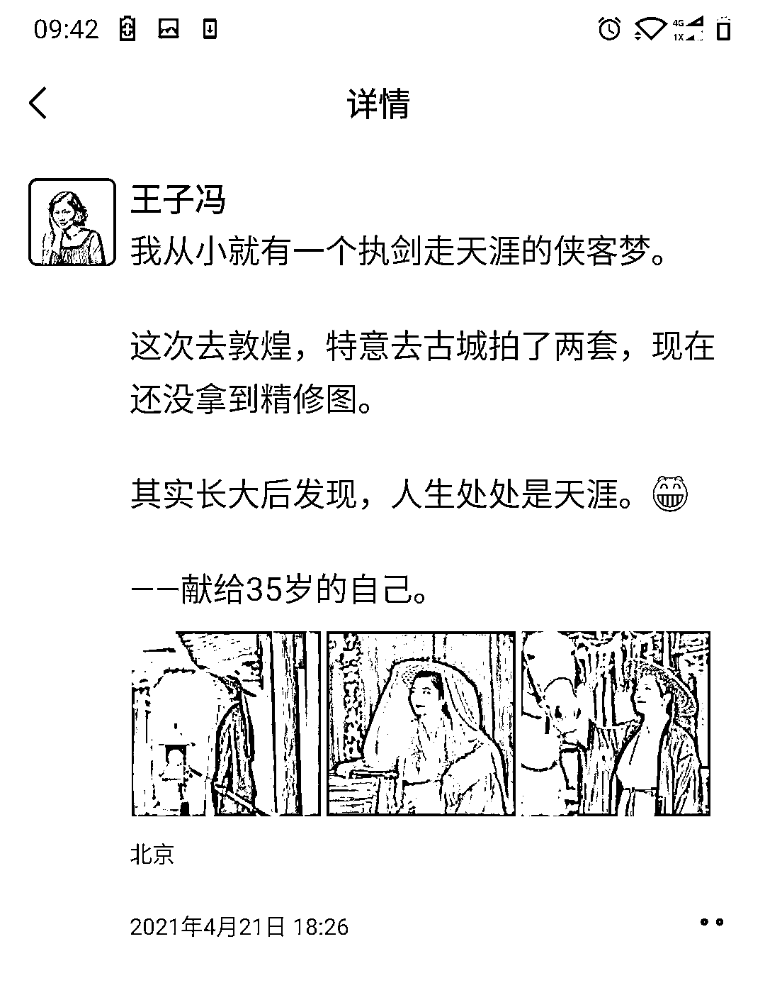
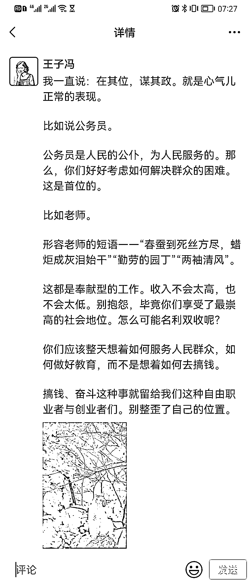
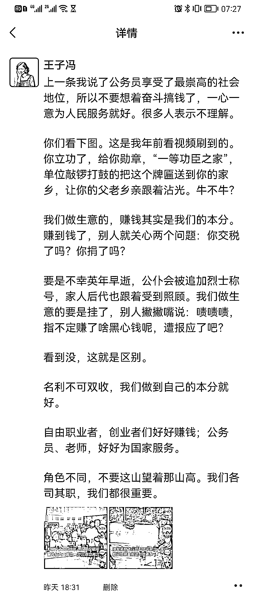

# 2.1.4 灵感就在手边

这类内容，通常从四个方向冒出来：

一是职场里的零碎瞬间。

二是陪娃相处的时刻（点开可查看大图）。

三是伴侣之间的同框日常。

四是生活里其他不起眼的场景。

这里真没什么捷径，关键是把自己的眼睛放进生活里：多留意身边发生的事，既看见那些温暖的、好看的，也别放过那些难看的、刺眼的。

举个例子，有一回我和一位在体制内工作的朋友聊完，随手记下了下面这段。他挺羡慕我时间安排更自由、收入也更高。不过说到底，每个人站什么位置就担什么责任，生活路径和追求本来就不必相同：

还有一次，我刷抖音看到国家表彰了一位立下战功的军人。这让我更确定：身处社会，各人把自己的职责尽好就行，别总羡慕别人的光：

