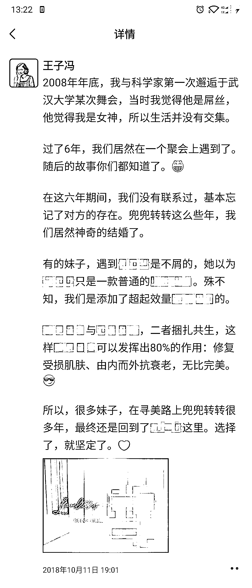
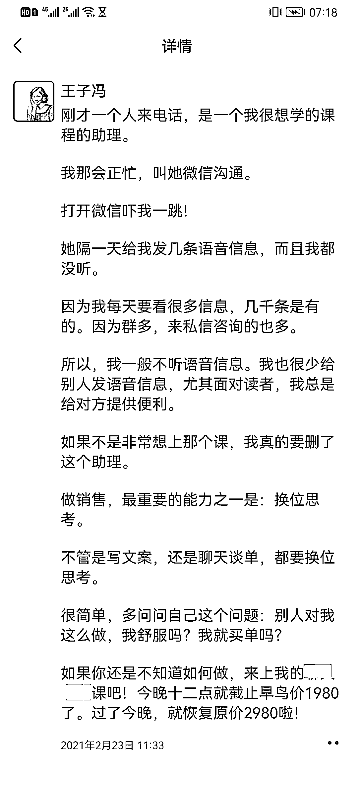
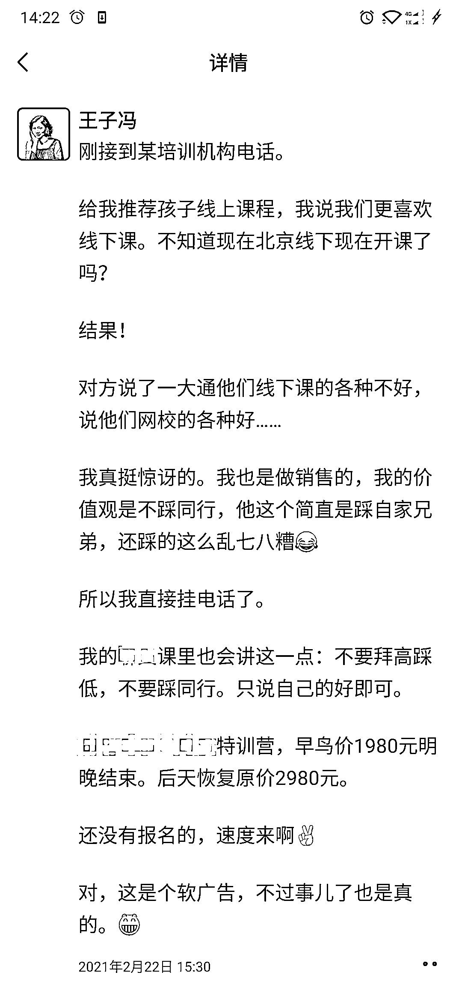

# 2.4.1.2 第二类：故事铺好，广告收尾

这种写法在结构上很好辨认：先让故事打头阵，再把广告放到末尾。

下面用案例来说明：

由于故事本身足够抓人，读者通常会一路看到最后。等到收尾时忽然冒出一则软广，大家往往不会觉得突兀，反而会认为你挺有趣。也正因如此，这类软广文案一直很受欢迎。

想找范例的话，不妨翻翻罗振宇老师的跨年演讲文稿：他常先讲几个小故事，再顺势引出一则广告，效果相当好：[《罗振宇 2023「时间的朋友」跨年演讲全文稿》](https://mp.weixin.qq.com/s/DNC5TsJg-RK8GOHzhLHStA)