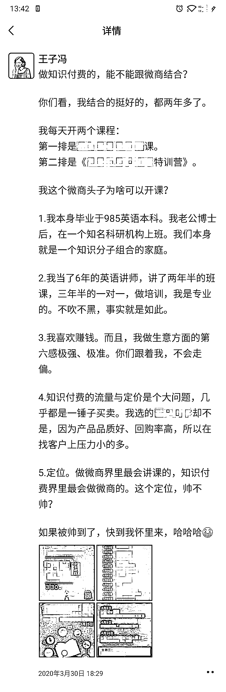
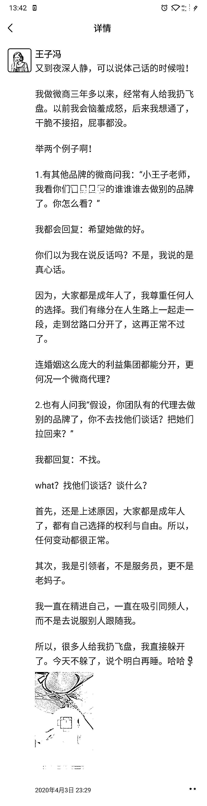
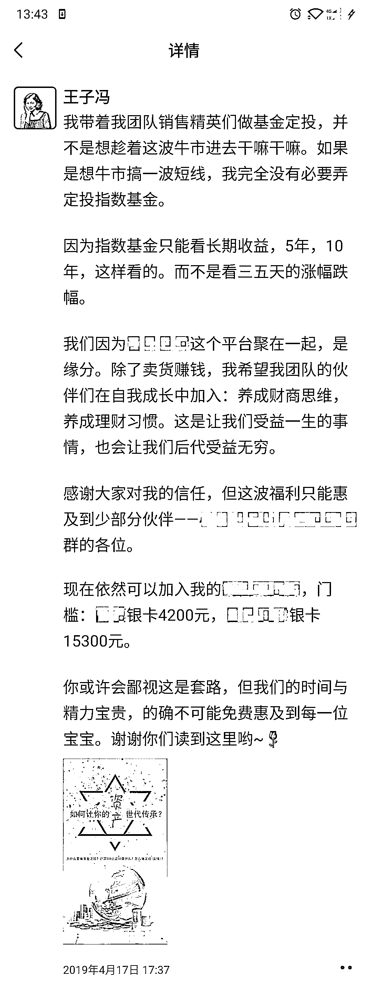
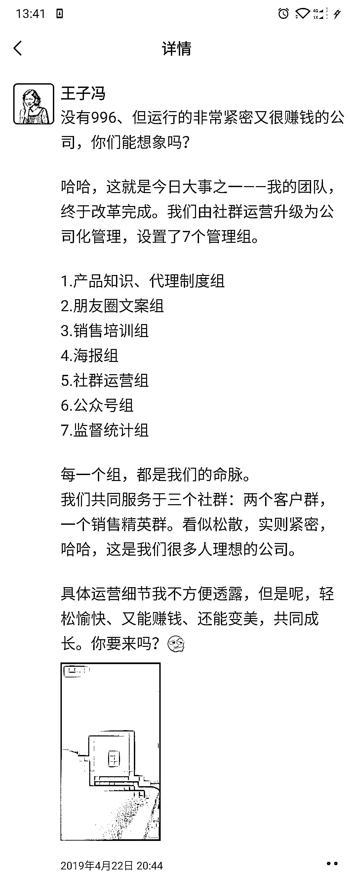

# 2.4.1.6 第六类：扩大格局，输出可为行业做什么

在一个行业里待得越久，写出的观点就该越有分量、越站在高处。

直接看几个例子（点击图片可放大）：

拿我自己来说，我常写团队长该承担什么、商业顾问该贡献什么，也会写我这个团队长，能为整个行业带来哪些价值。

别老固定在一个位置——既不能总以新人视角去写，也不能一直高高在上。最好的状态，是能随时切换，上得去也下得来。

当然，这类内容不勉强。如果你的认知和格局已经到位，完全可以往这个方向写；如果还没到那个高度，先不写也没关系。

写这些内容，不一定会立刻带来收益，但会让别人更全面地认识你，尤其是那些段位较高的人，往往会因此高看你一眼。朋友圈的意义不只是吸引客户，有时还能吸引到段位很高的老师。接触正向的圈子，能量也会反过来滋养自己。