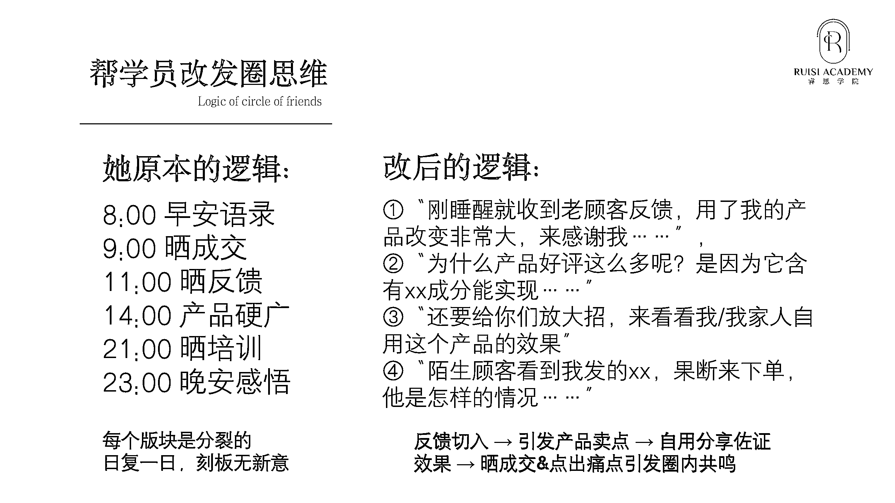

# 3.1.1 朋友圈这样调整，让人追着看

第一，把要发的内容全部打散，别按时间顺序来。每天呈现的布局都不同，用户才有新鲜感，才会对你的朋友圈继续保持好奇。

第二，找一条“逻辑线”把这些散乱内容串起来。比如：
- 早上一睁眼就收到老顾客的消息，她说用了咱们家的产品变化很大，特意来道谢；
- 紧接着解释：为什么好评这么多？因为产品里有xx成分，能实现……；
- 然后放大招：我和家人也在自用，真实效果给你们看；
- 最后晒出成交：一个陌生顾客看到我发的xx，直接下单了，他是什么情况呢？

这样一来，“反馈切入-带出产品卖点-用自用分享佐证效果-晒成交&点出痛点引发共鸣”一条简单的逻辑线，就把4条朋友圈串成了故事，一层层展开，让人想一直看下去。

第三，再加入一些意料之外的灵感型内容，比如生活故事、突发奇想、看新闻产生的观点。这些内容能让你的朋友圈整体变得灵活又有生气。

逻辑线发圈，核心是先找到那根“线”，把一个或多个事件串联起来，按照一定的逻辑去呈现，像电视剧一样展开。这也说明：逻辑线并不是固定的，每天都能用不同的逻辑线。

内容来源：《巧用「逻辑线」发圈法，让用户越看越上瘾》

