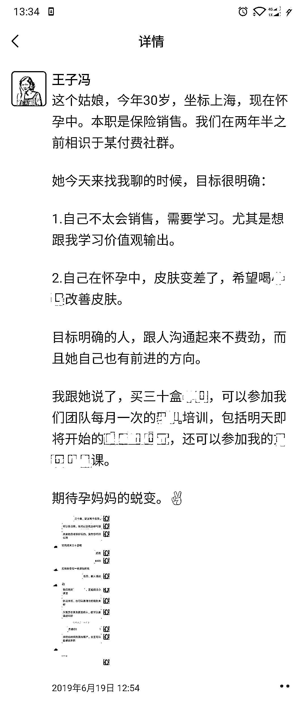
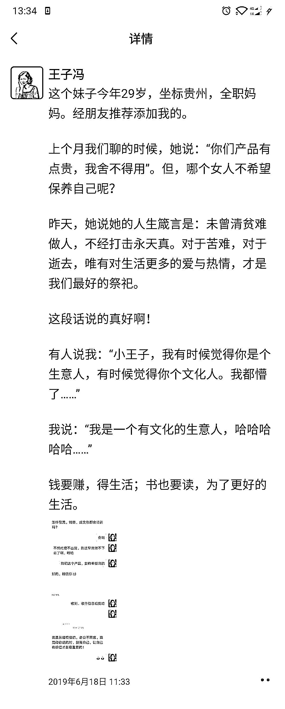
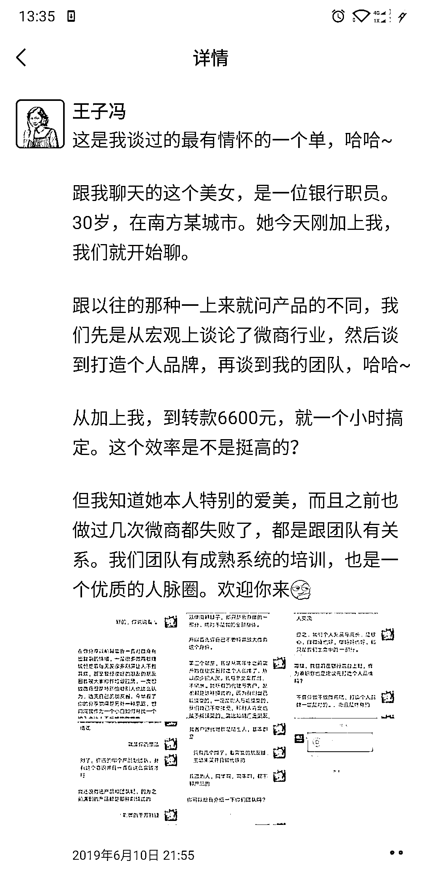

# 3.2 技巧二：用户故事，让朋友圈更会成交 @王子冯

想让潜在客户读着读着就冒出“这说的不就是我”的念头，进而产生下单冲动，用户故事型朋友圈很值得用。可以按四步来写：

开篇先交代背景，作用是让读者迅速代入；接着写你们是怎么认识的，用故事感把人留住；然后还原成交过程，这一段依旧要讲故事，而且涉及钱的情节天然更抓眼球；最后直接引导购买，给读者一个明确动作，这就是广告的落点。

案例参考：

几个要点：

背景部分，对照上面的示例，通常一开头就点出用户多大、在哪个城市、做什么工作、是什么身份。这几项千万别省，它们最容易让读者产生代入感。

为什么？你想想：刷朋友圈时忽然看到对方跟自己是老乡，哪怕还没打招呼，亲近感是不是先上来了？发现有人和自己干同一行，而且也在用某款产品，你是不是会想“那我也可以试试”？看到对方同样是宝妈，共鸣是不是马上就来了？再比如“90后”“80后”这类字眼一出现，你是不是更愿意往下读？

所以，年龄、所在城市、职业、身份这四个背景信息，是写好用户故事的关键。

