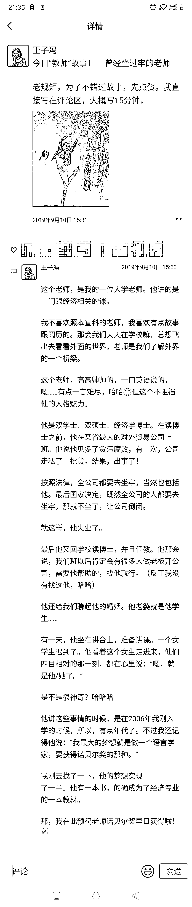
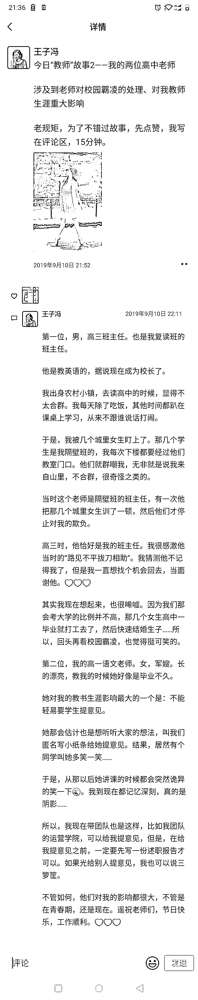
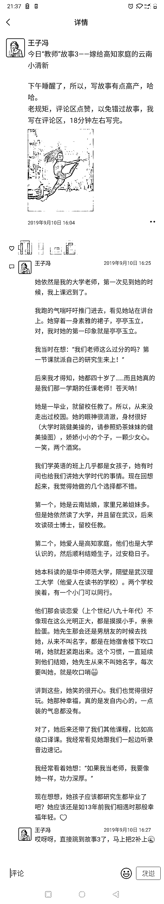
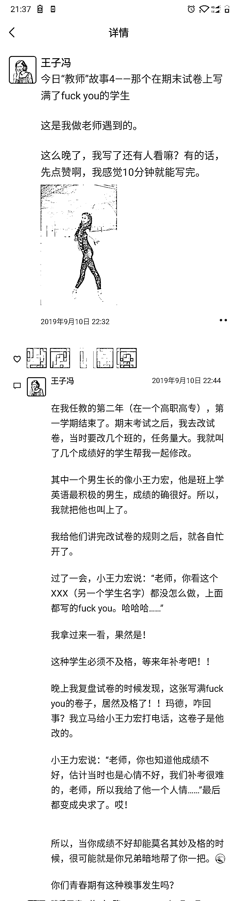
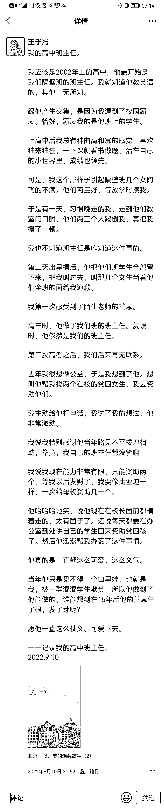
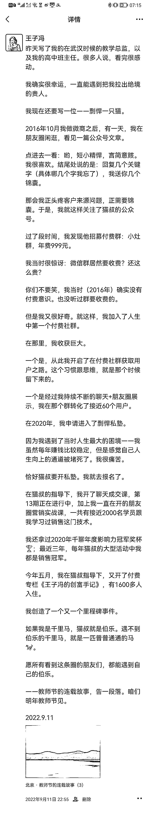

# 3.3.2 主题故事实例

先看几个具体的例子。点开下方图片，即可查看大图：

案例一：曾蹲过监狱的老师

案例二：高中时代的两位老师

案例三：嫁入高知家庭的云南小清新

再看另外一组，点开图片查看大图：

案例一：在期末试卷上通篇写满fxck you的学生

案例二：那位高中班主任，仗义又可爱

案例三：我生命中的伯乐——剽悍一只猫

写故事类朋友圈并没有固定模板，只要能把握好时间、地点、人物、起因、经过、结果这六要素，慢慢就能写出好故事。