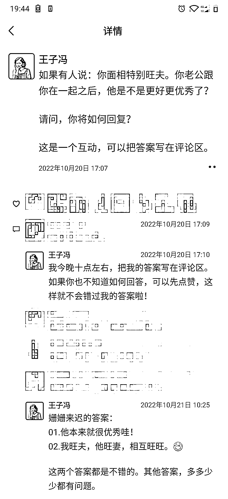
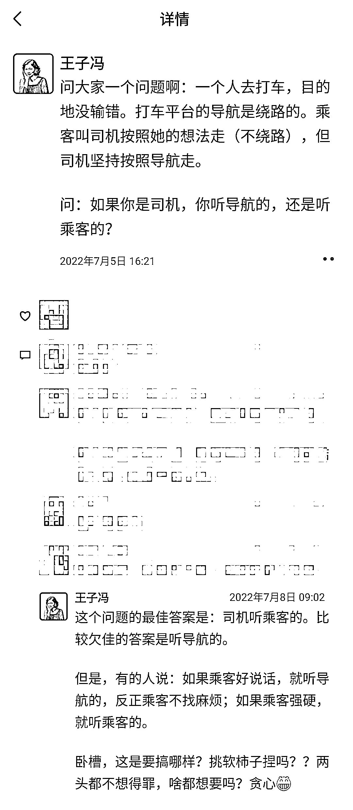
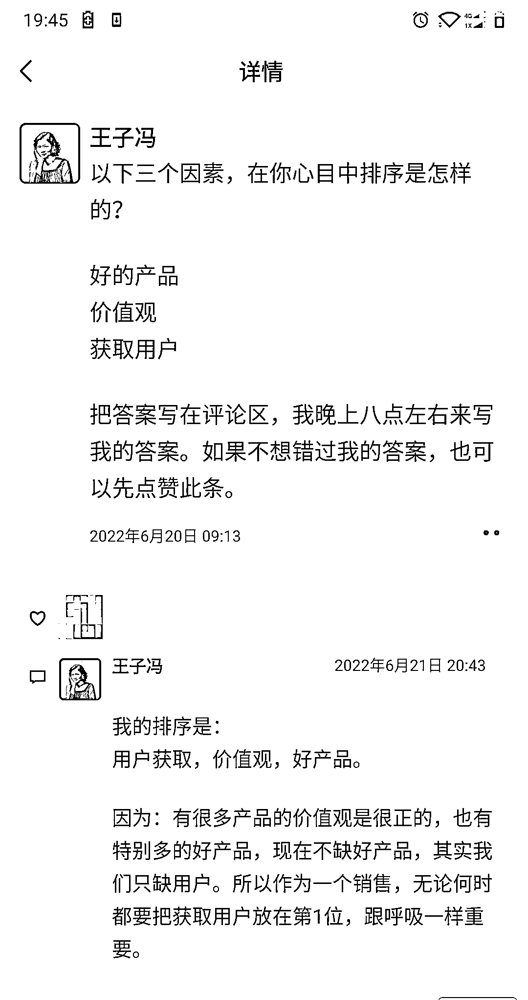
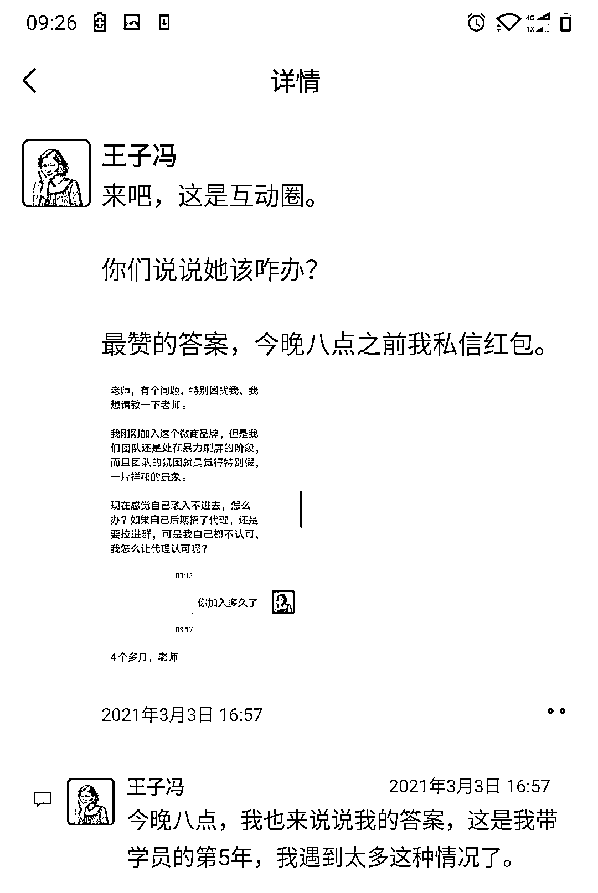
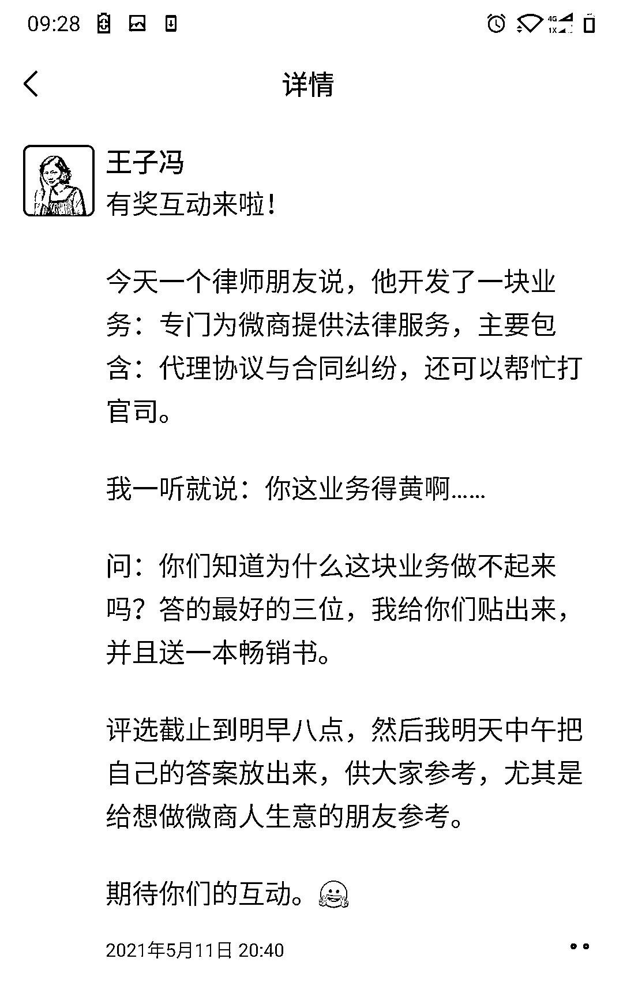
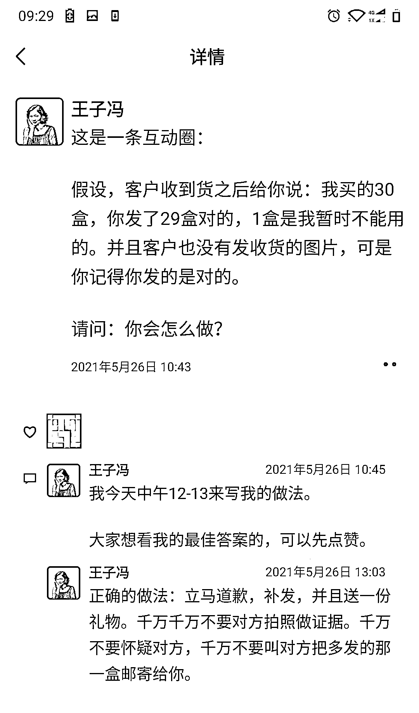

# 3.5.1.3 红包提问，答出真想法

有时不妨在朋友圈抛出一个业务难题，邀请大家来支招。比如：

我的一位代理遇到下面这种情况，各位觉得怎样处理更妥当？回答得精彩，我会私信发个红包。

这类内容要求参与者认真动脑，对发问者同样是一次考验——既然把问题摆出来，就必须准备好答案。自己若心里没底，千万不要发这种互动，否则只会让自己下不来台。

示例如下：

这样的互动明显更有深度。

凡是在评论区写下答案的人，基本都经过了反复斟酌。原因很简单：谁都希望保住体面，担心答得不好被人看轻。因此，平时做业务时，碰上自己已经有清晰答案的问题，不妨发到朋友圈互动，同时也能从侧面了解客户的想法。对客户给出的答案，你一定要格外重视，因为那往往就是他们最真实的看法。