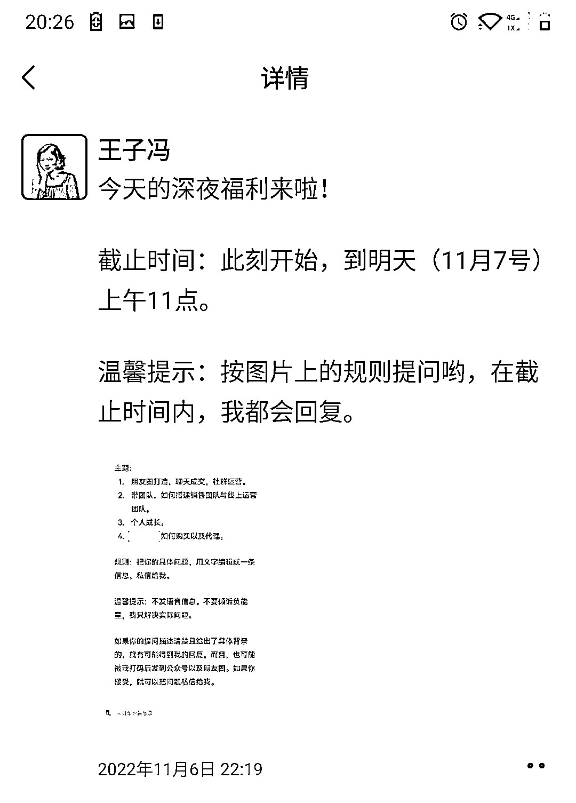
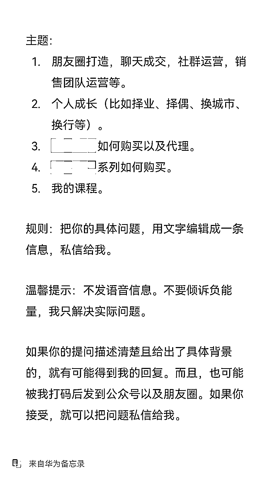

# 3.5.4 第四种：用聊天邀约激活互动

先解释一下：聊天召集令，可以理解为一次有边界的线上小聚——你先圈出一个时间段，再讲清参与规则，邀请愿意交流的人来互动。看两组示例：

像这样把时间和玩法说明白、把愿意交流的人聚到一起的方式，就是聊天召集令。

先看一种情形：

“接下来一小时我有空，愿意聊的，在动态下点个赞；不方便公开说的，评论区敲个‘8’，我来私信你。”不太擅长开口的人，很可能就留个8。而只要开始对话，就有机会走向成交。

那聊什么？先问清对方的身份和职业，再翻翻他的朋友圈，通常能找到可延伸的话题点。实在接不上话，就各自安好，不必硬聊。

这种交流能拉近你和读者的距离，提升信任与黏性。朋友圈负责持续曝光，是一对多；私聊负责加深关系，是一对一。只要一次聊得舒服，对方之后大概率会更关注你的朋友圈，某天可能就自然下单了。

再看答疑型玩法：

“今天14点到15点，我有一个小时，可以帮大家解答问题。范围包括朋友圈怎么经营、聊天如何促成成交、线上团队怎样搭建、社群如何运营。参与方式：把问题整理成文字私信我，别发语音。名额只留10个。”

这比单纯闲聊更显专业。如果你在某个领域确实有实操经验，这种方式效率高、效果也好。时间、主题、参与方式和人数都设了边界，无关打扰自然会被挡在外面。

它的关键，是把自己的价值感立起来。所以文案可以进一步收成一句：“我为你答疑解惑。”当别人把你当专家看，离成交也就更近了。

这种发圈模板，你完全可以照着用；不过先确认一点——你确实具备替人解决问题的能力。

