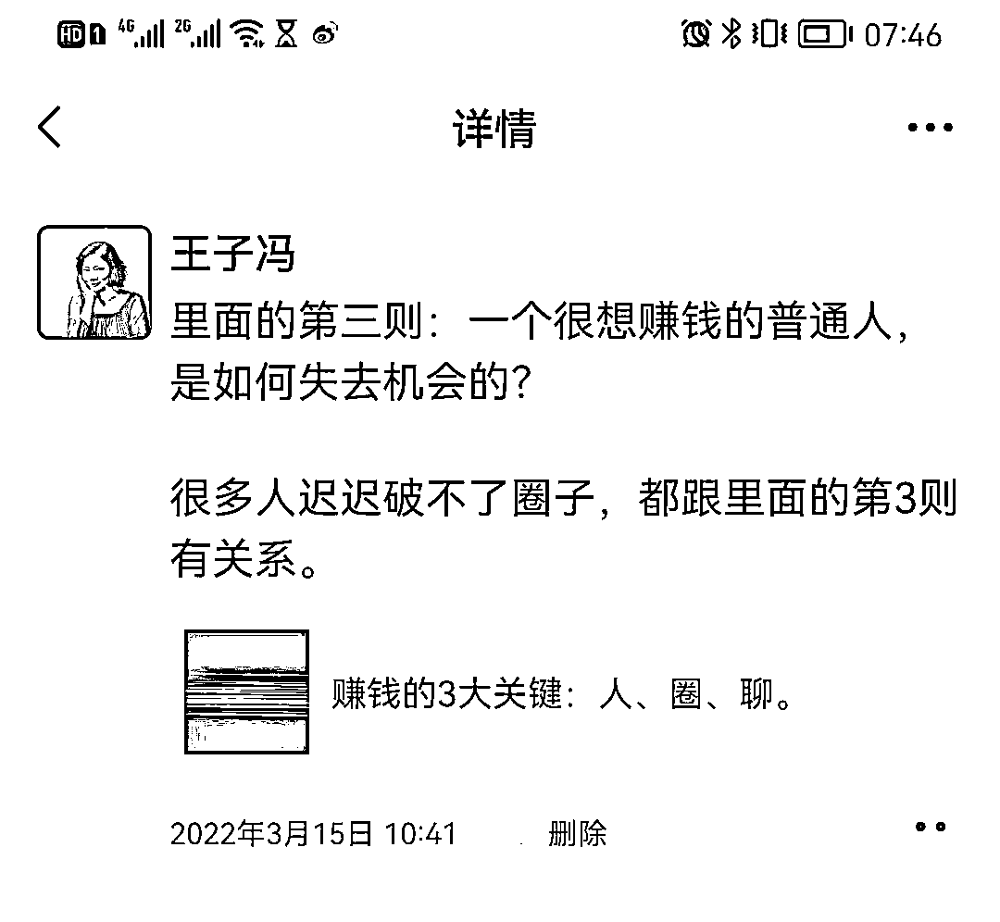
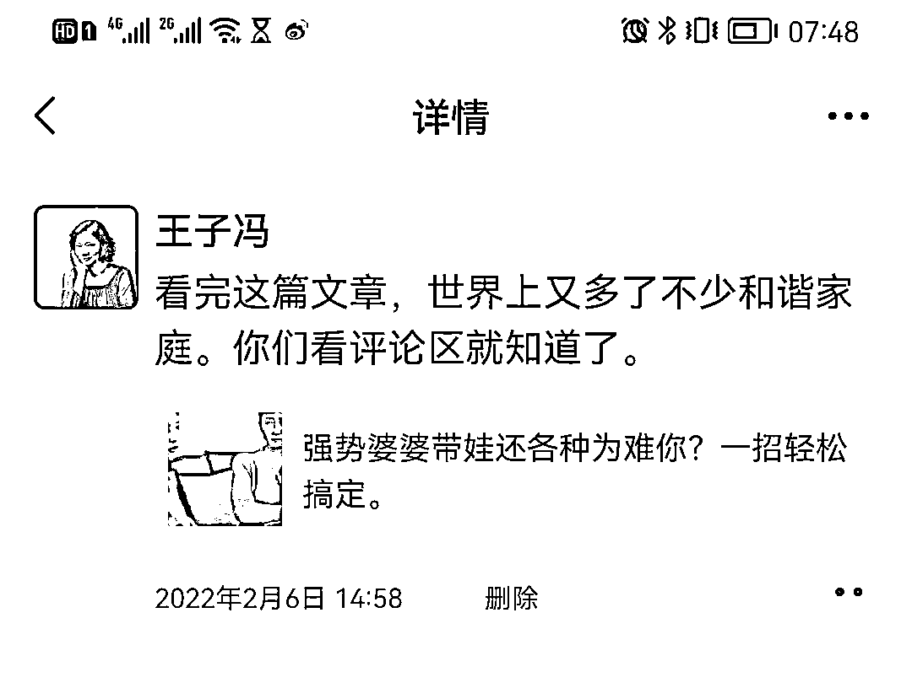
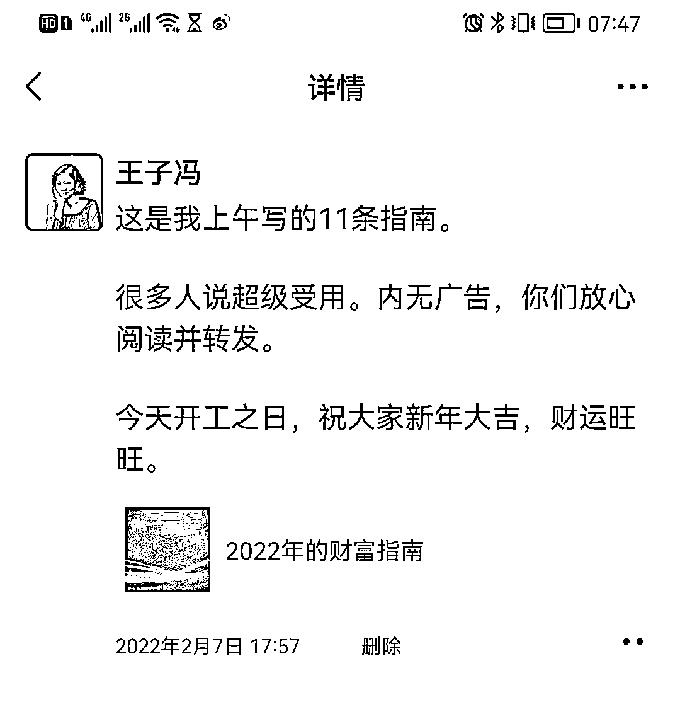
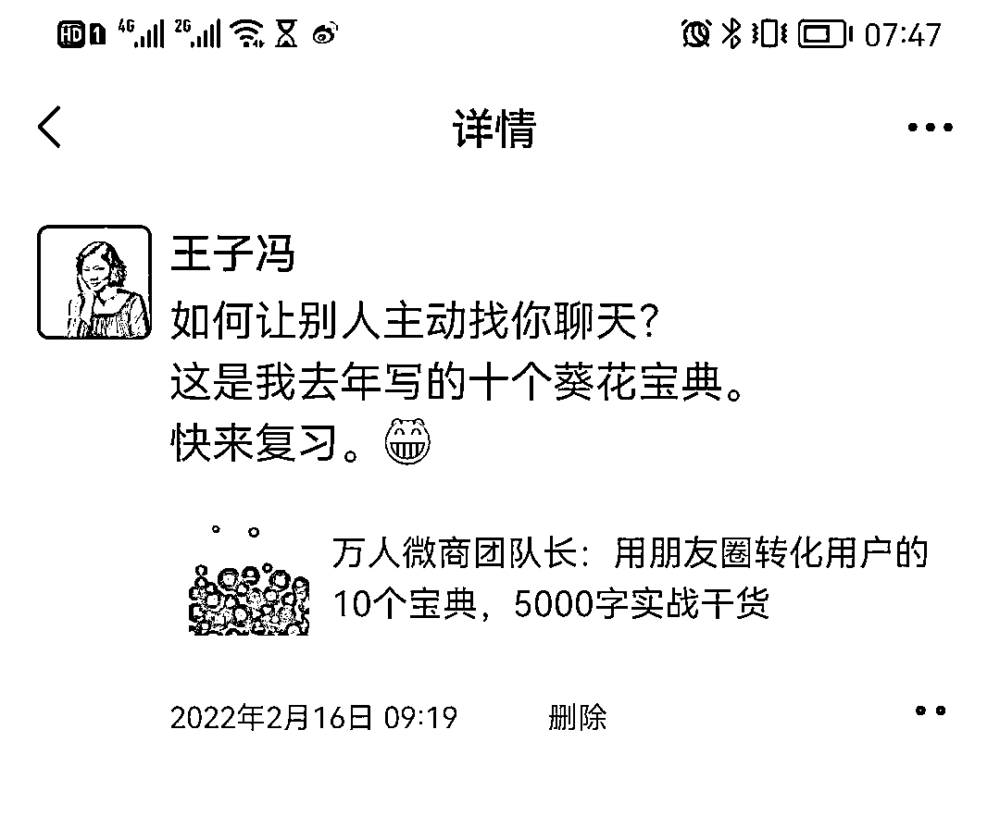
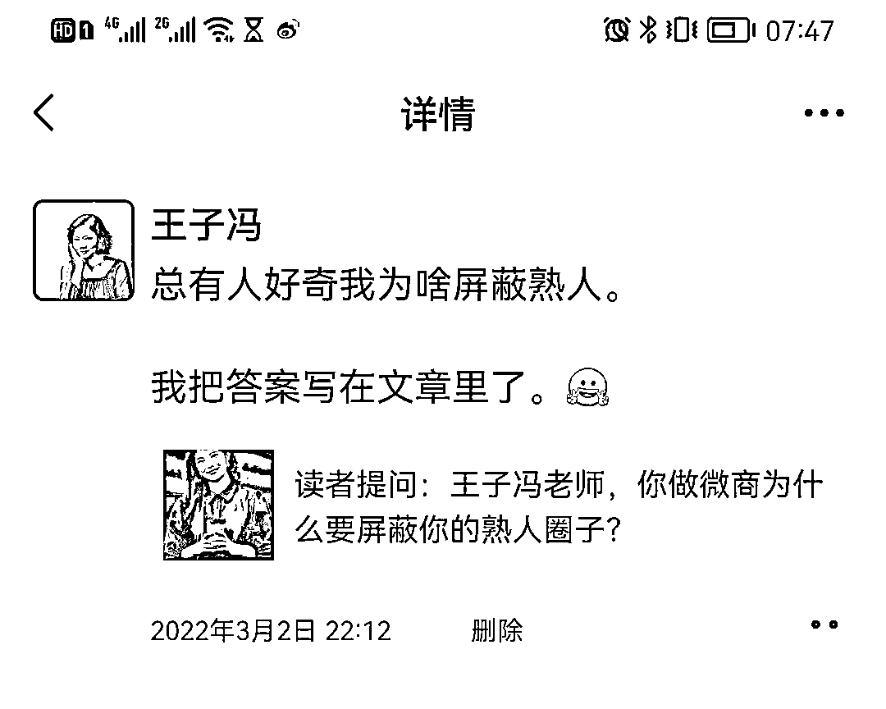

# 3.7 推荐高价值链接，朋友圈文案这样写 @王子冯

这类素材从哪里来，之前在「2.1 高效获取朋友圈素材」已经聊过，此处不再重复。

把优质文章或链接转到朋友圈后，配文该如何搭配？可以从以下两方面入手。

1）写推荐语要回答三个问题

这篇内容主要讲什么？读者为什么感兴趣、能获得什么？需要读者做什么？

只有内容和读者的切身利益相关，他们才愿意花时间；若与自身利益无关，通常不会点开细看。

当然，并非每篇内容都必须有干货。哪怕只是一段幽默段子，也能让读者开怀一笑，这也是一种收获。

这三点里，前两点是底线。

示例：

关键：配文长短不是重点，能摸准读者心思、吸引他停留才关键。

2）转发链接的其他方式

也可以分享旋律抓耳的音乐、让人捧腹的视频等。

规矩没变：文案别啰嗦，一两句戳中读者心思就行。目标很明确：让读者看完这句短推荐，立刻愿意点开链接。

