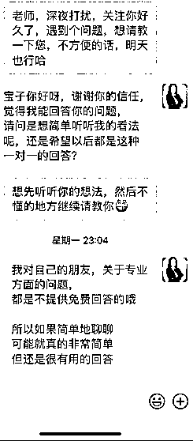

# 4.1.2 技巧一：产品不够，先把自己卖出去

下面只讲我的个人情况，供你参考。

进入知识付费行业六个月，我的系列课尚未成型，社群运营也谈不上熟练。要让我预判哪门课一定能卖爆，确实很难。可我始终认定，行业里的问题，我有能力去解决。

这背后其实绕不开两笔成本：时间与能力。靠十几年积累，做咨询我很容易进入状态；但把这些经验提炼成课，搬到线上交付，还要懂传播节奏，就没那么轻松。

那我的朋友圈该发挥什么作用？说直白点，就是提高成交效率。

当产品还不够丰富、不够成熟时，先经营自己，显然比急着推产品更重要。尤其做知识付费，更合理的顺序是先找到客户，弄清需求、预算和想达成的结果，再为他定制产品也不迟。

标准课、咨询、知识星球、私教陪跑……都可以是形态。先让足够多的客户产生购买意愿，再去展示更多产品，甚至整个过程中本来就要不断试错。

我的引流品是两个三十多元的产品，结果并不好卖；真正卖得动的是知识星球，收益贡献最大的是私教陪跑。因此我的结论是：想让客户接受为你量身定做的产品，先得让他们接受你这个人。

这些信任不是凭空来的，是我在朋友圈持续输出后，才有公域来的朋友开口：“关注你挺久了，想跟你请教。”

经营朋友圈，有点像养一盆花：先要熬得住安静，再摸清光照和水分的配比，剩下的交给时间。

还有一条不能少：你得真心喜欢自己卖的东西。

内容来源：《低互动朋友圈带来每月五位数变现，我是怎么做到的？》

