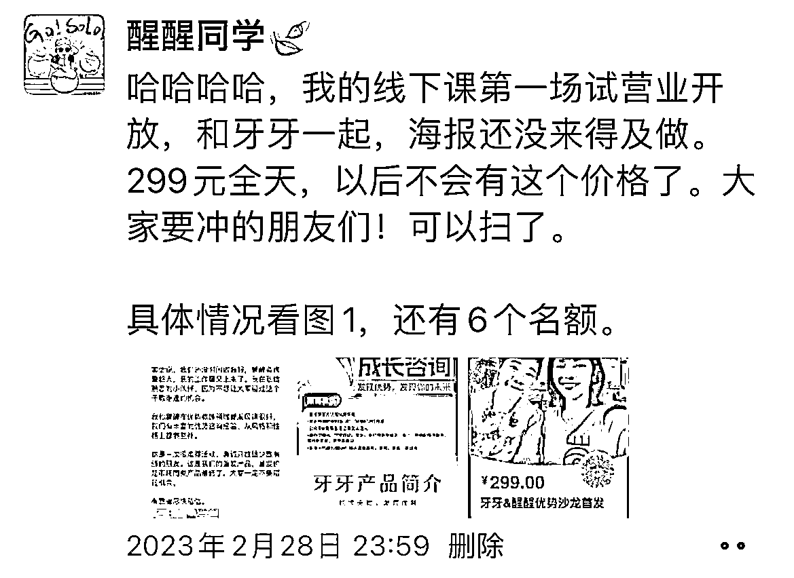
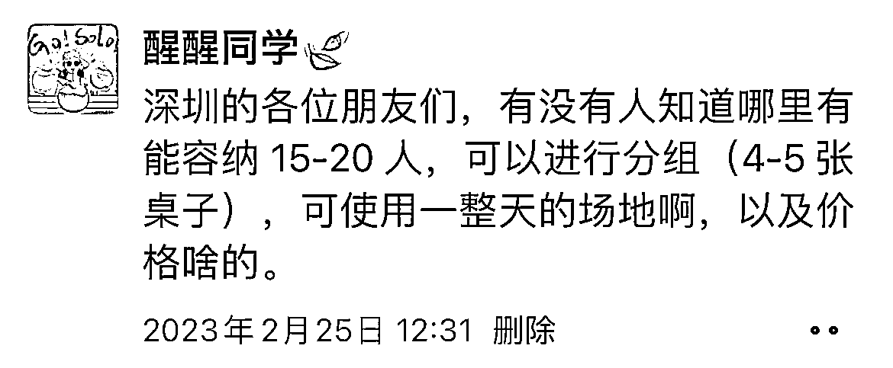
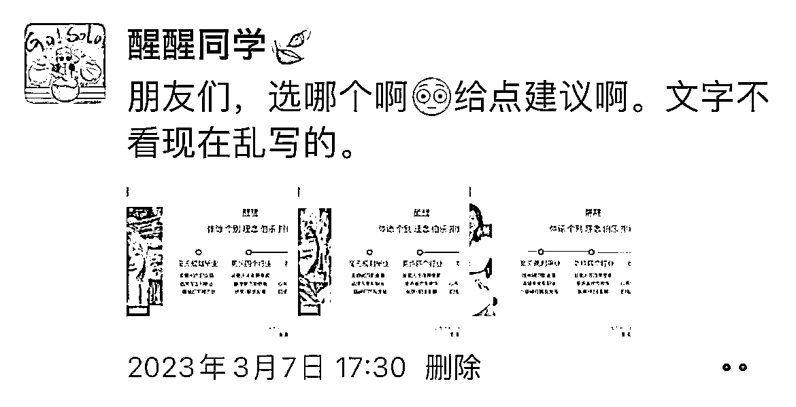
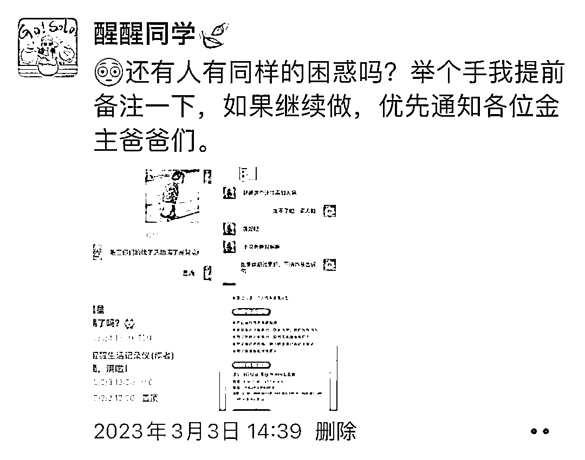
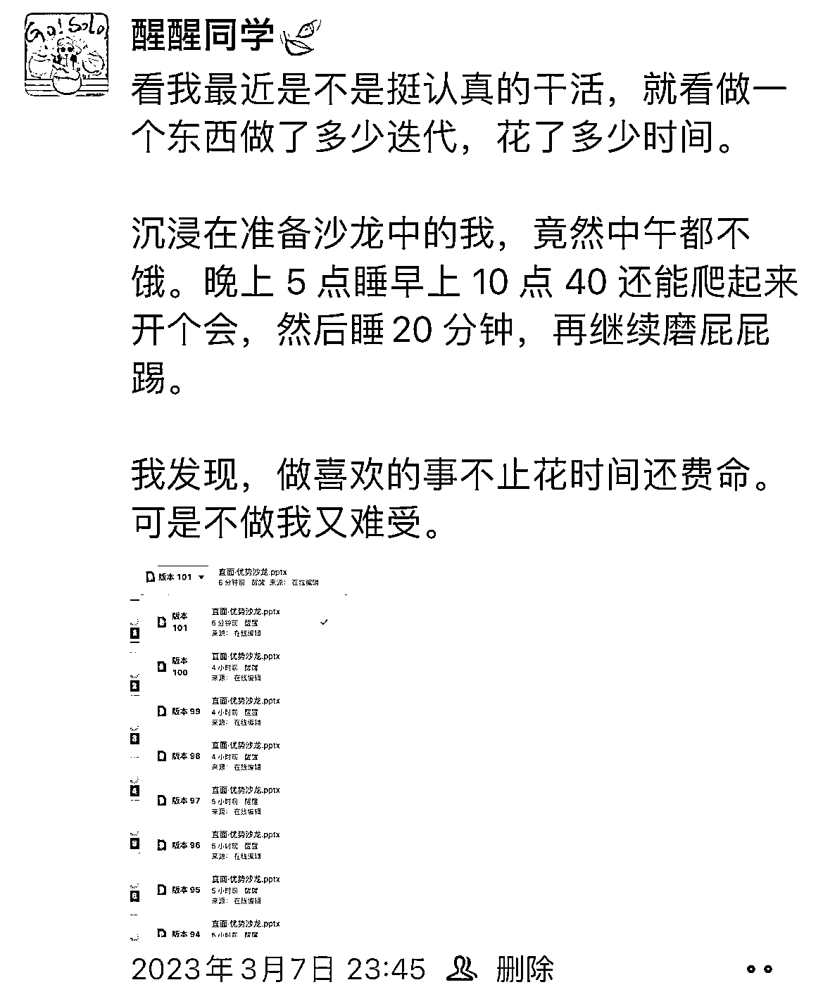
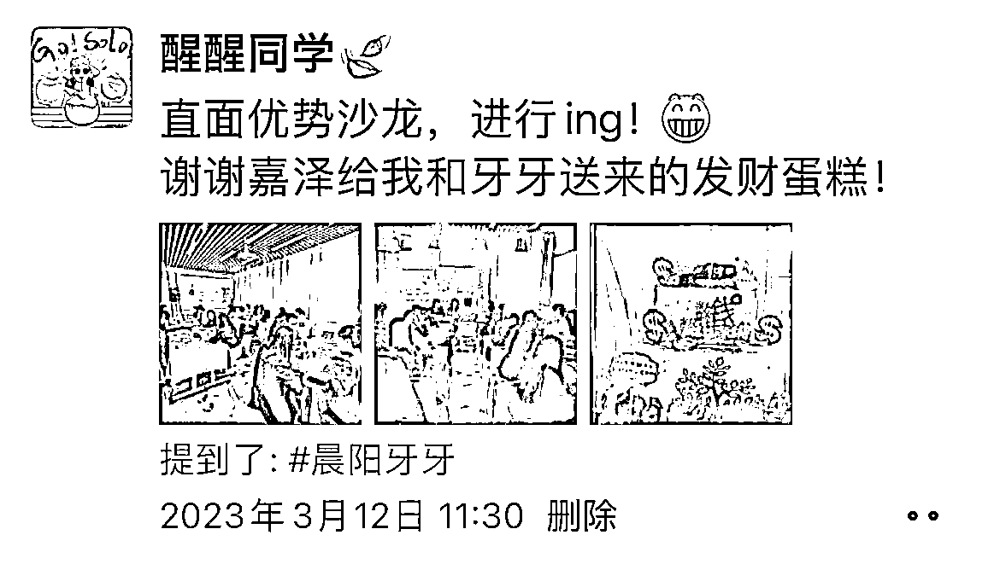
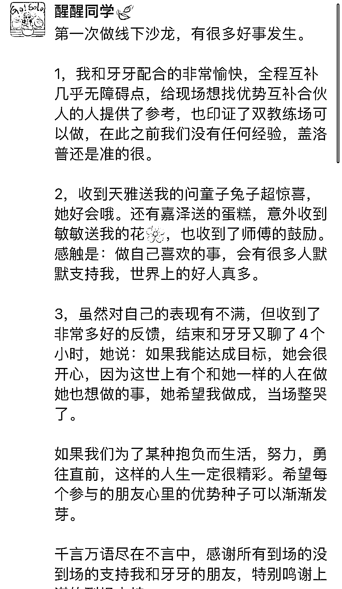

# 4.2 别急着发广告，先让朋友圈围观你的全过程 @醒醒同学🍃

不知道大家有没有这样的体验：走进一家餐厅，如果透过玻璃能看到后厨，看到食材在自己面前被洗、被切、下锅，那顿饭会吃得格外安心。但点外卖的时候，因为完全看不到出品过程，总会忍不住犯嘀咕：这不会是什么“黑厨房”吧？

发朋友圈其实也是同一个道理。你要是能让用户“看见”你的产品是怎么一点点做出来的，她反而会更放心。说得夸张点，她甚至会觉得自己也参与了“孕育”的过程，像看自家孩子一样，怎么看怎么顺眼，不买都觉得说不过去。当然，这不是教你套路别人，而是用公开的方式倒逼自己认真做事。

我就拿自己前两周第一次做线下沙龙来说。从冒出这个念头，到决定办，到准备物料，再到正式开讲，整个过程我都同步在朋友圈里。结果报名的人多到原场地坐不下，硬生生换了两次场地。

**第一步，大胆说出“我要办活动”。**

不用等物料、海报、流程全都准备到位才开始宣传，跟着你的准备节奏走就行。还没准备好就开吹，反而没有心理包袱；后面每做好一步，都是进步，别人也能看到你是在认真做事。

场地、海报、物料这些小事，都可以拿来发圈问大家，让朋友圈的人一起参与进来。对朋友圈来说，最怕的从来不是写得不够好，而是发了没人看、没有任何反馈。那一条朋友圈就帮我收集了四五个场地，甚至有人直接说要报名。每一次能和用户对话、能获取资源的机会，我都会好好珍惜。

**第二步，把准备过程变成“连载”。**

准备期间产生的所有思考、纠结、调整，都可以适当发出来，让大家跟着你的进度走。比如我会问大家“这两个海报哪个好看？”“这个模块这样设计你们更喜欢吗？”甚至“我穿这件衣服去活动行不行？”这种问题不需要对方花太多脑力，回个序号就行，所以参与度特别高，那条朋友圈收到了几十条回复。像这种参与门槛低的内容，可以多来几条。

还有一种情况：名额满了之后有人想加位，也可以发圈问一下。这样做，无论你是想继续加人，还是想把现有报名的人“稳住”，都会让围观的人觉得这场活动热度很高，也顾全了没抢到名额的同学。

后来我改PPT的时候也发了一条，纯粹是当时的真实感受。可也正是因为平时这些过程被大家看到，活动当天我们竟然收到了同行朋友送来的蛋糕和花。

这个世界真的很有意思，只要你愿意发声，就会和他人发生连接，连接往往会带来记忆和惊喜。人和人的感情很多时候不能摆在台面上算账，如果一段交易发生了却不伤感情，那一定是在交易之前感情就已经建立了。有了感情，成交只是顺理成章的事。

**第三步，活动当天适当“转播”。**

把现场发生的事、精彩瞬间同步到朋友圈，让没来的人也看到阶段性成果。

**第四步，活动结束后记得复盘和总结。**

可以写当天的感悟，可以整理一份复盘供别人参考，也可以把用户反馈做成宣传案例。我把总结发出去之后，马上又来了3个人想报名下一期，后来还慢慢带来了专栏和咨询产品的用户。再后来我决定试其他场次，一条朋友圈发出去，几个小时就报了15个人。说实话，在这之前我从没办过线下活动，海报也是临时做的，但一直坚持同步过程这件事，真的帮了我很多次。

说到底，如果一个人平时从不冒泡，某天突然甩出一张海报说自己办了个活动、出了个课，除非他是大V，否则很难瞬间报满。素人阶段，还是得靠持续展示自己的专业和用心，一点点积累信任。让用户像追剧一样跟着你的状态起伏去认识你，等他确认自己需要你的服务时，基本就差下单这一步了，根本不需要你费太多售前咨询的口舌。

内容来源：《仅靠🛰️+朋友圈赚七位数，我是如何长期经营朋友圈的？》

