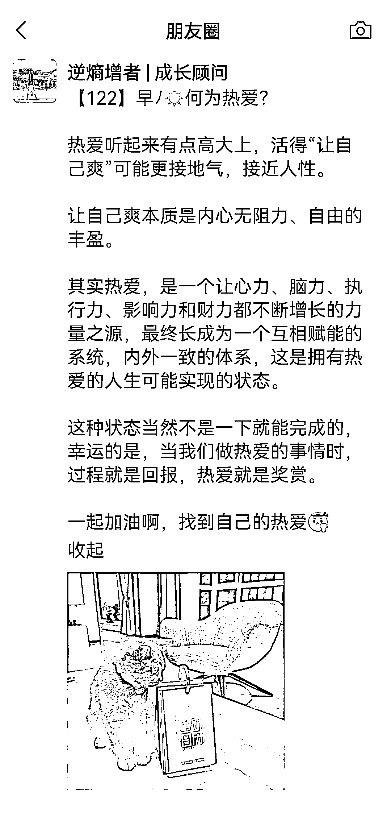
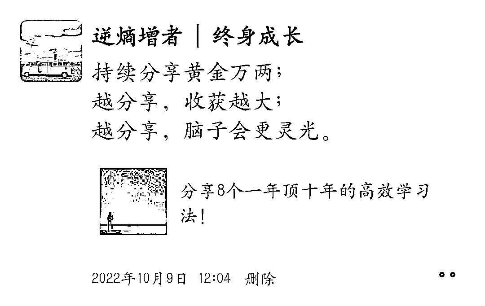
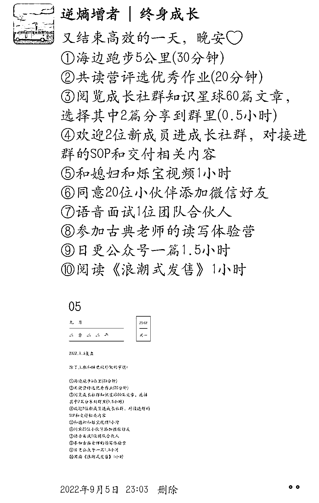

# 5.1 朋友圈几点发更有效？@逆熵增者

发朋友圈并不是随手一按就完事，什么时候发，往往会影响它被多少人看见。每个人的作息、生活习惯，尤其是每天刷手机的节奏，其实都有迹可循；顺着这些规律去安排信息发布时间，效果会更稳。结合朋友圈用户的活跃数据来看，有四个时段特别值得留意。

1）早上 7 点到 8 点：很多人刚起床，或者正在上班路上，工作还没真正开始，这段时间像是一段空白。不少人醒来后的第一件事就是刷朋友圈，看看有没有新鲜内容。这个时段更适合传递正能量，给好友打打气，让他们带着好心情开启一天。作者通常会发一张早起打卡图，再配一句金句，或者分享读书、学习相关的内容。

2）中午 11 点到 13 点：大多数人正在吃午饭，适合发一些和个人专业、知识、技能有关的内容。也可以顺势展示自己的成绩、案例和口碑，把个人 IP 和用户需求、产品价值连接起来，让内容真正有用、有价值。作者多半会在这个时间转发前一天的👸号文章，再加一句介绍语，相当于给👸号做一次二次触达和曝光。

3）傍晚 17 点到 19 点：这个时段不少人正在摸鱼，或者已经走在通勤路上，整体状态比较放松。内容可以更生活化，比如好玩的段子、让人流口水的美食，或者自己的休闲日常。作者一般会晒晒孩子，或者发几张出去玩时拍的照片。

4）晚上 21 点到 23 点：这是用户使用手机的高频时间。此时发布的内容可以主打福利，例如互动、优惠活动、促销等，因为用户在这个时段更容易产生冲动消费。睡前，作者通常会发一条当天复盘的朋友圈。

如果你是刚开始发圈的新人，可以照着这几个时间点来安排。但要是已经发了一个月以上，就不必太死板。真正想发的那一刻，就是黄金点。哪怕已经是晚上十二点，你突然特别想表达一种价值观，而且文案里充满能量，这股能量也可能冲破屏蔽，直接抵达读者内心，那就发。明明很想发，却被“黄金点”限制住，硬憋着不发，反而可惜。

所以，每一个你想发朋友圈的时间点，都是黄金时刻。

内容来源：《普通人如何发好朋友圈》

