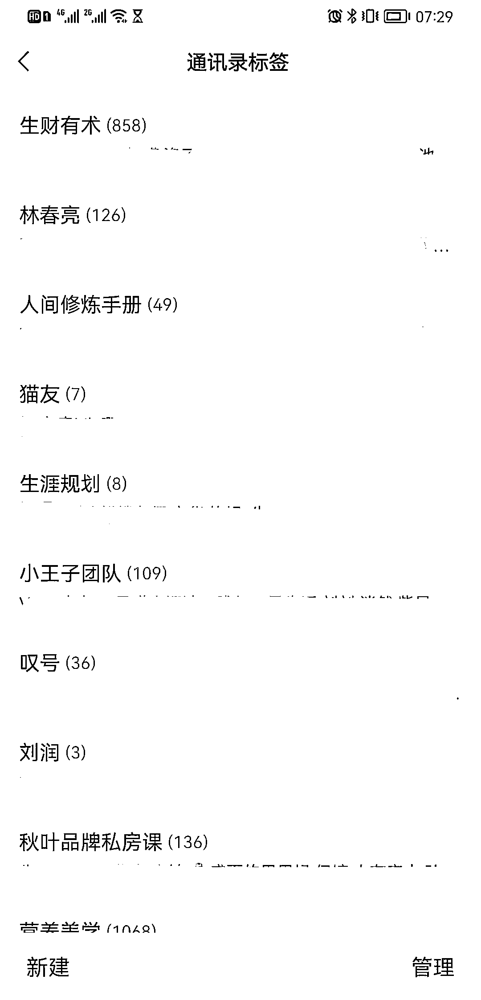
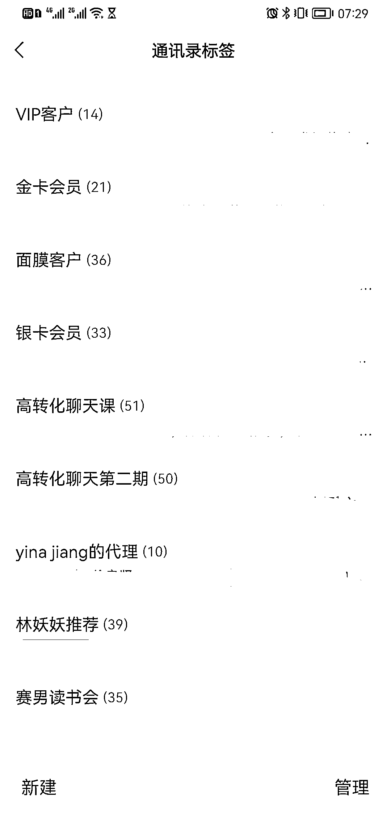
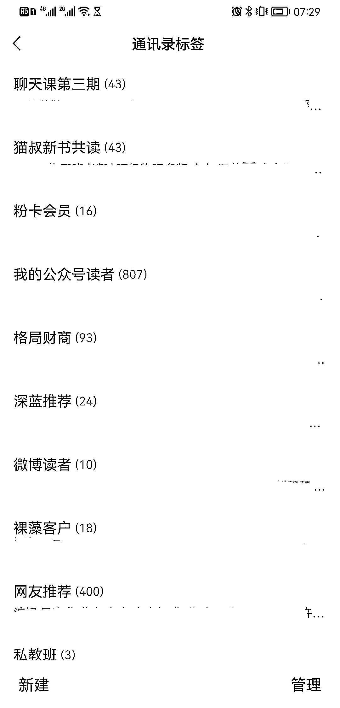

# 5.2.1 标签只认来源 @王子冯

我每个微信号的通讯录里，都会维护八九十到一百个标签，绝大多数好友也都带着标签。贴标签时我只守一条线：这个人是从哪儿来的。

想把私域做顺，最省力的获客路径无非两条：一是从别的付费场景里加人，二是从自己的自媒体账号引流。我基本只走这两条路，因为其他来路的人，转化率低到几乎可以忽略。也正因如此，按来源分组最清楚。

拿我某个号的部分标签举例（不是全部）：

第一张图里，排在前面的有“生财有术”“林春亮”“人间修炼手册”，最后是“秋叶品牌私房课”。这些全是按来源切的。同一个来源的人，往往带着相似的底色。

比如“生财有术”这批人，男性偏多，对赚钱有强烈兴趣，行动也很猛。和他们聊亦仁、涛哥、聊搞钱，很容易同频。

“林春亮”标签下的人，都是林春亮老师给我导流来的。价值投资是他们的共同语言，理财投资是兴趣所在，赵正宝老师也是他们都认识的人。

“人间修炼手册”这个社群，是创始人请我去做嘉宾时，很多人加了我。这个标签下的女生经济实力较强，学历普遍不低，也很爱美。

“秋叶私房课”的人，是我参加秋叶老师线下课时加的。大家共同经历过那场课，也认可秋叶老师讲的个人品牌打造方法，阅读和出书是共同爱好。

还有“生财有术私董会第一期”，这批人和我是同一期加入私董会的，月营收在50万到1000万之间，大多是规模不等的创业者和企业主，还在线下私董会活动中碰过面。

而且这些标签之间的人，重合度非常低。就算有人同时混两个以上圈子，比例也很小。每个标签下的人都有一些共同经历，哪怕平时没聊过天，点开对话框也能自然聊起来，不会尴尬。

要提醒一句：标签别按认识时间来设。我以前用过“2018年2月认识”这种标签，后来发现很坑。点进去一看，有人是商场营业员，有人开滴滴，有人只是某个群里加的，彼此毫无交集，甚至连当初怎么认识的都想不起来。

