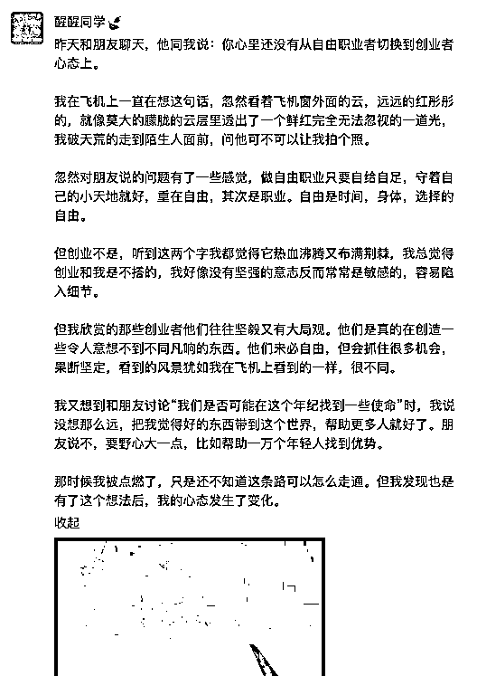

# 5.5 高频输出，真实表达 @醒醒同学🍃

常听人说：“要是没法让人一眼记住，那就想办法让人反复看到，直到记住为止。”

比起偶尔憋出一篇满分内容，长期稳定地发七八十分的东西反而更有生命力。总觉得状态不够好就不动笔、非要等完美了才肯发，其实那种震撼力很有限——真正让人惊艳得做到两百分，可那太吃功力了。但如果能坚持写下去，攒下几篇八九十分的作品，别人自然就会记住你。持续输出有用的东西，让对的人看见，再让更多对的人看见，赚钱基本就是水到渠成的事。

找素材的路子也不少：去知乎或者相关用户的社群里跟人聊，帮他们解决完问题就顺手整理成案例；或者翻翻同行的文章，把那些能引起共鸣的观点挑出来，用自己的话重新写一遍。一旦来了灵感，别犹豫，马上动笔，别给自己设一堆条条框框——想打动别人，真的挺依赖那种情感上的共振。

就说前天吧，我在飞机上琢磨着跟朋友聊过的话题，落地后直接发了一条朋友圈：

那条动态下面几十个赞，还有不少留言。有人写“看得热血沸腾”，有人说“这条能进自传了，随喜赞叹”，还有个朋友留言“股东报道”。等我睡醒，发现收到了一笔咨询转账。

我不敢断定这笔钱就跟那条朋友圈直接挂钩，但或多或少跟长期的分享脱不了干系。当你真心实意想做一件事，字里行间透出来的那股劲和诚恳，确实能触动很多人。

要是还怕没东西可写，不妨借助一些数据工具，像极客增长、5118 这类，搜一搜跟你产品相关的关键词，搜索量大的方向就是值得落笔的选题。我最莽的时候，试过同时写两版文案让用户投票哪个更让人动心，甚至直接请人帮我想怎么提升转化率，这些全是在朋友圈里聊出来的。聊着聊着，还真有人主动帮我转介绍。

我说的“真实”也在这儿——做宣传可以用技巧，但没必要遮遮掩掩，有时候坦率一点，用户反而更容易接受。就像那种：“我最近参加了个七天万元销售挑战赛，正在朋友圈卖某某产品，希望大家多给我提建议、给反馈。”这种操作不但不招人烦，有时候还能收获一波支持。可见卖东西本身不是槽点，让人反感的表达方式才是。

内容来源：《仅靠🛰️+朋友圈赚七位数，我是如何长期经营朋友圈的？》

