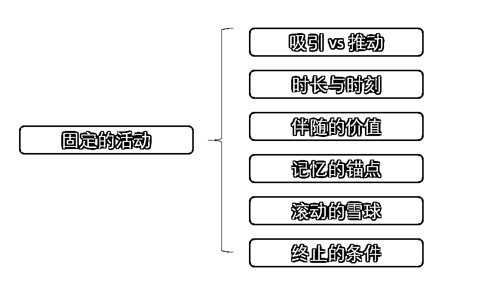
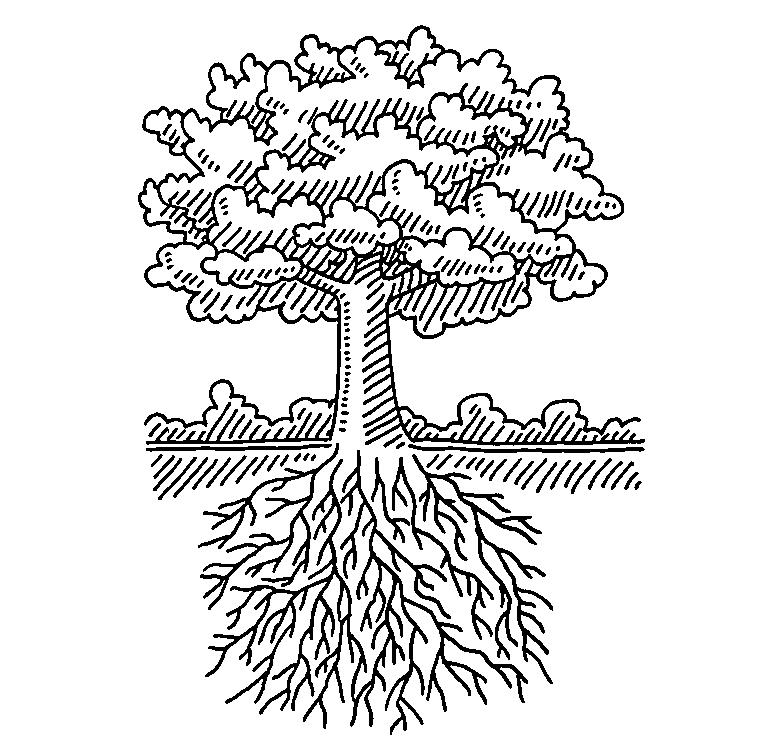

# 3.3.4 固定活动：让用户准点想起你

围绕“固定活动”这个要素，我整理了一张简单导图，下面逐项拆开说。

① 先吸引，别硬推

社群活动往往由发起人和几位核心成员一起设计，但上线后没人响应、大家无感，几乎是常态。问题常常不在点子，而在动作：你是在推它。凡是靠硬推才有人动的安排，基本都推不久。

从设计之初就要清楚：活动是用来吸引人、激发人的，不是给用户布置作业，也不是硬塞给用户去完成。想明白这一点，活动的节奏、需求、供给价值、吸引点和诱因，都会比过去设计得更好。

这和追女孩子有些像：死缠烂打未必有效，真正有吸引力才厉害。

那活动怎么吸引用户？要练换位思考，把“这个活动在用户眼里是什么样”变成本能和思维习惯，你才会找到感觉。

② 选对时间点，也算准时长

设计固定活动时，有两个重要工具：时刻和时长。时刻，是时间点经过考虑；时长，是持续时间经过考虑。既不建议把活动放在错误的时间点，也不建议错配时间长度。

举个例子：一个线上活动要大家花半天，还每周办两次。细节先不用看，光这个安排就很反人性，哪怕第一天没夭折，也很难期待长期参与率。

另外，工作日下午别在群里办活动；到了周末，也尽量让大家放松，线上活动尤其不要轻易占用周末。线下活动周末方便，但线上活动就要斟酌：是否值得大家牺牲周末时间。

经验上，用户参与活动的黄金时段大致是周二、周三、周四晚上，周末反而不高。当然，万事有反例，核心逻辑不变，某些反常安排也可能合理。

以行业峰会为例，多数是放在周内办的。原因有几层：参会者周内参加本行业会议，有正当性；放到周末，就容易被看作自己的事，还不带薪。周内参加，也方便和同事提起，整个业务组可能一起过去；业务负责人带核心员工参会，本身也属于工作，放周末大家一听积极性先没了，还没入场好感就减三分。对主办方来说，周内办还能挡掉一些与行业无关的人：周末大家闲，周内无关者很难向领导请假，理由不正当，假请不出来，也就不来了。这同样是择时带来的利好。

③ 小活动也有陪伴感

活动再小，也有伴随价值。

小时候我们都有守着电视的习惯：知道每周五有个什么节目，或者每天晚上九点半后有什么内容。哪怕不算特别好看，到那个时刻，也会想起来看一眼。

只要每个周期（比如每月、每季、每年）有个固定时间点，而且这件事本身合理，它就会产生陪伴价值。

做活动别总贪大，老想“搞个大动作”。大活动频繁办，谁也扛不住。活动不大，每周只占半小时到一小时，但周周都有，可能更合适。甚至每天只有一到五分钟，只要准点发生，也会让人产生期待。

罗振宇在公众号每天早晨发60秒语音，单次时间很短，但坚持十年后，伴随价值就非常鲜明。

④ 给用户一个记忆坐标

固定活动再小都不用怕，小比没有强一百倍。大小不是最关键的，更重要的是：用户得到的大于用户付出的。

不少社群创建者做活动，总想憋个大招。其实没必要，反而容易局限自己：总想着找一个多大的事来做，一两次后想不出来，就把自己逼进死胡同。

持续做小事反而简单。只要保证参与者得到的大于付出的，这样的小事就有长期运转的力量。

固定活动还有一个好处：它能在用户认知里建立一个记忆锚点，让用户条件反射式地记住你的社群。很多群玩着玩着就死了，因为群没有特别之处，大家也没有独特认知。但如果一个社群有固定活动，在持续发生有意义的小事，至少无论死活，它会被记住。

再举两个例子：十点读书，这个名字里就含着一个确定时刻，很容易养成用户习惯——22:00有事情要做；罗振宇坚持十年，每天早晨6点发60秒语音，用户甚至会不定期好奇他是否还在坚持。这样，大家记住了他，也记住了时间赋予他的力量。

⑤ 让活动滚成雪球

固定活动其实也是一个滚动的雪球。

可以把它想成社群内部一直在旋转的齿轮：有周期，每天转一次、每周转一次，或每月转一次。只要它在转，就能源源不断带来新事件、新社交契机和新价值。

活动一旦运转，就会有人参与。每次参与都会留下贡献、体验和记忆，这些都很有价值。对社群这样的共同体来说，稳定活动会像雪球一样，把共同记忆越滚越大，这是很有复利的点。

这种滚动还能起另一个作用：帮你筛选出真正的铁杆粉丝，也给用户留下更多记忆。无论哪一点，本质上都是让树生根。很难想象，没有扎根的大树，怎么在风雨动荡中挺立。

如果把社群成员和外部潜在目标用户看作土壤，那么社群里有局部影响力的铁杆粉丝就是树根。他们在抓牢土壤，也更方便帮助社群把人聚集起来，而不是靠你一个人完成这一切。

所以大规模社群会设小组长，或请行业里不同方向的高手；特别大的社群还会有各城市分舵，每个舵有舵主。

⑥ 开始前想好怎么结束

固定活动好处再多，也有一点要提醒：创建时，顺手想清楚它终止的条件。

事情发展充满意外，创建一个固定活动，不等于永远背负它。最好一开始就说清结束条件，这和“丑话说在前面”是一个道理。当价值增量不达预期，或者事情开始起变化时，给自己一个合理停下来的机会，很重要。

