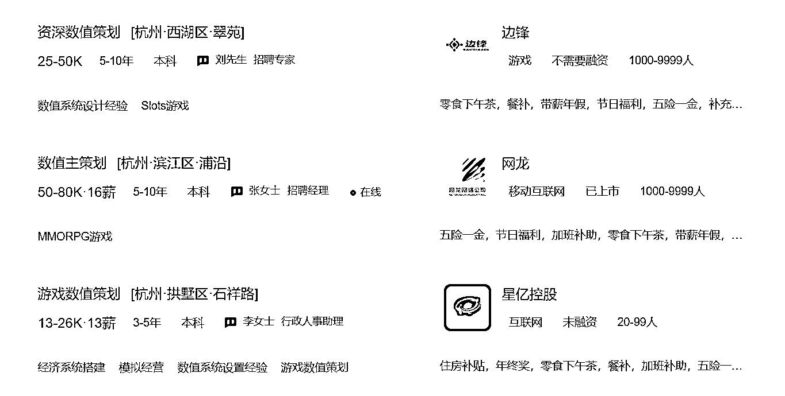

# 4.5.4 把重复活交给工具，把价值写进规则

1）工具：让系统替你值守

长期增长，尤其是不靠运营活动硬推的那种，通常得有数字化工具搭把手。

出现下面这些信号，就该考虑引入 SaaS 服务或专业系统了：

• 新成员加入后能自动贴标签，按来源渠道归类统计；
• 用推荐海报配合扫码入口，把引导流程自动化；
• 通过 SCRM 为每位成员留一份简要档案，方便做精细服务；
• 搭建独立的荣誉体系，或者配置清晰的打卡记录功能。

如果活跃用户和社群扩张的每个动作都等人来干，增长就很难做到随时在线。所以要琢磨的是：怎样让 SaaS、SCRM、RPA、浏览器扩展等接手一部分环节，把流程自动化。

生成式 AI 这两年热度很高，未来社群里长期有类似 ChatGPT 的角色参与服务，也不是没可能。

你在社群运营中，有哪些工具一旦用上就回不去？欢迎在评论区聊聊。

2）规则：让价值观落到制度里

规则这件事，在社群里难度更大、牵涉面也更广。当然，规则条文本身常常并不复杂。

它要应对的，往往是社群里不断变化的局面。好规则能托住价值观，还能持续把它夯实。

有时候，制度所传递的价值排序，比社群乃至任何组织嘴上的倡导更有穿透力。

而激励设计，对社群气质的改造最猛。

这里我先忍住讲理论的冲动，用几个例子来展开。

一份游戏数值策划岗位的招聘信息（2023 年 2 月 25 日）

*

在游戏——也可以视作一个规模很大的社区——的设计里，做数值经济设计的岗位（业内常称数值策划）做的就是机制相关的工作。

这个岗位很关键。他们通过数值去规定：玩家投入后能换回什么、稀缺怎么界定、拿到的资源如何被消耗，以及各种消耗与转化之间怎样保持平衡，从而让整个系统长期跑下去，不会突然塌掉。

缺了靠谱的机制，多人游戏很容易出现类似通胀的失控：原本稀有的顶级道具一夜缩水，后来者追赶老玩家的速度被拉到离谱的十倍，体验就会彻底失衡。

*

回到社群，谁在什么地方投入能换回什么，这件事决定了社群资产的基本盘。换句话说，它反映的是创建者怎样理解社群的基本盘。

社群或组织提倡什么，有没有优先级？优先级怎么排？反对什么，又有没有优先级？顺序如何？

这些问题，靠宣传是定不下来的，只能靠制度定下来。

比如，长内容与短内容谁更重要？帮群友解决问题和撮合彼此认识，哪个优先？直播分享与文字发帖，如何排序？学习与实践，又该把谁放前面？

最好在社群早期就想明白。若到了快速扩张期还含糊，对社群来说，往往就是隐患。

想明白的标志，同样是把答案写进制度。

再比如，社群若发行货币，它因何产生、为何支付？把这两问答清楚，激励机制的骨架也就出来了。

还有一种情况：社群倡导的努力方向没有任何回报，而不被倡导的方向却回报丰厚。那么社群最终长出来的价值取向，反而会倒向后者。

对于不提倡、甚至禁止的行为，社群到底投入了什么？只靠口头说说，当然禁不住。

以付费社群为例：哪些举动会让你宁可全额退款也要请人离开？这些举动才是真红线，而不是群公告里列的那几行字。

定义“什么行为会触发移除与退款”，其实就是在定义一套制度。

宣传与行动能保持一致，不容易，但值得做。

*

再换个场景：城市与县城、契约型社会与熟人社会，各自运行的制度并不相同。

同样的结果，在不同制度下会换来不同回报：有的催生成果，有的却带来摩擦和冲突。

*

写到这里，4.5 节已经不短了。你还记得这一节的主题是“增长与自增长”吗？

不妨回头看看结论。

五条被验证有效的路径：口碑、内容、问题、软件、机制。

:D

