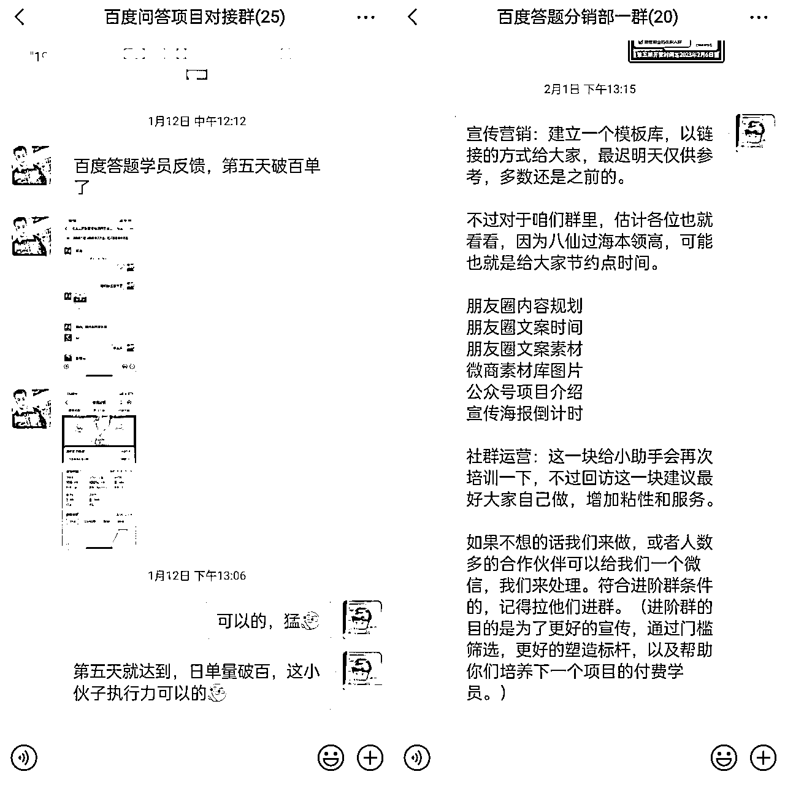
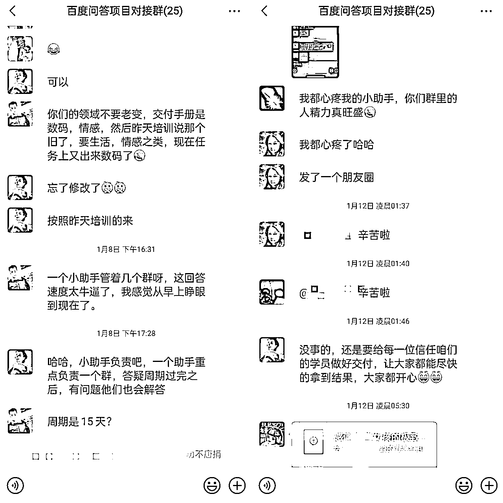
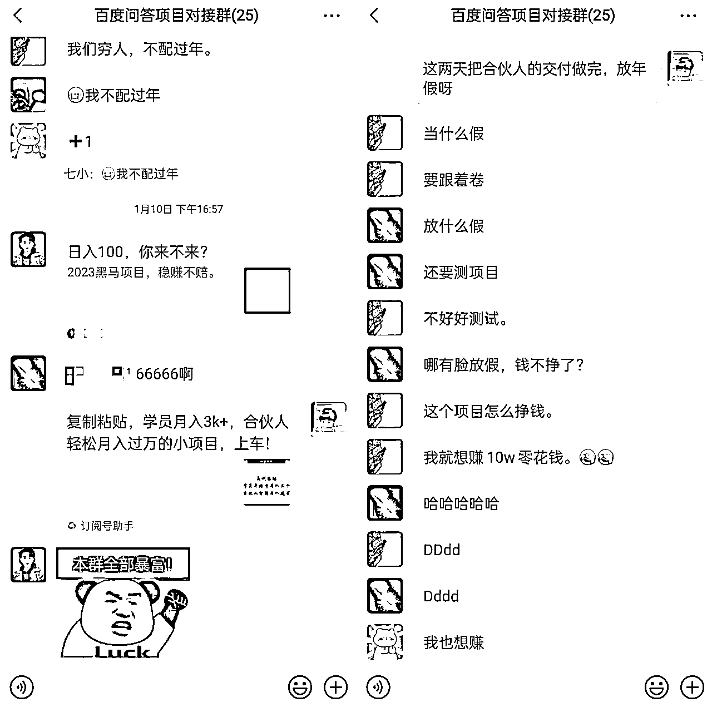

# 6.2.1 【案例一】答题项目合伙人社群：分销增长实操

这次复盘的是“百度答题”在社群端的分销玩法。路径不复杂：以分销拉新，把答题学员聚进训练营完成服务，靠培训费变现。

项目背景方面，客群盯的是高校学生假期兼职。疫情让线下零工不好找，线上机会成了替代方案。2022年9月团队试过一次，但答案依赖人工搜索，产出慢、放不大，便先停下。到12月，龙哥盟社区里 ChatGPT 话题升温，团队把它与答题结合，项目重新开跑。

首期人不多，精力全放在服务上，学员全部跑通。原因不玄：人群对口、动作够轻、交付能托住执行。第二期起量很快。市场盘子大，校园代理先加入推广；线上也能复用，于是团队去问熟人有没有兴趣。重复问题一多，他们干脆建分销群，把通知和答疑集中起来。

这个群后来不止发通知。成员各有各的影响力，创业者又对赚钱敏感，群内慢慢长出分销气氛。

1. 把分销伙伴群做出活力：目标先行，动作跟上
先回答“群为什么存在”。团队分两类：学员群负责服务，分销群负责传播和裂变。动手运营前，把群目标、价值主张写清楚，后续动作才不会散。

拿分销群来说，核心就是曝光与转化。主张要直白、好懂，还要和伙伴的收益挂上钩。载体选🛰️，群名短、好搜、好记；加入门槛、操作步骤、注意事项都提前说明。

招人靠“内容+渠道”：持续输出项目信息与优势，多平台扩散；也可定向邀约，最早那批伙伴就是团队自己拉进来的。想留住人，得给干货：培训材料、案例拆解、行业经验；再配分销主题互动，让沟通不止于通知。

群里聊点轻松事，气氛更热，黏性也更强；把推广中卡住的问题摆出来，大家一起拆。

伙伴推广遇阻，团队要快速接住，给支持、收反馈；过程数据也顺手沉淀，后面宣传用得上。关系同样要养：群里多数人彼此熟悉，平时交流多、互助多，协作感自然就出来了。

这样，社群才可能既有活力又能协作，课程和产品的传播、分销也更有落点。

2. 运营合伙人社群，这几处别踩空
1）先把规矩立住：成员要知道边界和参与方式；分销政策、推广路径、群公告都要有人讲。

2）交付分两层。学员侧：服务做扎实，保证结果；流程持续打磨；答疑每天归总；助教秒回；任务目标拆到日；用激励把气氛托起来。

3）合伙人侧：让对方省心，给全链路支持；朋友圈转化素材备齐；专属手册和答疑跟上；引导学员裂变带来新流量；后端服务做好，利润分配讲清楚。

4）别让伙伴只围观。多晒正反馈：当天分销数据、学员收入反馈等；评选积极贡献者，发红包，带动更多人下场。

5）定期回访，摸清推广中的需求和堵点，反推课程与产品迭代；安排专人盯伙伴的👸号、朋友圈，把有价值的信息带回群里，维持关注。

6）内部维护之外，还要向外破圈：找私域 KOL、其他社群谈合作，一起推课程或项目，扩大触达。

7）奖励和福利别省：节日红包、小礼品等，都能增强关系黏性和推广意愿。

说到底，负责人要在建群、招人、供内容、做支持、收反馈、办活动、处关系上持续投入，边跑边改。

3. 分成比例怎么定
不少朋友看到答题项目跑得不错，来问能不能照着学。团队很难给一套万能标准，但可以拆几个变量。

成本：先保住盈利空间。给得太高，利润被压薄，长期不利。

竞争：同类产品给得高，你的比例太低，就很难吸引伙伴。

贡献：谁带来的销售额和利润更多，谁就该拿更高比例；团队通常做阶梯。

大体区间在 30%—70%，具体结合上述因素调。也可按推广效果、销售额动态浮动，让伙伴更有冲劲，带动销售与市场份额。

4. 怎么让伙伴主动干
实战结论：靠谱的分销伙伴，是筛出来的。推一个产品，教育成本很高。培训能放大价值，但如果连推广动作都要手把手盯，不如自己培养人更省事。

当然，团队是第一责任人，不能躺平。要降低对伙伴的依赖和摩擦，可以从这几处迭代：

奖励给力：推广成功后有提成或奖励，积极性自然上来。

文案多样：海报、倒计时、项目介绍等素材备齐，让伙伴按场景和客户挑。

培训到位：讲清产品卖点，教推广方法，提升效率和效果。

自由留足：推广时间、方式、渠道可自选，方案策略可自定，创造力和热情才有空间。

反馈可见：让伙伴实时看到推广效果与销售情况；团队定期评估并给建议，帮他们调整动作。

这样既能把动力和自主性拉起来，也能让伙伴更愿意投入，最终带来更多销售额和市场份额。

内容来源：《从 0 到 500w+：百度问答项目社群分销模式的打造与实践》

