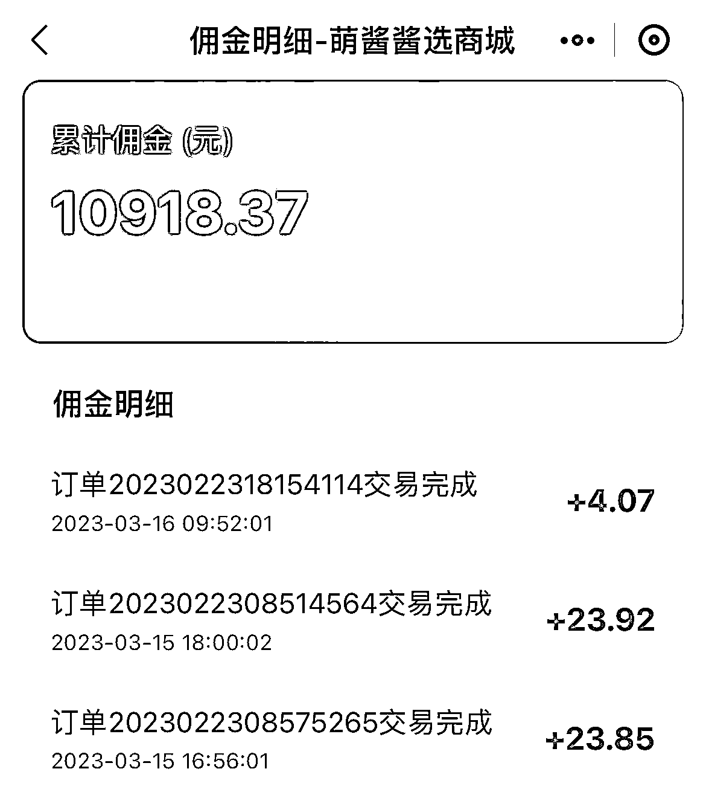
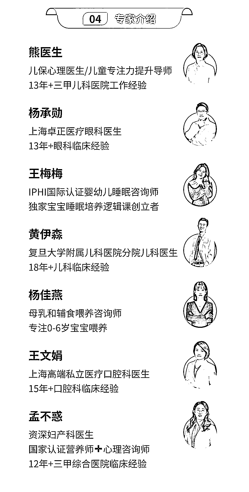
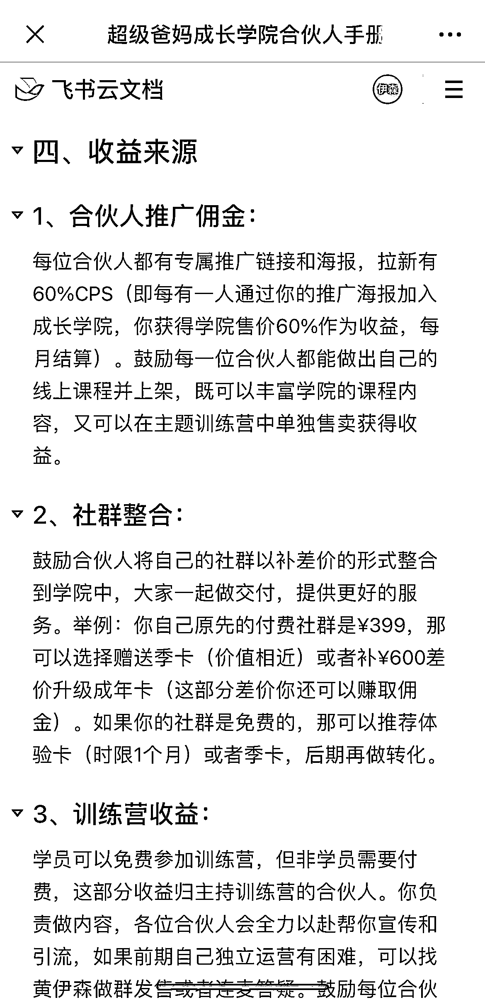
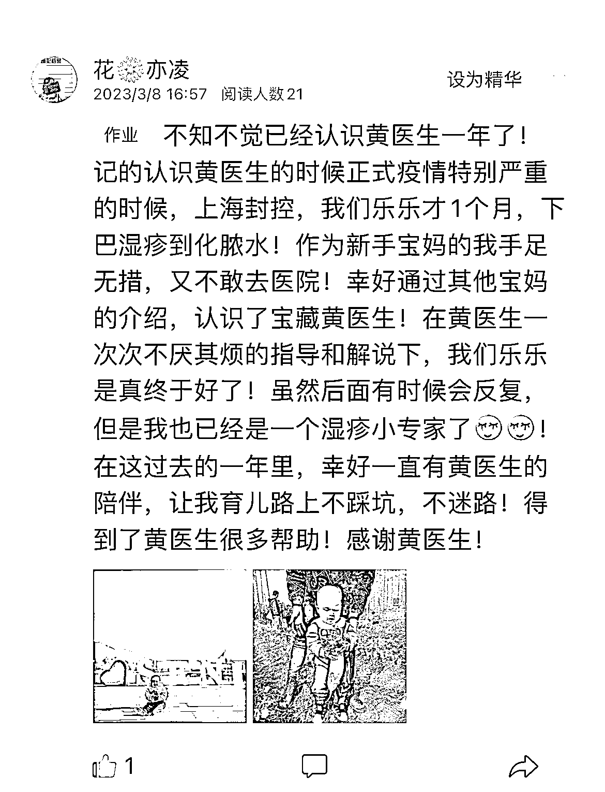
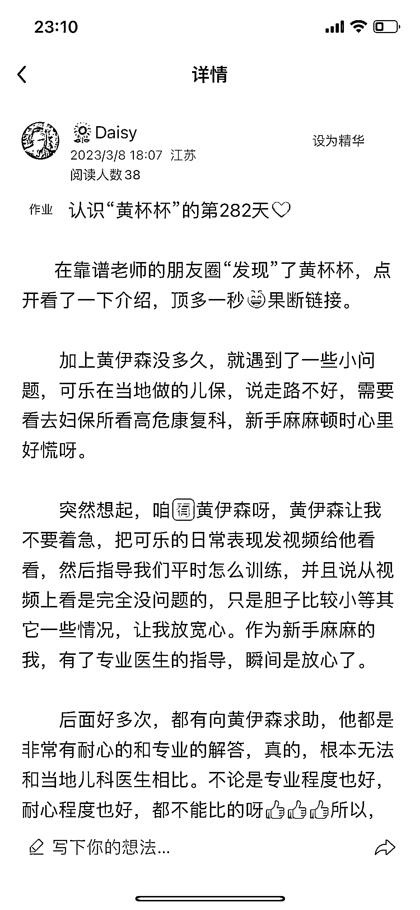

# 6.2.2 【案例二】付费社群：从 0 到 1 盈利十万的育儿社群 @黄伊森

**一位儿科医生的社群变现手记：从知识分享到母婴好物推荐**

**项目概览**

这个案例讲的是怎样借助育儿知识输出积累个人影响力，再顺着用户的实际困扰延伸出带货社群，最终打通两条收入路径：知识付费与产品销售利润。

**起步条件**

我本身有海外留学背景和儿科临床经验，最初尝试用短视频和图文内容切入自媒体。当时市场风向也在推着人往前走，社群这件事就这么被提上了日程。后来在龙哥盟日历共读群里，我摸到了社群运营的主线思路。真正跑起来之后，又从育儿付费社群的互动里嗅到了新的需求缺口，母婴好物群这才被孵化出来。

**1. 社群缘起与冷启动**

我的本职是儿科医生，所以第一反应自然是做宝妈育儿群。但说实话，建群之前我完全是个运营小白。于是我先去听了圈友@北大苏姐 的社群踩坑课，那堂课到现在我还记得清清楚楚。她从实战里总结的几个坑，我直接转述给大家：

• 第一，千万别碰免费社群！千万别碰免费社群！千万别碰免费社群！
• 第二，别搞群主一个人自嗨式输出，群里没人接话、没有互动，那等于白干！
• 第三，群规必须明确，而且执行要硬。规则的意义在于筛出同频的人，让大家待得舒服、留得下来。

大家都知道那个消费力排序：孩子＞女人＞宠物＞男人。所以育儿加宝妈这个组合，消费潜力大、变现天花板高，宝妈群向来是社群里头最热闹的。但运营稍有不慎，它就容易沦为闲聊加吐槽的集散地。

我理解的好社群，是能把一群人聚到同一件事上，让大家愿意泡在里面，每天有东西可学、有成长可感，而不是靠毫无意义的“刷活跃”撑着。

加入赚钱之后，我看到不少圈友在推赚钱日历、做共读群，把同频的人聚在一起交换认知、一起进步。这给了我启发，于是我把私域社群的主题定下来了：育儿日历共读群。群规就八个字——抱团取暖，互惠利他，保持同频，鼓励链接。做法上借鉴赚钱日历共读的形式，每天抛出一个育儿知识点，让群里的宝妈们天天有新内容可学，还能围绕这个话题聊起来。

**铁粉初代**

虽然这是个付费社群，但最早那批成员其实是免费的——是我门诊里的铁杆粉丝家长。我把他们请进来，当作第一批友军和基本盘。

他们在群内舆论引导上帮了大忙。另外，我每隔三四天就会找她们聊一聊，问问对分享内容和运营方式的看法。因为之前门诊积累的信任底子还在，她们给反馈特别坦率、特别实在。我听完就调整，调整完效果确实明显，内容分发变得更高效、更及时了。

**2. 提高曝光：连播 100 场，大力出奇迹**

在那之前，我没有任何互联网产品销售经验，说白了一个纯素人。记得有一次，我的自媒体合伙人@梁靠谱医生 在她的赚钱日历共读群里说过一句话：互联网素人要出头，一是靠持续的内容输出能力，二是要有自己的互联网标签。

加入赚钱后，视频号直播正火，我又看到粥左罗老师搞连续直播 100 天挑战。当时我就想，我能不能也发起一个属于自己的连续 100 天直播挑战？好处有三个：

• 第一，连续直播本身就是内容社群的持续输出，能稳住活跃度、保障内容质量，同时让更多人看见我们，扩大社群影响力和规模。
• 第二，连播能逼着自己提升直播能力，包括直播间运营、互动、带货。后面有新产品上线，直播间就是现成的成交场。
• 第三，100 天挑战完成后，我能拿到一个属于自己的互联网标签。以后可以跟人吹：我是第一个完成连续 100 天直播挑战的儿科医生，哈哈。

从克服惰性，到学怎么播，到保证交付内容，再到请其他领域的大咖帮忙交付——100 场直播跑下来，社群从 63 人涨到 401 人，门票从每人 36.5 元提到 76.5 元（每满 100 人涨 10 块）。社群影响力在往上走，个人 IP 也在不断加固。

**3. 变现：及时孵化新社群，但保持原有社群功能稳定**

宝妈群体的消费力毋庸置疑，婴儿用品占了大头。但市面上产品多如牛毛，智商税也不少。从儿科医生的专业视角出发，帮宝妈们看成分表、筛出靠谱实用的育儿产品，让她们少踩坑、少交冤枉钱——这个点非常抓人。

直播过程中，不少育儿电商平台来找我谈合作。经过沟通和筛选，我锁定了一家我认为靠谱的母婴用品平台，新开了一个“伊森严选母婴好物群”，主推有专业背书、实用靠谱的母婴产品。

目前销售额已经超过 10 万，我个人佣金也拿到了一万多块——这还是在上海疫情期间物流严重受限的情况下跑出来的数字。销售额算不上多高，但我信一件事：任何 100 万都是从第一块钱开始的。随着口碑和影响力继续累积，增长绝不会是线性的。

**4. 突破瓶颈：由低转高，客单价涨了 15 倍**

社群运营到一定阶段，就得挑准时机迭代升级，从低客单往高客单走。我做了五件事：

**第一，挖需求。** 社群在长，成员的需求也在长。要敏锐地捕捉需求变化，甚至去挖潜在需求，依据这些去升级产品，客单价才有可能往上抬。最开始这个育儿社群就是个低客单价引流品，和很多育儿群一样，我一个人包打天下，群里所有问题、分享全是我来。临床干了这么多年，九成问题我能搞定。但社群一大，你就会发现：一个儿科医生再全面，也覆盖不了儿童健康的全部领域。现在宝妈对孩子健康的关注早就超出了看病——喂养、睡眠、儿保、视力、口腔，全都算。再往深了挖，宝妈自身的需求也是增长点：产后康复、女性成长、宝妈副业，都可以做。

**第二，搭“小而全”的团队。** 发现新需求却搞不定，怎么办？我的策略是：放下创始人 IP 执念，找同行当医疗合伙人，组一个“小而全”的班子。医生这行特殊，不光要专业过硬，还得有互联网思维和商业思维，愿意在网上输出专业知识，跟得上节奏，能一起运营社群、打磨产品。比如发现孩子们有眼科、口腔、睡眠、喂养、身高这些需求时，我就会在各个社群里留意合适的同行。碰到候选人，先请他来做个直播连麦或者图文分享，借这个过程观察他的专业能力和互联网输出能力。筛完之后，我最终敲定了 6 位医疗合伙人，覆盖儿童心理、喂养、睡眠、口腔、眼睛，以及宝妈产后妇科问题。社群的护城河就这么被挖深挖宽了。

**第三，分工明确，舍得分钱。** 合伙人团队定下来后，我写了一份合伙人手册，把每个人在社群里要输出什么内容、什么时候该做什么事，写得清清楚楚。手册里也列明了赚钱渠道。利润分配上我的原则是“进四出六”——大头给合伙人。大家有充足动力去拉新、做服务、去成长，这个团队才有凝聚力。

**第四，体验卡制度。** 做知识付费的人最烦那种伸手白嫖的。但社群升级时，我设了个体验卡：不了解我们的新用户可以免费体验 28 天，期间无限次提问，还能参加实操训练营。28 天免费，到期觉得服务不值，分文不取，直接退出。为什么敢这么干？因为我们是育儿社群，做的是长期陪伴型服务。28 天对宝宝来说很短，我们只是给宝妈一个机会，去了解这个有专业团队的、不一样的社群。我们不担心被白嫖——她体验过专业服务之后，我们相信 28 天后她会选择成交而不是走人，因为别处找不到这样的育儿社群。这点信心我还是有的。而且付费用户本来就是双向筛选：如果宝妈的育儿理念跟我们实在不合，我们也会劝退。28 天后好聚好散。

**第五，借周年庆造共同回忆。** 3 月 8 日正好是社群运营一周年。我在育儿星球开了个会员日抽奖，参与方式是写一段这一年里跟黄医生社群的故事，再晒一张宝宝照片，就能参加抽奖。目的就是造共同回忆，同时让宝妈们提供正反馈和宣传素材。效果不错，收了一堆真情实感的好评，都是真实发生的故事。这些素材可以反复用在朋友圈和社群升级的过程中。

内容来源：《从 0 到 1，我是如何打造出盈利十万的育儿社群的？》

