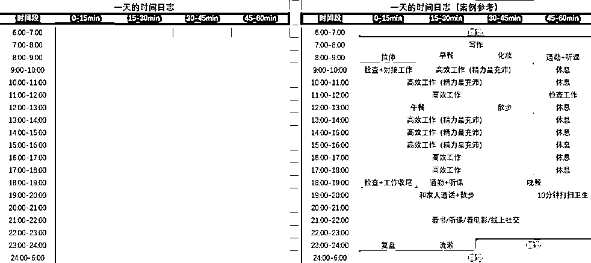

# 2.4 用一份日志，管好你的24小时

前面已经聊过记录、复盘，也讲过怎么分配时间。接下来别只停留在理解层面，直接动手给自己建一份时间日志：时间管理，就从记录和复盘起步。

第一步：把时间记录下来

可以下载块时间 App 来帮忙记录，也可以直接用工具包里的时间日志表格，为之后的整体复盘提供依据。时间日志模板下载：《时间管理 | 实战工具包》

时间日志表格长这样（概览）：

第二步：调整时间安排

时间日志做好后，结合记录下来的内容，完成下面这个小练习，让时间分配开始初步优化：

💡 模板参考

第一步：把一天的24小时按【基础—蓄能—创造】来分类，逐项写下来：
1、基础：
2、蓄能：
3、创造：

第二步：我的时间安排，可以从这些地方调整：
1、
2、
3、

再写一句给自己的打气/鼓励：

参考示例：把一天的24小时按【基础—蓄能—创造】拆分时，我的事项包括：
1、基础：睡觉、三餐、洗漱、歇息、通勤、打扫、化妆、与妈妈通话
2、蓄能：阅读、散步、拉伸、看漫画、刷微博、联系朋友
3、创造：做规划、IP、引流、产品、内容、运营

我的时间安排可以这样调整：1、人际连接安排得偏少，计划每天上午11:30—12:00主动联系一位朋友；2、入睡时间由12:00提前到11:30；3、起床后到10点固定为产出时段。

送自己一句打气的话：稳住节奏，反而走得更快。

你也可以在工具包表格的第二个子表格里找到这份模板，下载后直接用：《时间管理 | 实战工具包》

