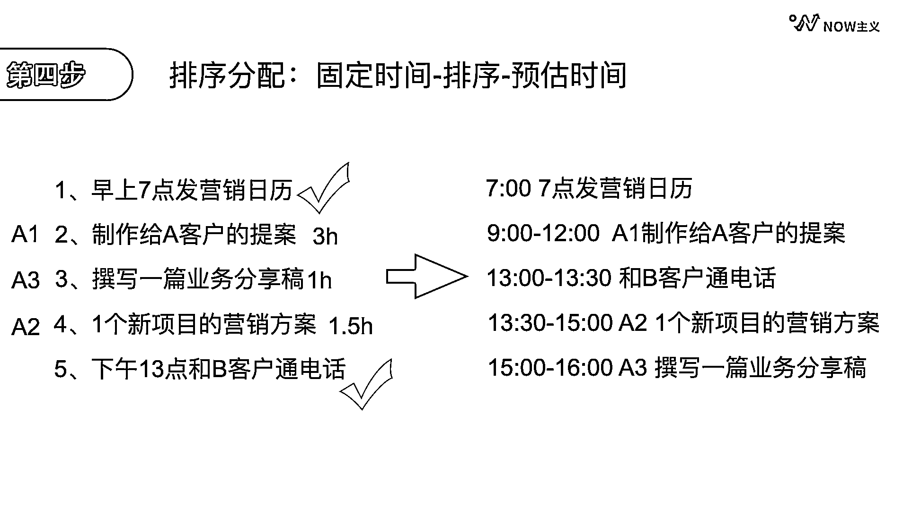

# 3.1.4 第四步：排序分配——先安顿时间，再排优先级

每天手头既有例行公事，又有不断冒出来的新任务，堆在一起常常让人犯难：到底先做哪一样？

办法其实很简单，分三步走：先把时间固定的事安排好，再比较各项任务的重要程度，最后按预估耗时排进日程。

举个例子。我某天共有5件事：早上7点要发营销日历，下午1点要跟B客户通电话，另外还要做一份客户提案、写一篇业务文章、给新项目出营销方案。因为时间是硬性条件，我先把两个有固定时间点的事项列出来：7点发日历，以及1点到1点半的客户电话。剩下三件事，我按重要程度标成A1、A2、A3，并预估耗时分别为3小时、1.5小时、1小时。A1最关键，放在上午9点到12点；A2安排在1点半到3点；A3放在3点到4点。

计划排好后，难免还要应对新增事项：突发紧急状况、计划外事件，或是产生干扰但算不上重要紧急的事。这里要特别提醒：新增事项未必都得自己做。判断下来不是自己该做的，可以果断拒绝；可以交给别人的，就授权出去。确实需要自己做的话，2分钟内能办完的，顺手就办了；2分钟搞不定的，先记入事项清单，和其他待办一起比较，看是立刻处理还是换个时间再做。

这样一来，工作里的事件就能分成A、B、C三类：

- A类：确定必须亲自执行的重要事项，属于计划内安排，包括重要紧急和重要不紧急。
- B类：突发的紧急情况或计划外紧急事件。
- C类：其他时候冒出来、对内外形成干扰，但既不重要也不紧急的事件。

分类之后，处理顺序可以参考这些原则：优先确保A类事项得到执行；B类事项记录后推迟或委托出去，能不自己做就尽量找人做；C类事项不做，只在文字上留个记录。

第二个要记住的观念是“高能要事”：每天都要让A类要事在高能量时间段执行。一个人的效率高峰通常在早晨醒来后的2-3小时；就我个人而言，上午9点后的1-2小时和下午2点后的1-2小时，精力最集中。如果几件A类事紧急程度差不多，我会把最难的那件放到这些时段；如果某件事很紧急，那就先处理紧急事项。

会不会有两个任务实在分不出优先级？其实不会。只要把它们放在一起比较，总能分出哪个更重要。把当天要做的事情全部列出来，先做什么后做什么，往往一目了然。

当然，高能时刻因人而异，有人觉得深夜才是思路最清晰的时候，所以可以根据自己的状态灵活调整。

内容来源：《高能要事：如何通过时间分类来提高时间管理效率》

