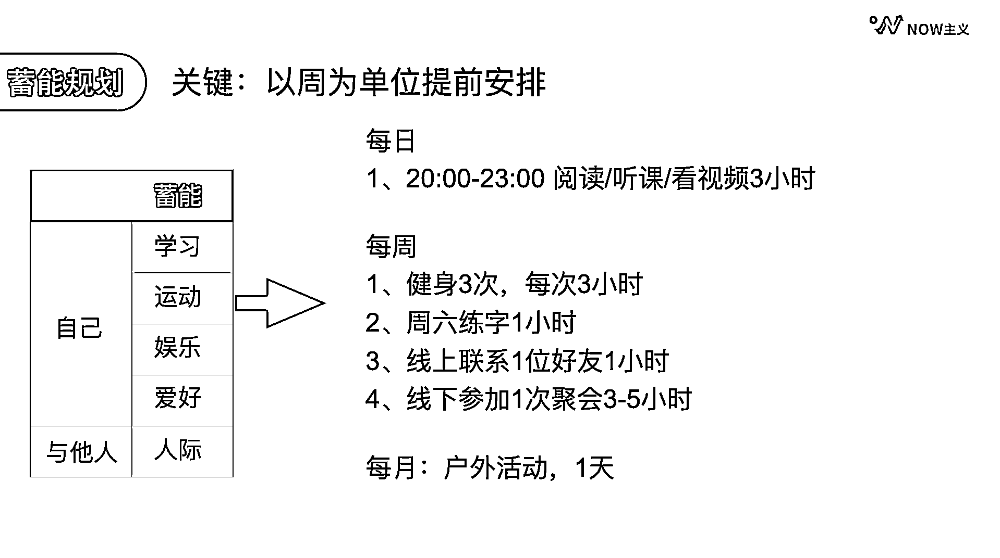

# 5.2 规划三步法

蓄能安排其实可以拆成三个动作：先列计划，再估耗时，最后按周提前排好。

拿我自己举例，我的蓄能时间覆盖学习、运动、娱乐、爱好和人际。规划时，我会先把每类想做的事逐项写下来，再给每件事估个时间。比如：

学习：读《影响力》大约要 8 到 9 小时。运动：健身 3 次，每次 2 小时，再加上往返和清洁各 1 小时，合计 9 小时。娱乐：看一部 2 小时电影、一部 30 分钟纪录片，每天还想刷 15 分钟漫画和 30 分钟🧣。爱好：周末留 1 小时练字；如果有一整天以上空闲，就安排爬山或徒步。人际：每周线上联系一位朋友，并安排一次线下社交。

很多人也遇到过类似情况：午饭时想边吃边看综艺，电脑打开挑了许久，饭都吃完了还没选好；或者晚上好不容易有空想读书，翻来翻去找不到要读哪本，时间就这样溜走了。

所以做计划时，要把具体读哪本书、看哪部电影、做哪种运动提前定好，别让临时选择消耗时间。

我的常规蓄能时间可以这样排：

有了这个基础模型，后面的蓄能安排就能照着参考。

