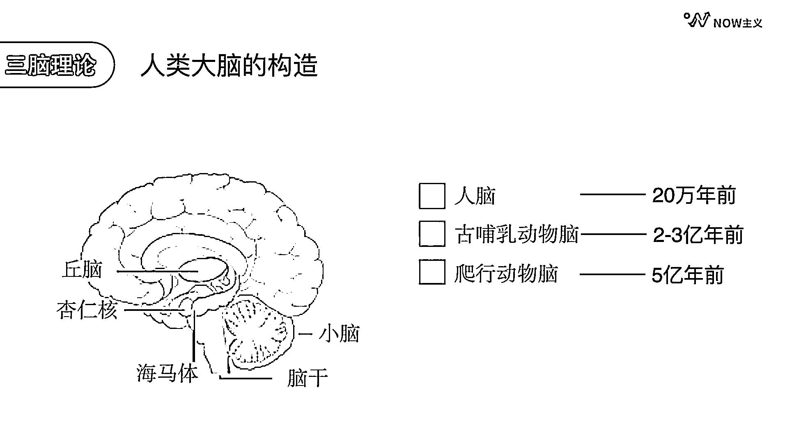
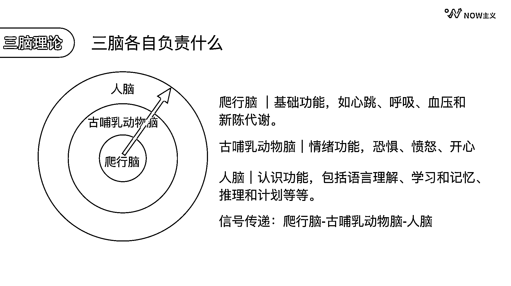

# 8.1 情绪到底从哪里来

你有没有过这样的经历：明明想好要冷静处理一件事，可一旦情绪上头，理性瞬间被抛到九霄云外。其实，几乎每个人每天都会被情绪困扰。这背后藏着什么秘密？答案藏在我们大脑的进化历程里。

大脑不是一天长成的。最里层的爬行动物脑，早在5亿年前就出现了；包裹它的古哺乳动物脑，诞生于2到3亿年前；而最外层的人脑，直到20万年前才形成——这就是流传甚广的“三脑理论”。虽然到了2023年2月，情感神经科学领域的最新研究已经指出，这个理论因为过于简化而不够严谨，但用它来理解情绪与理性的基本关系，仍然非常直观。因此，我们不妨借用这个极简模型，来搞清楚负面情绪是怎么来的，又该怎么应对。

这三层大脑各司其职。最内层的爬行脑，管着心跳、呼吸、血压和新陈代谢这些生命基础；中间的哺乳动物脑，负责恐惧、愤怒、喜悦等情绪反应；最外层的人脑，则承担语言理解、学习记忆、推理计划等高级认知功能。

大脑里信号的流动方向，是从里到外的：爬行脑先活动，接着是哺乳动物脑，最后才是人脑。把三层功能简化一下，就是：最里面管生理，中间管情绪，最外面管理性。这样的结构决定了，我们的情绪总是先于认知产生，而且情绪对我们的影响力，远远超过理性判断。更关键的是，这是生理结构决定的，人人都一样，谁也躲不开。

既然情绪无法避免，那怎样做才能让情绪更稳定呢？

