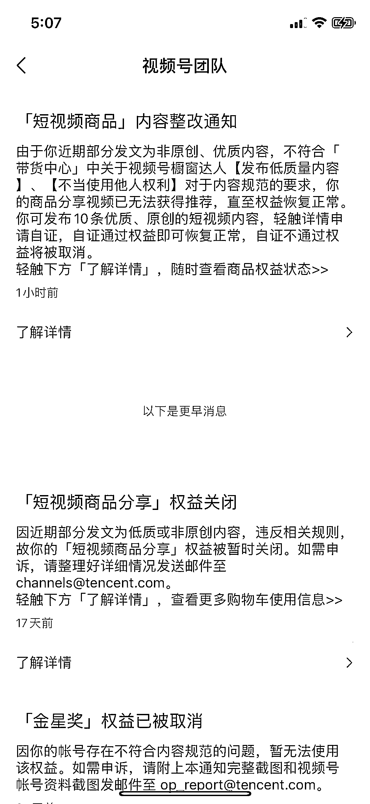

# 1.1 视频号：红利还在，门槛高了

先把结论摆在前面：视频号已经走过了前两年“进场就分钱”的阶段，平台正在转向规范化运营，规则更细、审核更严，整体体系也在补全。换句话说，靠运气和简单操作吃流量的窗口正在缩小，真正拼内容、拼执行的时候到了。

回看规则变化，节奏很清楚：
- 2022年3月至5月，搬运内容就有机会做出爆款，无人直播、半无人直播、店群铺货等玩法都能跑；
- 2022年6月至8月，基础混剪仍有爆款机会，但平台对无人直播收紧，半无人直播常被判定低质量，店铺端也开始治理刷量和重复铺货；
- 2022年8月以后，搬运和混剪更依赖速度与技巧，店铺还要满足门槛才能进入流量池；
- 2022年11月，新号扶持周期被压缩，🛰️小商店中的第三方后端店铺（有赞、爱逛、魔筷、微盟、微店等）开始被清理；
- 2022年12月1日起，带货商品只能来自「优选联盟」，也就是视频号小店体系；
- 2023年1月，店铺评分体系和达人橱窗评分体系上线，后续评分会直接影响带货流量和选品资格；
- 2023年2月，商品要求更严格，审核周期变长，平台也加大了对原创视频的审核与扶持；
- 2023年3月，直播间可直接跳转企业🛰️和🛰️客服，转化链路缩短；
- 2023年4月，预约领券功能的开放范围调整，「优选联盟」的准入与清退规则更新；
- 2023年5月，群视频号进入内测，🛰️群可以开通群视频号，社群与视频号开始打通。

到了现在，单靠搬运已经很难获得正反馈。想拿到不错的播放和收益，二创、原创才是更现实的方向。目前短视频带货的主流路径是：先选品，再做视频，视频跑出爆款后开直播承接成交。

提到直播不用紧张。第一，不直播、只靠视频把用户引到橱窗成交的玩法一直存在，只是转化率不如直播高；第二，视频号直播转化并不复杂，不需要豪华直播间，能简单回答商品相关问题就可以，上手难度不大。

规则逐步完善，内容审核力度也在加大。辛苦做出的视频发出去是0播放，别急着失望，这很正常，继续打磨下一条作品就好。在当下，愿意投入时间就有较大概率换来不错回报的项目并不多，视频号算一个。

尽管门槛抬高，视频号仍有三个红利值得关注：
- 流量：它的标签精准度和稳定性不如抖音，但新号起流量、拿初始曝光仍相对容易；
- 利润：抖音多数赛道竞争激烈，而视频号同类商品价格常能比抖音高出1至3倍；
- 人群：三四线城市居民和中老年用户上网经验相对少，信任感更强，退换货比例也更低。

另外，圈友@盗坤是最早进入视频号的一批人。他在2022年7月对当时的视频号局面做过一次分析，态度中肯、判断客观，原文题为《视频号带货的真实世界》，值得一看。

内容来自3月3日@李诚 Sonic 的《如何在视频号平台高效做带货》，以及《2023 如何玩转视频号带货》@李诚 Sonic。

