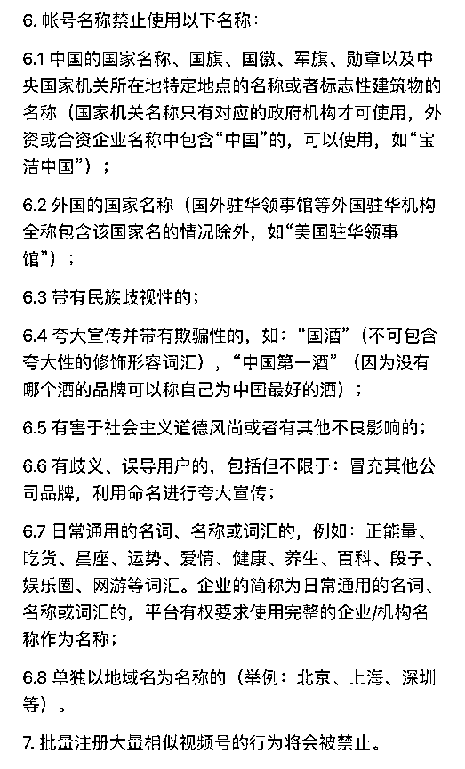
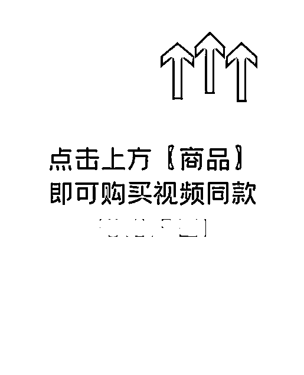
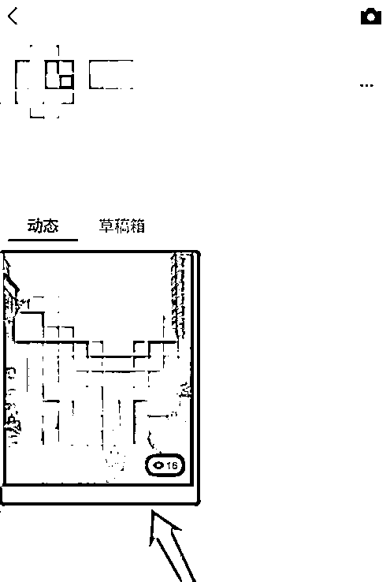
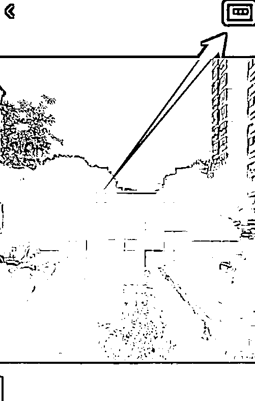
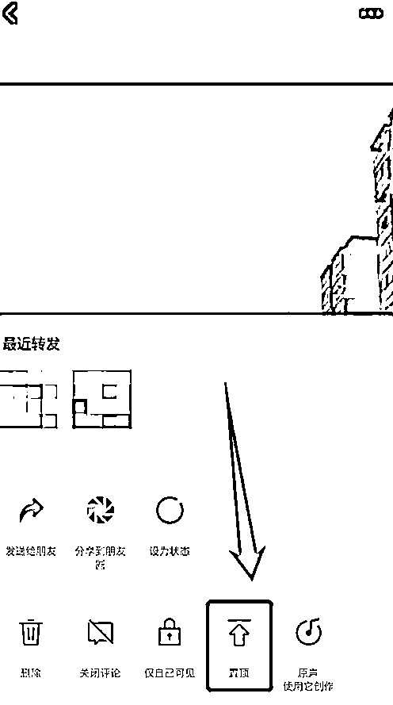

# 2.2.2 账号包装 4 个细节

想让别人更容易搜到你的号、记住你的号，并在看完内容后愿意下单，前期的包装不能省。下面 4 个细节值得逐一检查。

1. 名字：先定方向，再取名字

先看官方对账号命名的提醒：

起名前先想清楚，这个号到底要做什么方向。名字起得好，别人搜索相关词时你会更容易被找到。

把几个与领域相关的词拼在一起，是常见的起名方式。比如做国学、书籍、认知的方向，可以借用这些词的元素。因为用户搜索这些词时，名字里正好带着它们，被搜到的概率自然更高。

顺口好记的名字大多已被注册，注册前尽量把备选名字列得多一些，挨个试。

每年可改名的次数上限是 5 次。没有灵感时，参考其他平台同类创作者的取名方式，或者先用通用名，比如【xx - 同款在橱窗】。

@麦洛 也提醒，改名机会有限，最好先用通用昵称，比如「xx-同款商品在橱窗」。

以上名字相关内容来自《视频号带货建议指南》。

2. 头像：好认，才容易被记住

头像的职责，是让用户留下印象。它可以直接用文字（比如名字的简称），也可以把文字与图片结合。不知道怎么设计，去参考你所在领域头部账号的头像风格。

做图可以用图怪兽、可画、创客贴这类的在线工具，也能找免费可商用的图：

•图怪兽：[`818ps.com/`](https://818ps.com/)
•可画：[`canva.com/`](https://canva.com/)
•创客贴：[`www.chuangkit.com/`](https://www.chuangkit.com/)

注意别用带商标、有侵权风险的图；个人照片也尽量别当头像，否则用户看不出你是做什么的。

3. 简介：把购买路径写清楚

简介随时能改。入口是：进入自己的主页，点头像，再点右上方 …，然后再点头像，就能看到简介修改处。文字尽量控制在 3 行以内，超出部分会自动收起。

简介要跟着内容方向走，不知道怎么写就参考成熟大号的套路。以卖货为主的号，简介里最该写清楚的，就是怎么买，例如：同款视频在👇🏻下方【商品】栏下单。

🛰️方面，留与不留都行。想留的话，即使平台属于腾讯，也建议用含蓄的写法，可以这样写：'+v：'、'更多 xx 联系领取：'、'商务合作请联系：'。但起步阶段先别放，避免被举报；等号有了一些粉丝再公开。另外，把用户引到🛰️再成交，既低效又费精力，一开始不值得把时间搭进去。

4. 置顶：让好内容留得更久

等你的号有内容之后，再来做这一步。一个号的主页顶部最多固定 2 条视频，顺序怎么放，也有讲究。常规安排是：第一条放数据表现好或者紧跟热门话题的内容，第二条放你最有信心带去转化的卖货视频。

以卖货为目标的话，还能在顶部加一条演示购买流程的教程，让新访客一看就会。

[p.mp4](https://search01.shengcaiyoushu.com/upload/doc/U4hgduUC2oyyl6xt72rcuxnDnEg/Cq0YbZSc3oj82hxuEUccpfn8nCd)

置顶方法并不难：进入视频的播放页，点右上方【···】，在弹出菜单里选【置顶】，就完成了。

以上内容来自《8 月初阶视频号航海实战手册》。

