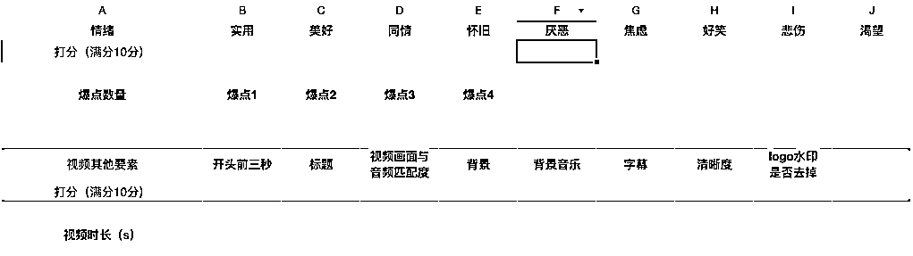

# 5.1 短视频爆款怎么打

做短视频，想提高出爆款的概率，可以从四个方向入手。

1、追热点的底层逻辑

平台通常会给热点内容更多流量扶持，用户也天然爱看热门话题。如果一时找不到追热点的方向，直接刷抖音热榜就行，哪个话题热就跟哪个。

2、爆点越多，越容易出圈

所谓爆点，就是能推高视频热度的抓手。一条视频里爆点越密集，冲上热门的机会就越大。

3、前三秒定生死

短视频的开局三秒就是黄金窗口，必须一上来就锁住注意力。如果前三秒没留住人，用户又凭什么把整条视频看完？三秒之后，故事要持续勾住观众，让他们愿意一直看下去；到收尾几秒再把情绪推到高点，促使大家转发和评论。

拿一个曾上推荐的视频做拆解：这是参加视频号小航海后第一次拿到推荐的作品，很典型，也很有纪念意义。后来我其他账号里不少点赞10w+的视频，底层逻辑和它一致。

热点思维方面：

阿里巴巴被罚182亿，当时在各平台都是大热门，曝光量极高。

爆点丰富度方面：

第一，阿里被罚182亿本身是热点事件，天然带爆点；
第二，马云自带知名度与关注度，也是爆点；
第三，内容讲“公司越大压力越大”，容易被听成辩解，评论区自然会有争论；
第四，背景音乐营造紧张感，把情绪带起来；
第五，下方标题设置了疑问，引导大家在评论区回答。

黄金前三秒方面：

第一，视频上方用标题让用户秒懂事件，并重点展示“被罚182亿元”，用户一进来就被抓住眼球；
第二，开头直接出现马云，前面说过，马云也是爆点。

4、用打分表判断爆款潜力

新手如果拿不准作品成色，可以参考下面这张表给自己的视频打分；通常分数越高，成为爆款的概率越大。

