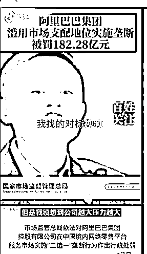

# 5.3.1 爆款视频，这样拆才有效

锁定值得模仿的同行后，下一步就是把对方跑出高流量的作品逐一拆开来看：画面呈现、脚本措辞、标题设计、配乐选择、评论区反馈……能分析多细就分析多细。只有拆得足够细，才更容易还原它走红的真正原因，再把这些经验用于复制。

下面用我们过去研究过的一条同行作品做示范，看看它为什么能火。

1、画面与内容层面

“阿里巴巴被罚128亿元”在当时是刚出现的大热点，新鲜度很高。热点本身就容易获得平台推荐和用户关注；而阿里巴巴集团也自带流量，任何动态都容易引发围观。画面中出现了马云，他同样具备话题度。再加上128亿元这个罚款金额足够震撼，很多人也乐于看到原本高高在上的对象突然受挫。

2、配乐选择

它采用了紧张、带情绪推动感的配音，而且属于新闻内容中常见、热度较高的那类声音。

3、评论区反馈

留言几乎都围绕马云和淘宝假货展开，有调侃，也有激烈指责。由此可见，马云与淘宝仍然是具备二次加工空间的话题。

