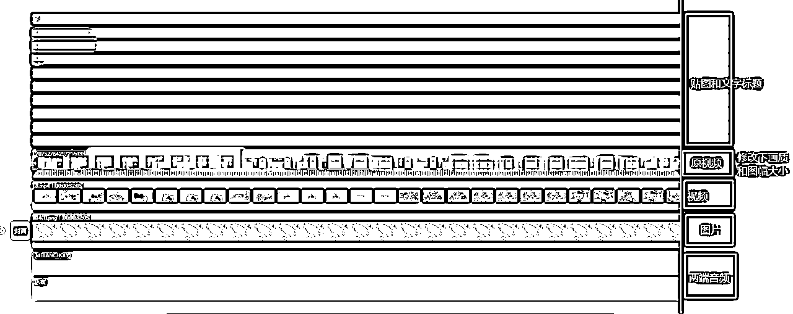
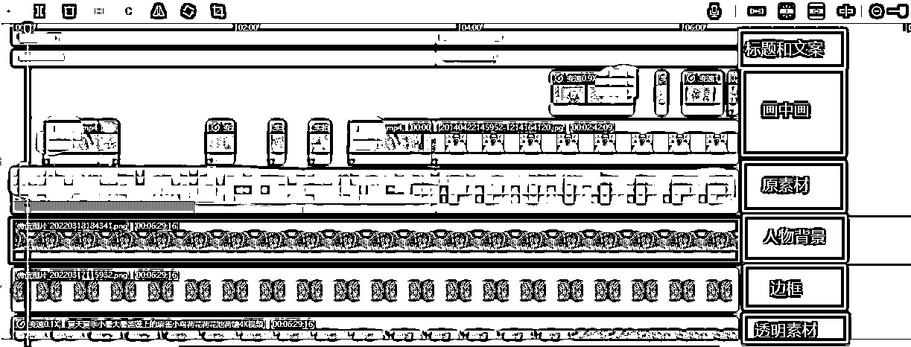
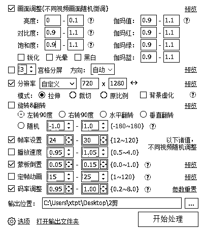
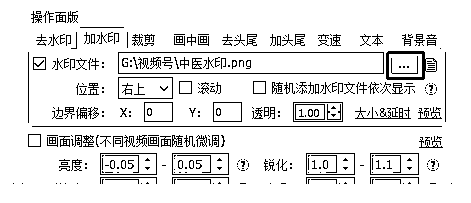
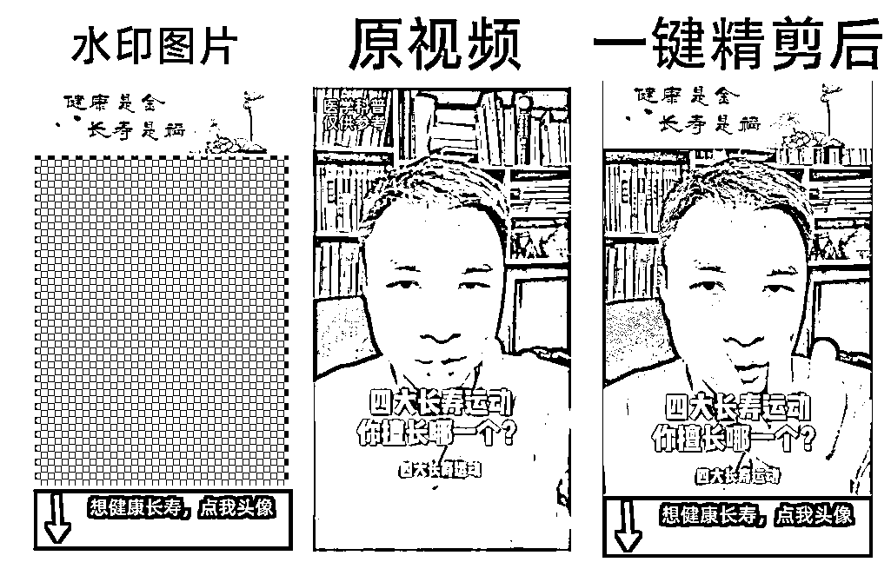
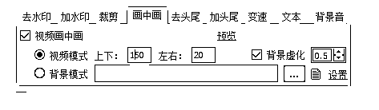
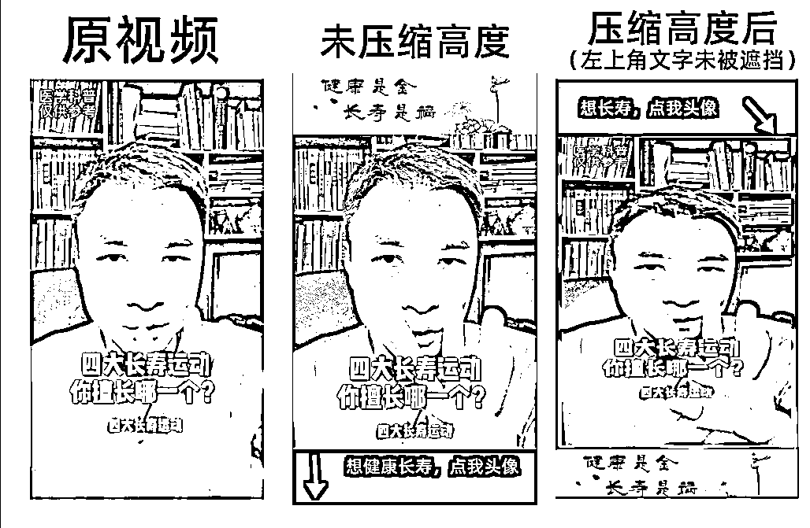

# 5.4.2 模板搭一次，后续剪辑更省时

先以剪映电脑端为例：把原视频的水印处理掉，再导入剪映做二次加工。具体可以组合“一段视频画中画＋一张图片画中画＋四个贴图素材＋两段音频”，再把标题重新处理一遍，用这一套操作完成二剪与去重。

也可以照着下图思路来二剪：让原视频充当背景图，把其他素材叠加到背景图上方，再配上画中画、边框、贴图和音频等内容，同样能完成二次剪辑去重。

内容来源：《8 月初阶视频号航海实战手册》

模板搭好之后，后面做视频的效率会明显提高。除了这种方式，圈友 @figo 还分享了另一套做法，专门讲怎么批量去重、批量产出内容。这里只摘录一部分，完整内容可查看《如何剪辑视频和制作剪辑模板》。

1、先借助 CRVideoMate 完成基础混剪，参数支持自行调整，具体如下。

2、制作水印 PNG 图片，再调用软件自带的水印工具。

↓加水印后的效果见下↓

3、如果直接加水印会挡住原视频的关键区域，可以把原片高度压低，参数如下。

注意：这里的“上下数值”高度应不小于水印图案的高度，画面才不会被水印遮住。我填的是 150，大家可以根据实际需要调高或调低。

压缩后的画面效果见下↓

PS：该软件可以制作多款水印，做到同一品类配同一张水印，还支持导出参数，方便适配不同剪辑类型。

CRVideoMate 下载地址：[`www.cr-soft.net/crvideomate.html`](http://www.cr-soft.net/crvideomate.html)

内容来源：《利用批量剪辑软件 CRVideoMate，一键完成视频号精剪去重，可带个性化图案》

