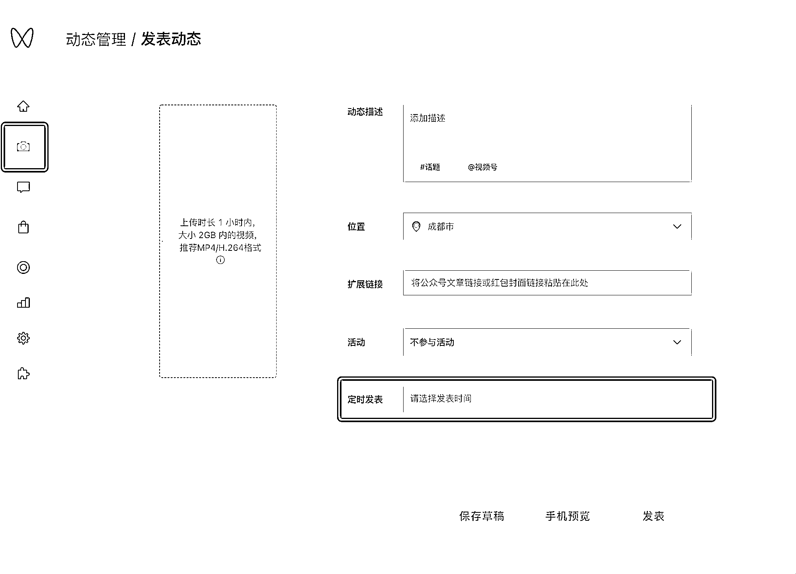

# 6.2 视频号电脑端发布，这三个优势别错过

除了在手机上通过 App 发视频，你还可以用视频号助手来完成。电脑浏览器直接打开 `channels.weixin.qq.com/` 即可。相比手机端，这种发布方式有几个明显好处：

1. 支持定时发布，不用守在手机上等时间；
2. 可以绑定视频号运营者，多人协作更方便；
3. 处理视频评论更轻松，后台操作体验更高效。

定时发布怎么用？

举个例子，某个账号一天要发 10 条视频，计划每隔 1 小时发一条。如果同时管理好几个视频号，还在手机上一条条手动发送，不仅费时费力，还容易出错。这时候只要把 10 条视频都传到视频号助手后台，再统一设置好发布时间，系统到点就会自动发送。短期、少量地使用定时发布，平台并不会区别对待，视频分发和播放流量都不会受到影响。

需要特别留意几点：

- 电脑网页端发布和 App 发布效果是一样的，流量没有差别。
- 话题一定要加，很重要，真的很重要。
- 一个账号每天发 10 条左右就差不多，别发太多，间隔也别太近。

