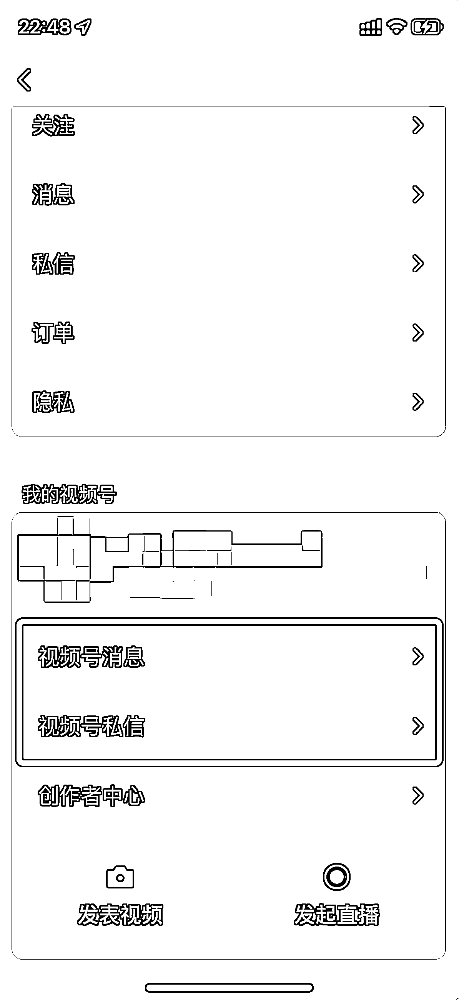

# 6.3.1 评论、私信、打招呼，这样回才有效 @麦洛

来自用户的每一条评论、私信或招呼，都值得你认真回应。但回复的重点不是聊天，而是把对方一步步引向“下单”。所以，要紧扣他们提出的问题去答，别自顾自说一通。

偶尔碰到一两条不友好的评论，也别往心里去，更不必在评论区吵起来。吵赢了口舌之争，也不会带来一分钱收入；真正能让你赚钱的，是持续精进、踏实做事。遇到这种评论，你可以选择不理会、直接删除，或到视频号助手里把它设为“精选评论”，这样就不会被公开展示。

内容来源：《视频号带货建议指南》

