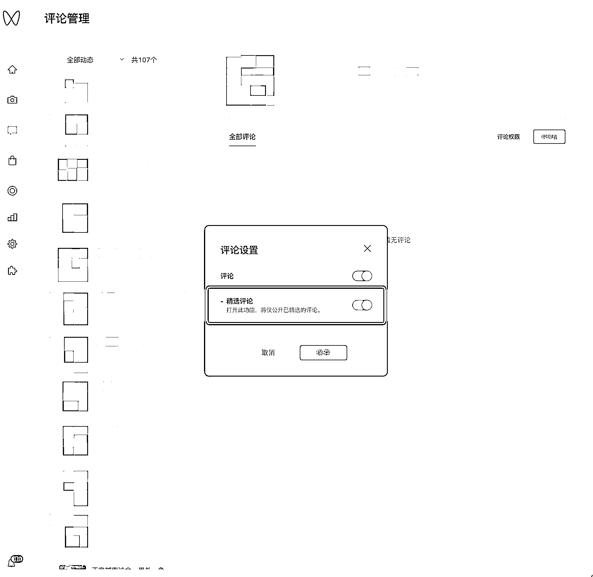

# 6.3.2 多账号评论管理，这个方法很省事 @麦洛

比如你正用手机做着直播，或者频繁切换账号觉得很麻烦，但依然想通过评论回复，把观众引到橱窗去下单，那就不妨试试“绑定视频号运营者”功能，把几个账号的评论统一起来管理。

如果评论里混进了不少负面声音，你还可以打开“精选评论”，只放出那些你希望其他人看到的内容。

这个操作其实很简单。视频号助手里还有其他功能，可以自己慢慢摸索。发布视频时，把发布间隔时间适当拉长一些，一般就不会有问题。

如果视频完全没有播放量，也就是0播放，背后的原因可能不少，像是账号被判定成营销号，或者视频内容已经被搬运过。可以一步步来排查：

- 用同一个视频号发点别的内容，如果有流量，那说明是视频内容本身的问题，换一条内容就行；
- 如果这个账号发什么内容都没流量，就说明问题出在账号上。换一个账号发同样的内容试试，如果新账号有流量，那就直接把原来的视频号注销掉。

从最近大家的反馈和实际经验看，官方对搬运视频的处理越来越严格。这部分我们在后面的“6.6 零播诊断及解决方案”里再展开细说。

内容来源：《视频号带货建议指南》

