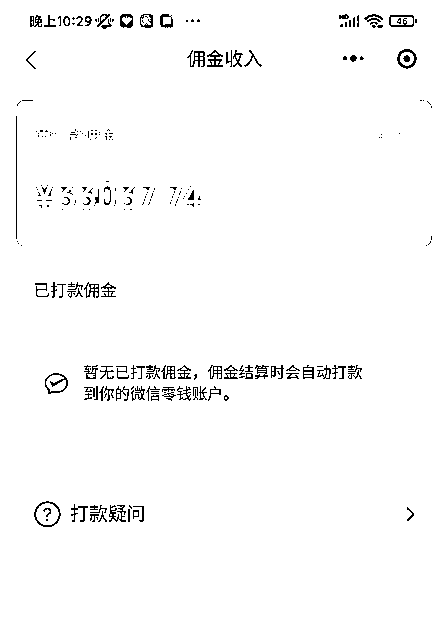
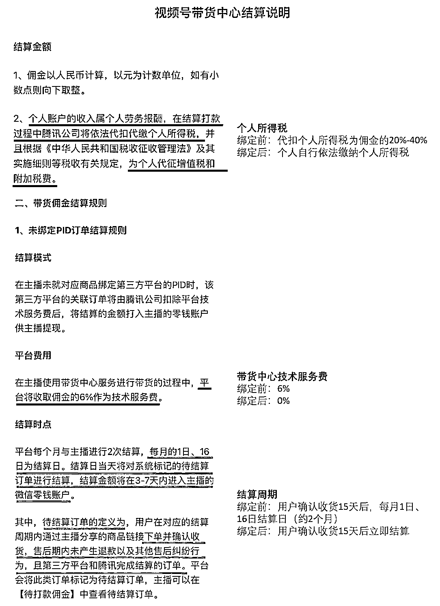

# 6.8 带货收益去哪核对？

想查视频号带货收益，操作入口这样找：先进入创作者中心，点开“带货数据”，再选择“今日数据”，佣金信息就能看到。

不过，提现环节会收取手续费，而且不同商品渠道的费率并不一样：

- 小商店联盟按6%收取；
- 小商店导购同样是6%；
- 爱逛为16%；若已绑定爱逛小店，直接到爱逛小店发起提现，则按10%计算；
- 魔筷为6%—10%，并且需先缴纳990元才具备提现资格。

另外，目前打款日期并不完全固定，各渠道的提现周期也有差异，具体规则可参考这份官方说明：[《小商店带货结算规则 | 🛰️开放社区》](https://developers.weixin.qq.com/community/business/doc/00064631af05c0783d8b3e9955b00d)。

要是带货数据表现不理想，就需要思考如何优化和迭代；这部分会在「八、如何优化内容」中详细展开。

