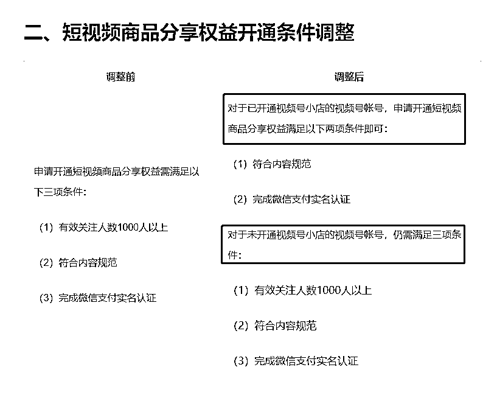
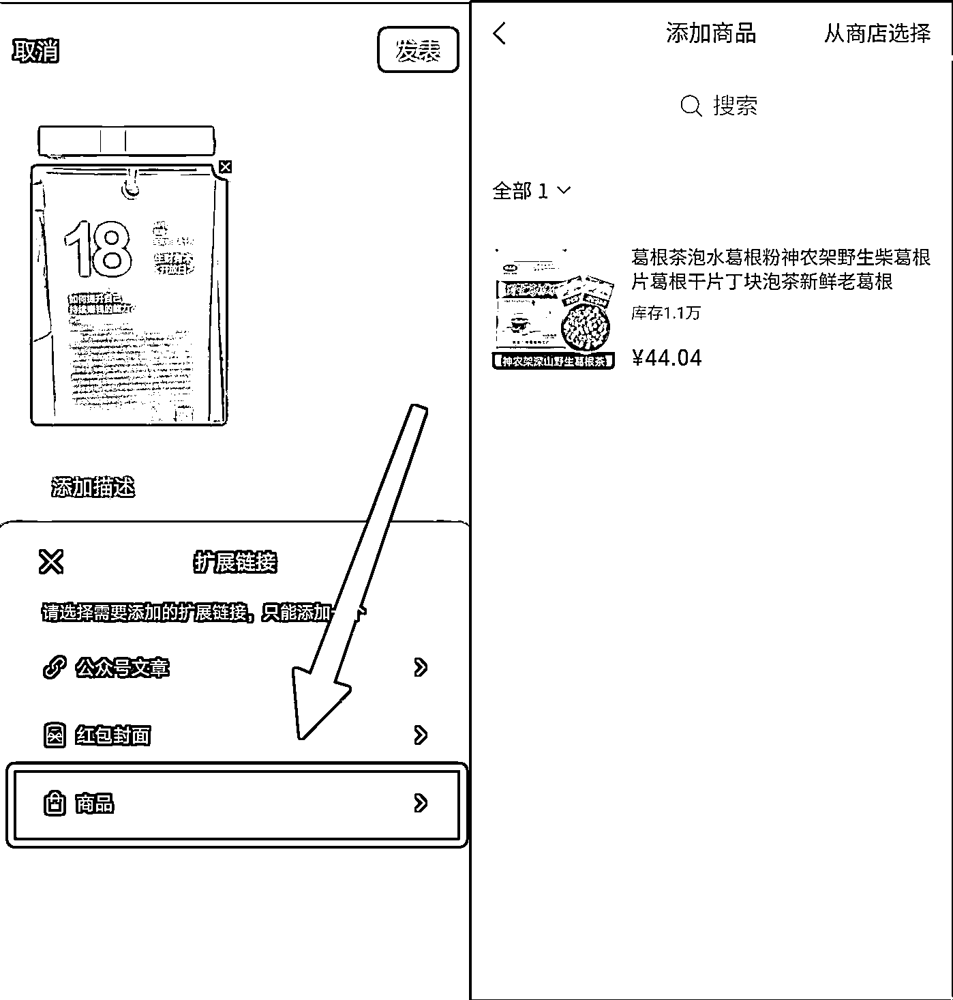

# 7.2 视频带货：商品链接怎么挂

给视频挂商品，眼下主要有两条路可走。

**路径一：直接挂商品链接**
需要先说明的是，现在不能再绑定小店了，只能从选品中心挑选商品。

**路径二：用购物车挂橱窗里的商品**
发视频时通过购物车带商品，首先要解决的就是购物车权限。视频号对账号开放购物车的规则已经做过调整，具体可查看[《视频号短视频商品分享权益、加热商品功能调整公告》](https://support.weixin.qq.com/cgi-bin/mmsupportacctnodeweb-bin/pages/xMfOwhhPENOpYAK4)。

已经开通视频号小店的账号，需要满足：
• 内容层面符合平台规范（这条最关键）
• 完成微信支付实名认证

尚未开通视频号小店的账号，需要满足：
• 粉丝数超过 1000
• 内容层面符合平台规范（同样是重中之重）
• 完成微信支付实名认证

一句话概括：开了视频号小店的账号不再卡千粉，普通账号仍然要过千粉这道关。

另外，“内容符合规范”这一条比较看运气，也让不少人迟迟拿不到购物车，于是只能去市场上直接买带购物车的视频号账号，目前价格大约在 3000 元上下。如果想尽快入局、先上手找找感觉，圈友可以通过购买账号的方式拿到购物车。

如果不想花这笔成本，可以看看圈友 @肖肖 的复盘：《1 个月拿到 28 个视频号购物车的经验复盘》。

商品前面已经放进橱窗后，发布视频时按下面几步操作即可：

1. 拓展链接选择「商品」（也就是大家说的购物车）
2. 在橱窗里选中这条视频要带的商品（商品怎么加入橱窗，前面已经讲过）
3. 完成

内容来源：《视频号带货建议指南》

