# 7.4.2 优选联盟选品库怎么进？@牧歌 @李诚

如果想让别人帮自己卖货，第一步是用企业营业执照注册视频号小店，并且把店铺数据做到优选联盟的准入线。提交申请并通过后，隔天商品就能出现在联盟选品库中。

## 准入条件

以下五项需要同时满足：

- 商品品质退款比例不高于行业阈值
- 商品纠纷退款比例控制在行业基准以内
- 视频号店铺运营时长突破 15 天
- 商家总销量突破 100 单
- 累计 GMV 达到 2 万元及以上

更细的规则可查阅官方资料：

- [《视频号带货中心小程序联盟商品优选计划》](https://developers.weixin.qq.com/community/develop/doc/0006e6475ace406e451e3aa1c5bc01?highLine=%25E8%25A7%2586%25E9%25A2%2591%25E5%258F%25B7%25E5%25B8%25A6%25E8%25B4%25A7%25E4%25B8%25AD%25E5%25BF%2583%25E5%25B0%258F%25E7%25A8%258B%25E5%25BA%258F%25E8%2581%2594%25E7%259B%259F%25E5%2595%2586%25E5%2593%2581%25E4%25BC%2598%25E9%2580%2589%25E8%25AE%25A1%25E5%2588%2592)
- [【官方】《🛰️视频号「优选联盟」准入及清退规则》](https://szsupport.weixin.qq.com/cgi-bin/mmsupportacctnodeweb-bin/pages/u1hpGXn4BYFW57yE)
- [《🛰️视频号优选联盟各类目开放禁入明细》](https://docs.qq.com/sheet/DSVlGRFh3V2FiZGVQ?tab=BB08J2)

需要留意，视频号店铺政策调整比较频繁，准备进入选品库前务必确认最新公告；航海过程中若有疑问，可以直接在航海大群提出。

## 进入选品库的操作流程

1. 先登录🛰️小商店管理端：`https://shop.weixin.qq.com/`

2. 在后台导航中找到“推广中心”，再进入“小程序联盟”：

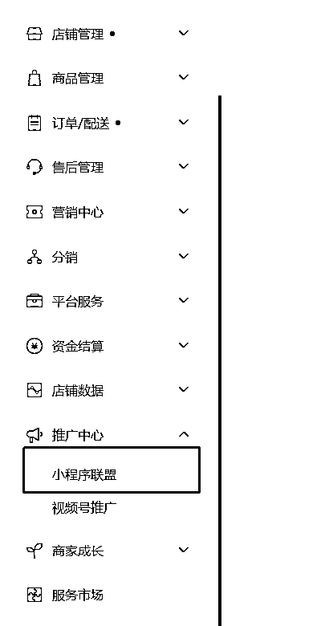

3. 页面跳转后，打开小程序联盟。

4. 在页面右上方找到头像入口，执行登出：

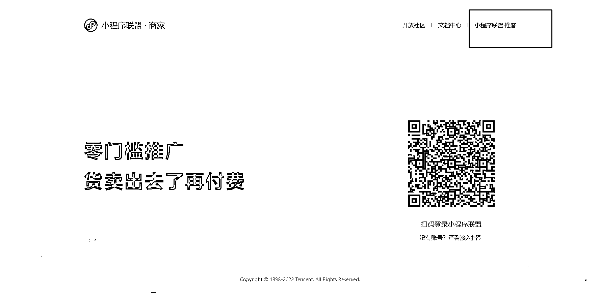

5. 切换到右上方的“小程序联盟推客端”，通过扫码完成登录。

6. 登录成功后，从“商品推广”进入“商品库”（红框处）：

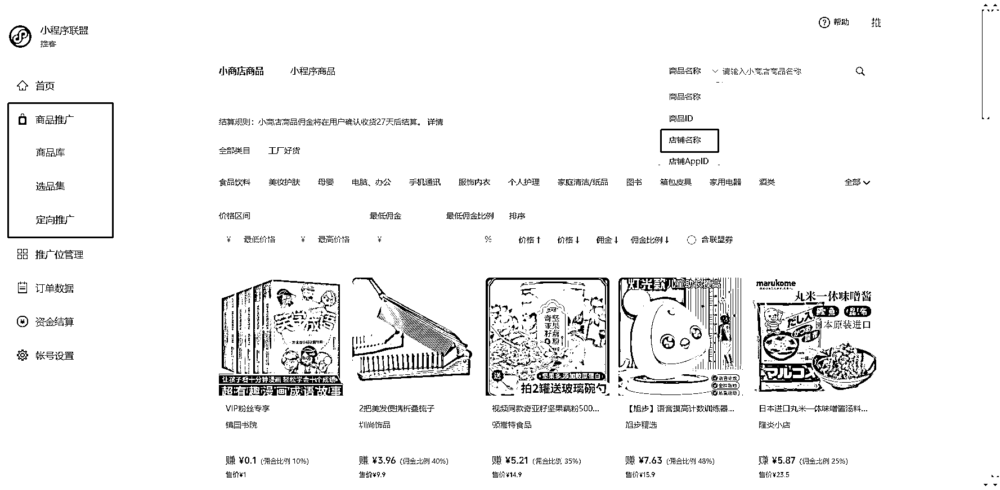

7. 在蓝色框的“店铺名称”栏填入自家店名，系统会列出对应结果：

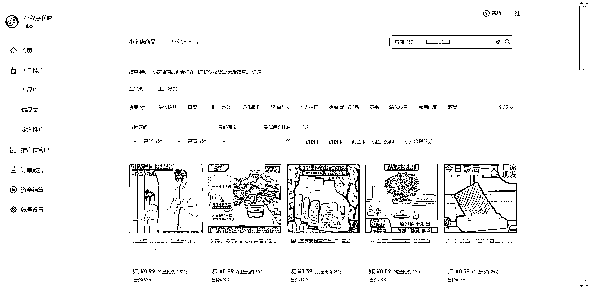

选中“商品”，按“推广”：

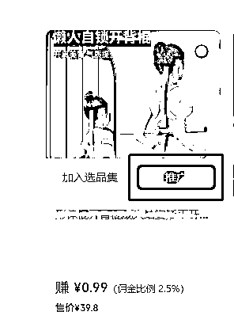

推广位不必纠结，保持默认“带货中心”即可。

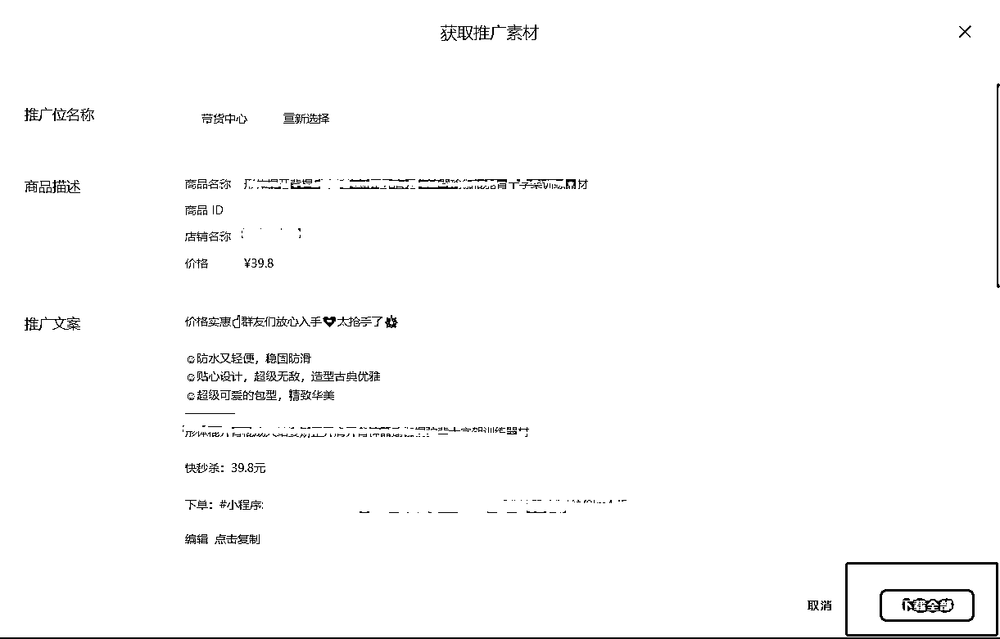

随后选择“下载全部”。

8. 打开已下载的文件：

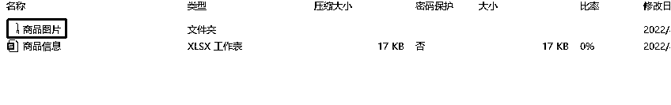

在文件中定位商品小程序码：

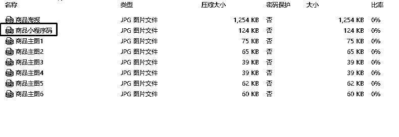

到此，流程走完。

9. 后续订单统一走扫码下单。要查看订单入口，请回到第 3 步所在页面：

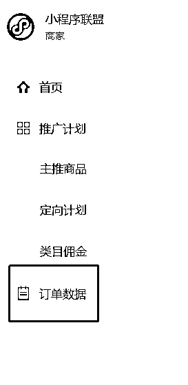

打开“订单数据”：

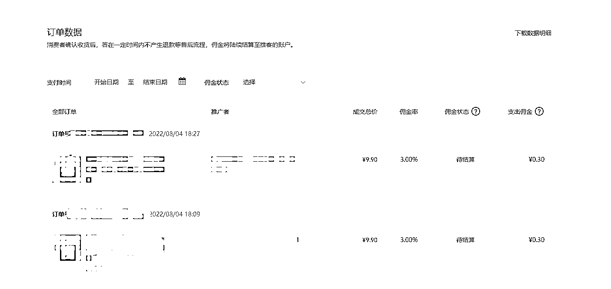

让订单量保持在 30 单以上。

这样便符合联盟渠道下单要求。

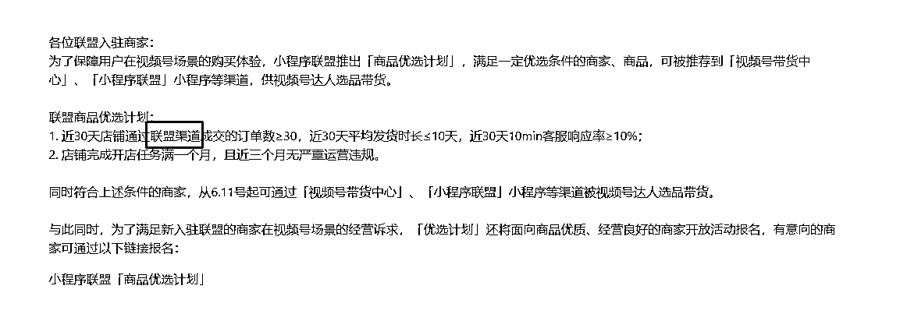

## 常见疑问

- 小程序联盟运营规范：[`developers.weixin.qq.com/doc/ministore/union/specification/introduction.html`](https://developers.weixin.qq.com/doc/ministore/union/specification/introduction.html)

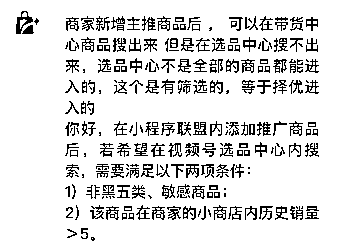

- 推客端已登录，却检索不到店铺商品，是什么原因？

  答：通常因为🛰️小商店运营未满 30 天、商品未达要求，或上架时间过短。

- 绑定资金账户时出现“带货中心绑定银行账户 [37022]”报错，如何处理？

  答：在手机端检索“小程序联盟绑定”即可。

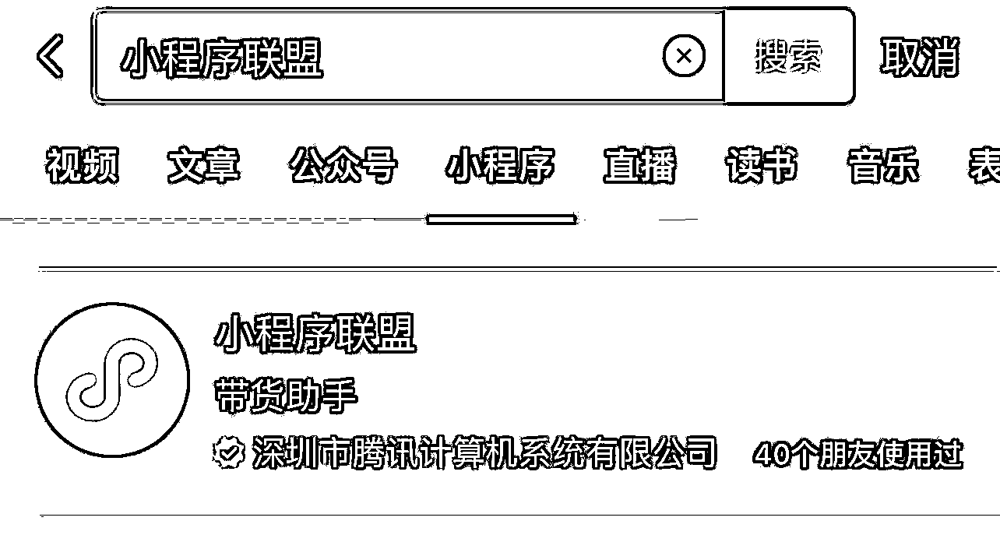

- 每个商品都得人工凑 30 单才能进选品中心吗？

  答：不用，走一次流程即可。

- 30 单要求不同人分别下单，还是同一人多次购买也算？

  答：都算，但拆给 30 个人更稳妥。

- 这些订单是否必须真实发货？

  答：必须发，可直接使用以前买过的订单号。

- 多久能进选品库？

  答：第一天搭建计划，第二天把单量做到要求，第三天就能进入选品库。

内容来源：[《商品如何进入选品中心》](https://f6uz5wrpjh.feishu.cn/docx/doxcnMc6i3irGmSjFteSU69ieNb)
