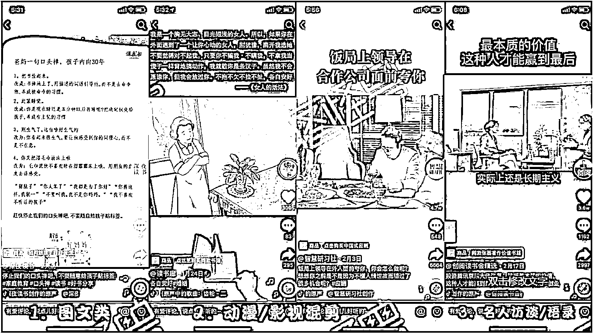

# 10.1.3.1 不出镜，也能做内容

不露脸同样能产出吸引人的内容，常见做法可以归为下面几类。

**静态图文配背景音乐**：拍一张书籍照片，或者从网上找一张合适的图，在画面上叠加文字内容，再选一首背景音乐搭配起来。

**动画、手绘或影视素材混剪**：这是目前比较主流的方式。把动漫、手绘或影视片段剪辑成视频，配上文案和背景音乐，一条内容就能成型。

**名人访谈、演讲与语录素材**：可以从名人著作里摘取段落，也可以把名人公开讲话整理成文字，再搭配相关视频或照片呈现。另一种做法是找名人、明星的演讲或采访音视频，与真实书籍画面做混剪，不过这种方式存在一定侵权风险，使用时要谨慎。