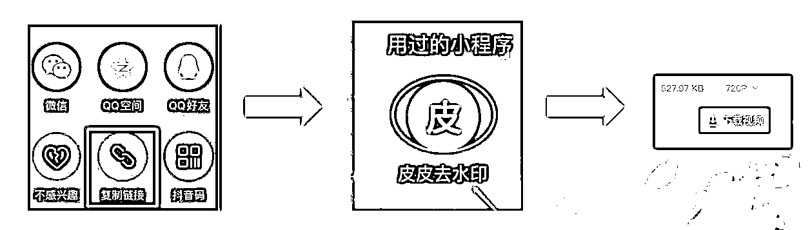
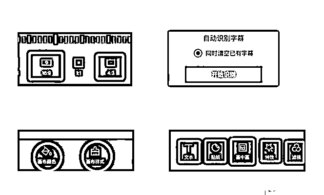

# 10.1.4.4 新手剪辑上手清单

想开始剪视频，先确定要用的内容：把原视频地址复制出来，做去除水印处理，再保存到本地。这个环节可以借助🛰️小程序“皮皮去水印”完成。

接着把视频素材放进剪映，先裁切画面，再设置背景外观。

- 裁切时提前定好统一画幅，比如16:9或4:3，后面尽量保持同一比例。
- 用字幕识别功能后，要注意语句停顿是否合理，并逐字核对错别字。
- 背景颜色和背景样式要前后统一，避免风格跳来跳去。
- 文字部分主要用来放标题和字幕。
- 贴纸可以提示观众点赞、关注，也能加入gif动图。
- 特效和滤镜适度使用，让画面观感更舒服。
- 画中画功能可以帮助降低重复感。

按这个流程操作，新手也能把剪辑步骤理顺。

