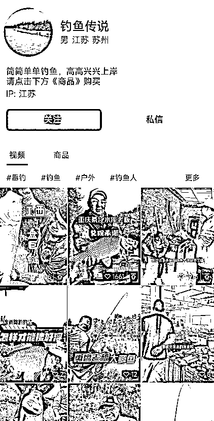
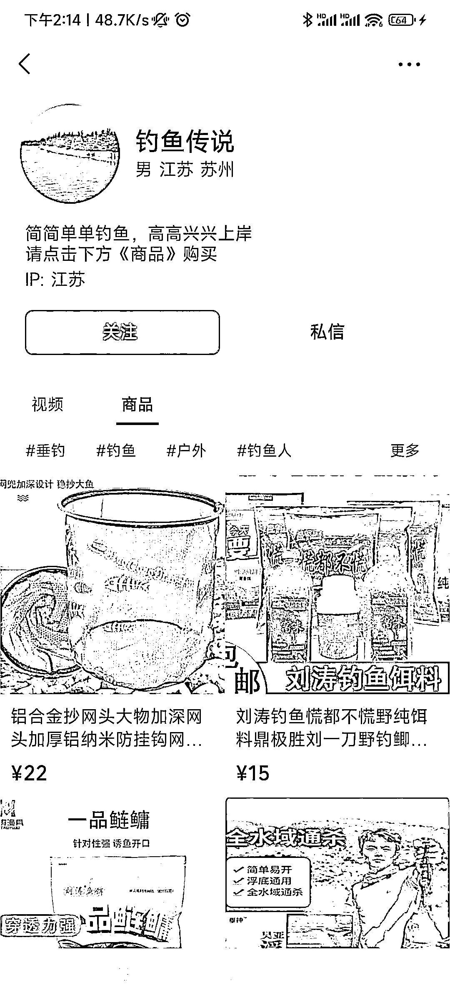

# 案例一：钓鱼传说靠自然流量卖渔具

主页信息：

1. 流量从哪里来
内容呈现上，这个账号把实钓起鱼的画面和商品露出放在一起，用真实上鱼过程带出产品。获客渠道主要依靠平台自然推荐流量。账号做法集中在主页：昵称与简介强化标签，资料区把用户引到橱窗下单；介绍页里没有放🛰️号，也没有做私域导流。

2. 变现卖什么
卖的是实物商品，品类包括渔具、户外装备、鱼饲料、渔网等。货源与渠道为自营货品，自己开🛰️小商店来卖。定价覆盖10元到1200元；货由工厂生产，成本信息未披露。

3. 变现如何落地
交易在平台内完成。方法部分素材未展开说明。使用的工具是🛰️视频号橱窗，目前没有直播。