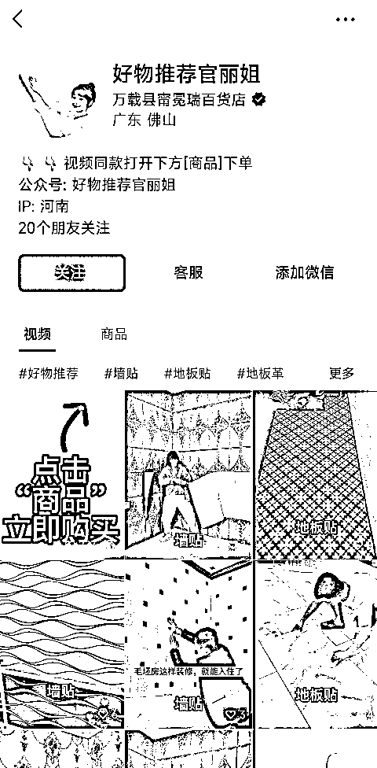
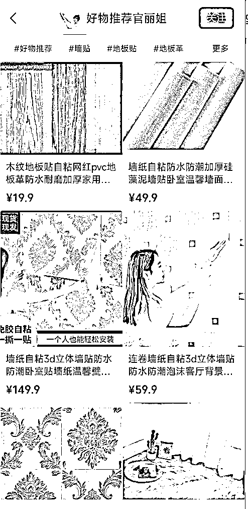
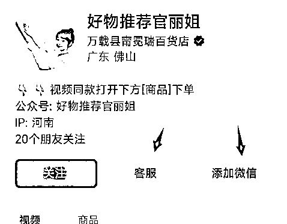
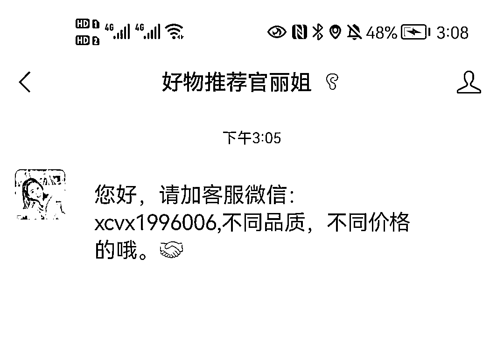
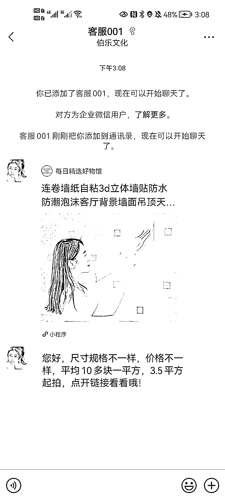
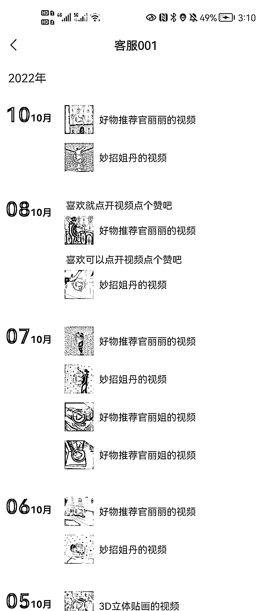

# 【案例四】好物推荐丽姐：混剪引自然流，橱窗卖3D墙纸

先看案例主页：

**账号底子**
这个号叫“好物推荐丽姐”，已完成蓝V企业认证，归属地是佛山。昵称和简介都把品类标签亮了出来，资料区则负责把用户往橱窗下单上引；另外，一条教用户去橱窗购买的视频被固定在顶部。账号还布置了两条私域承接路径：企业微信客服和加微信。

**流量从哪来**
内容上，把地垫、墙纸等商品做成混剪，再借热门视频带动流量；渠道上，主要吃平台自然推荐流量。

**卖什么、靠什么赚**
变现方式很直接，就是卖货，主推3D墙纸。货源来自第三方合作店铺，微信小商店、魔筷、有赞都有铺货。客单价大致在30—59.9元以上，佣金比例30%起步；定制类产品的佣金会更高。

**成交怎么跑**
成交分两种载体：平台内直接成交，以及私域里的定制成交。具体做法：。工具方面，使用微信视频号橱窗和企业微信；第三方分析工具则包括蝉妈妈、考古家、飞瓜等。