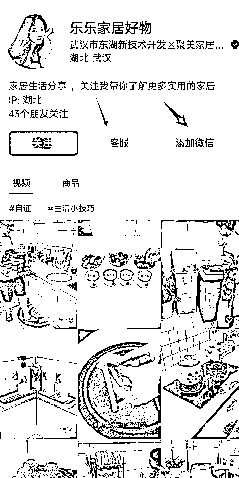
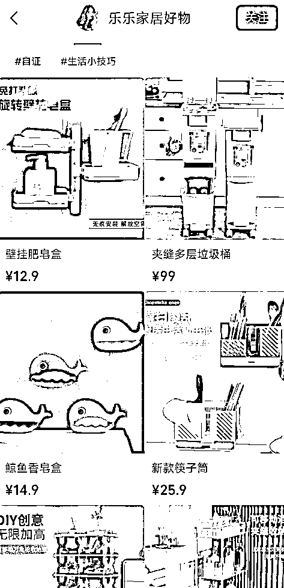

# 案例五：乐乐家居好物带货拆解

这是一个蓝V认证账号，归属地显示为武汉。案例主页入口：

**1. 流量从哪来**

内容以生活好物混剪短视频为主，曝光依靠平台自然流量。账号昵称与简介都把标签写得很清楚，简介区还设置了前往橱窗下单的提示。另一个特点是配置了企业🛰️客服入口。

**2. 卖什么来变现**

变现方式很直接：销售日常生活用品。选品包括肥皂盒、垃圾桶、筷子筒等。货品来自第三方，合作店铺覆盖🛰️小商店、魔筷和有赞。客单价集中在9.9—59.9元，佣金比例为20%—30%。

**3. 变现怎么落地**

交易在平台内完成。执行中使用🛰️视频号橱窗和企业🛰️，同时借助蝉妈妈、考古家、飞瓜等第三方工具。