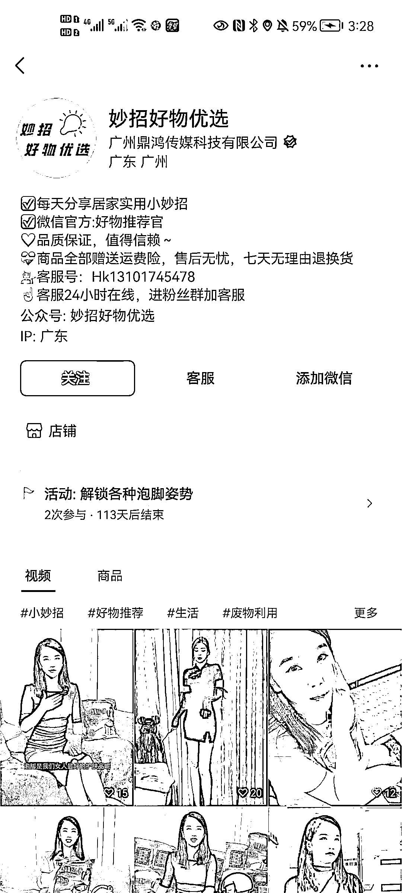
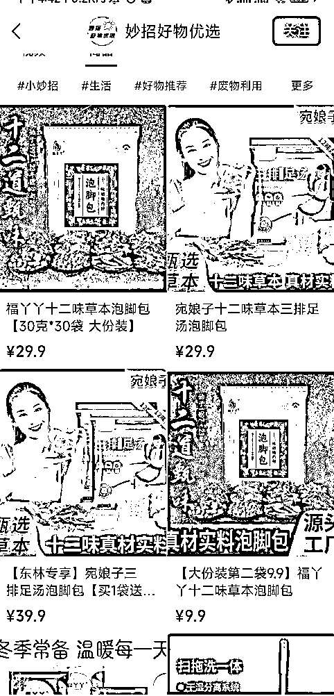

# 【案例六】混剪泡脚包，自然流怎么卖？

这次拆解的对象是“妙招好物优选”：蓝V企业认证，归属地广州。先看案例主页：

1. 自然流量入口怎么搭
这个号的内容以商品混剪短视频为主，流量主要来自平台自然推荐。账号包装上，昵称和简介都突出标签；简介里设置了去橱窗下单的引导，主页还放了店铺入口。除此之外，还配置了企业🛰️和客服两个引导触点，并关联了👸号。

2. 卖什么、怎么定价
变现方式很直接——卖货。核心品类是泡脚包，货源来自第三方货盘。价格带为9.9—59.9元，佣金在40%以上。

3. 成交落点与工具
成交主要放在平台内完成。方法上，以平台内成交为核心来承接。常用工具包括🛰️视频号橱窗和企业🛰️；外部辅助工具则会用到蝉妈妈、考古家、飞瓜等。

