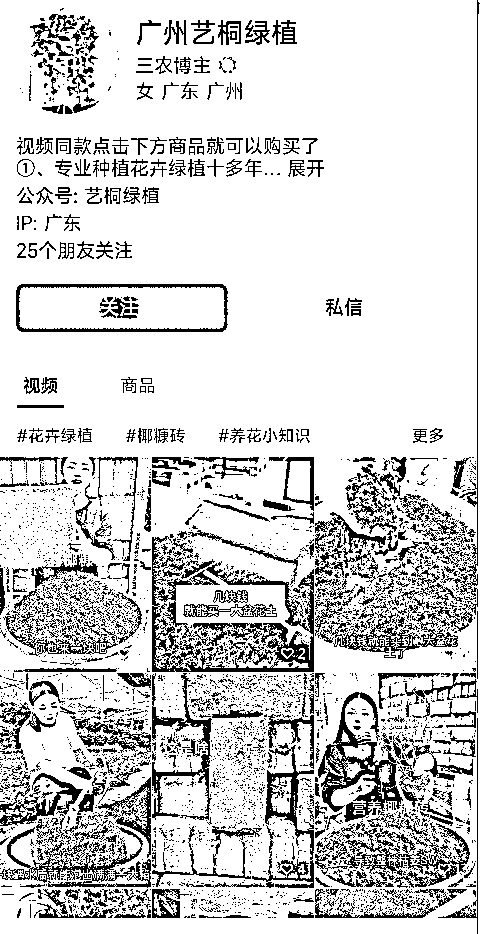
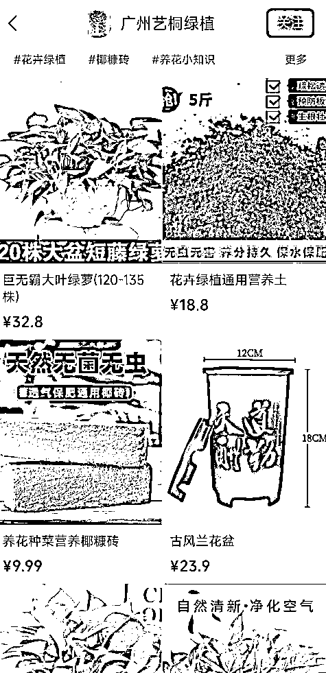

# 案例七：广州艺桐绿植，内容引流带动橱窗成交

**账号概况**：广州艺桐绿植是蓝V企业认证账号，所在地为广州。主页入口如下：

## 1. 流量从哪里起步

视频内容以绿植相关用品的使用演示、绿植养护知识分享为主，曝光主要依靠平台自然流量。账号在名称和简介中强化标签，并在资料区设置引导，方便用户前往橱窗下单。该账号已通过企业微信认证，同时关联了公众号。

## 2. 靠什么商品变现

变现方式为直接进行绿植类商品带货，覆盖绿植产品、营养液、营养土、花瓶等品类。供货由自有货源和第三方产品共同构成；客单价集中在9.9元至59.9元之间。

## 3. 转化如何落地

成交在平台内完成，主要借助微信视频号橱窗和企业微信承接用户；运营过程中还会使用蝉妈妈、考古家、飞瓜等第三方工具辅助。